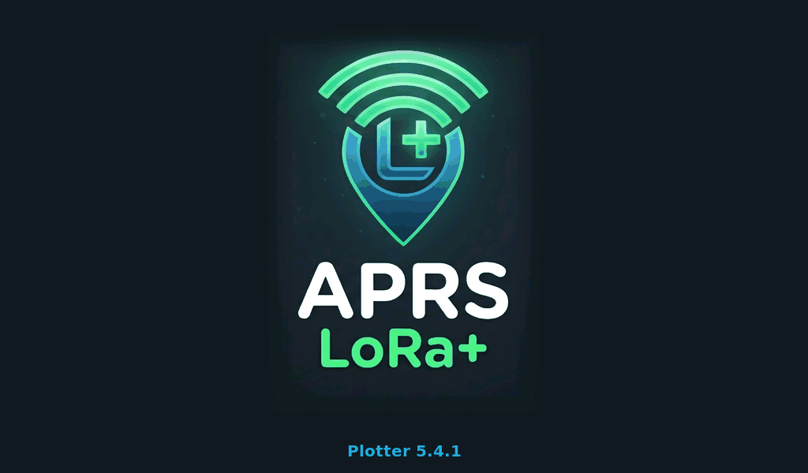

# APRS LoRa+ Plotter — Manual de instalación y funcionamiento

Versión 5.4.4 · Waveshare ESP32-S3-Touch-LCD-7B (7", 1024 × 600)

**Es una ayuda a la navegación. No sustituye a la carta oficial ni a la vigilancia.**

> **Estado de esta versión.** El firmware compila y la interfaz se ha dibujado y revisado en el PC, pero **no se ha
> probado todavía en la placa** ni con equipos reales (AIS, NMEA 2000, red, Bluetooth). Las partes con más riesgo son
> la tarjeta microSD, el RS485, el CAN y el arrastre táctil de la carta. Si algo no funciona, el apartado 8 dice qué mirar.

## 1. Qué hace falta

- Pantalla **Waveshare ESP32-S3-Touch-LCD-7B**. No vale para la LCD-7 de 800 × 480.
- Cable USB-C de datos y un ordenador para grabar el firmware.
- Tarjeta **microSD en FAT32** (opcional, recomendable): cartas y waypoints.
- Para los datos, según lo que tengas: receptor AIS o instrumentos NMEA 0183, red NMEA 2000, WiFi a bordo, el móvil con
  la app APRS LoRa+, un tracker APRS LoRa+ o la pasarela XIAO.

Alimentación, conectores y serigrafía: los de la placa. Consulta la documentación de Waveshare para la tensión de
entrada y la posición de cada borne; este manual no los repite para no dar un dato equivocado.

## 2. Grabar el firmware

La placa tiene dos puertos USB-C. Usa el del **conversor serie (CH343, marcado UART)**: por ahí van la grabación y la
consola. El otro, el USB nativo, comparte pines con el CAN y deja de funcionar cuando el NMEA 2000 está encendido.

### Con el instalador web (recomendado)

1. Abre **https://ea7jrs.github.io/APRS-LoRa-Plus/#nautica** en Chrome o Edge (ordenador, o Android con cable OTG).
2. Elige el grupo **Náutica**.
3. Conecta la placa por el puerto UART y pulsa **Detectar placa**, o elige `waveshare_lcd7b` a mano.
4. Pulsa instalar. **Los ajustes guardados en la placa se conservan.**

Es el mismo instalador del tracker, el rotor, el gateway y el display. El plotter aparece en él cuando su versión está
publicada.

### Con esptool

Cada versión trae dos ficheros:

| Fichero | Para qué | Dirección |
|---|---|---|
| `aprs-lora-plus-plotter-7b-5.4.4-full.bin` | Primera instalación: cargador, particiones y firmware | `0x0` |
| `aprs-lora-plus-plotter-7b-5.4.4-firmware.bin` | Actualizar una placa que ya tiene el plotter | `0x10000` |

```
pip install esptool
esptool.py --chip esp32s3 --port PUERTO --baud 460800 write_flash 0x0 aprs-lora-plus-plotter-7b-5.4.4-full.bin
```

`PUERTO` es `COM5`, `/dev/ttyACM0`, `/dev/ttyUSB0`... según el sistema. Para actualizar:

```
esptool.py --chip esp32s3 --port PUERTO --baud 460800 write_flash 0x10000 aprs-lora-plus-plotter-7b-5.4.4-firmware.bin
```

Si no entra en modo de grabación sola: mantén pulsado **BOOT**, pulsa **RESET**, suelta **BOOT** y repite la orden.

Grabar la imagen completa con esptool **borra los ajustes guardados** (red, unidades, fondeo...); actualizar con el fichero de
firmware los conserva. La tarjeta no se toca nunca.

### Con PlatformIO (desde el código)

```
git clone https://github.com/EA7JRS/APRS-LoRa-Plus-Plotter
cd APRS-LoRa-Plus-Plotter
pio run -e waveshare_lcd7b -t upload
```

## 3. Primer arranque

1. Al encender sale unos 2 segundos la bienvenida de APRS LoRa+ (el logo y «Plotter 5.4.4»), la misma que en la app y
   en APRS LoRa+ Display.

   

2. Luego sale la pestaña **Instrumentos** con datos: es el **simulador**, encendido de fábrica.
3. Recorre las pestañas. En **Carta** verás el barco moviéndose y cinco blancos AIS con nombres inventados.
4. Sin tarjeta, la carta dice «sin cartas en la tarjeta para esta zona»: es normal.
4. Cuando conectes una fuente real, **apaga el simulador** (Ajustes > Simulador). Mientras está encendido sus datos
   tienen prioridad sobre todos los demás.

### Consola serie

Por el puerto UART, a 115200 baudios:

| Orden | Hace |
|---|---|
| `APRS-INFO?` | Devuelve dispositivo, placa y versión |
| `SIM 0` / `SIM 1` | Apaga / enciende el simulador |
| `N2K <id> <bytes>` | Mete una trama NMEA 2000 como si llegara del bus. Ejemplo: `N2K 09F8012B 14A7B21F6C513C03` |

## 4. La tarjeta microSD

| Ruta | Contenido |
|---|---|
| `/charts/osm/<zoom>/<x>/<y>.png` | Mapa base OpenSeaMap / OpenStreetMap |
| `/charts/ihm/<zoom>/<x>/<y>.png` | Cartas del IHM (no válidas para la navegación) |
| `/charts/ign/<zoom>/<x>/<y>.jpeg` | Mapa base del IGN |
| `/charts/pnoa/<zoom>/<x>/<y>.jpeg` | Ortofoto PNOA |
| `/waypoints.gpx` | Waypoints y la ruta; lo escribe el plotter |

Las teselas llevan la numeración habitual de OpenStreetMap (XYZ, 256 × 256). Hay que copiarlas a mano: el plotter aún
no las descarga. Para navegar por una zona bastan los zooms 10 a 15. Respeta las condiciones de cada proveedor: no
hagas descargas masivas de los servidores de OpenStreetMap. Más detalle en `CARTAS.md`.

`waypoints.gpx` es GPX estándar: se puede abrir y editar con OpenCPN u otros programas.

## 5. Conexiones de datos

### 5.1 Puerto RS485 (AIS y NMEA 0183)

- Ajustes > **Puerto serie RS485**: 38400 para un receptor AIS, 4800 para NMEA clásico.
- Un equipo con salida **RS-232 o RS-422** (como el Comar SLR200G) necesita un adaptador a RS485 o el nivel correcto:
  **no lo conectes directo**.
- Solo hay un puerto y una velocidad. Un equipo a 4800 (el viento del NASA Target 2, una emisora VHF) y un AIS a 38400
  no pueden entrar los dos por aquí: el segundo tiene que llegar por la pasarela, la red o el Bluetooth.

Sentencias que se leen: RMC, GLL, GGA, VTG, DPT, DBT, MWV (viento aparente), HDT, HDG, HDM, VHW, MTW, XDR, RSA, GSV,
GSA y AIS (VDM / VDO: mensajes 1, 2, 3, 4, 5, 9, 12, 14, 18, 19, 21, 24 y 27).

### 5.2 NMEA 2000 (CAN)

- Ajustes > **NMEA 2000**: encendido de fábrica. 250 kbit/s.
- El plotter **solo escucha**: no transmite ni reclama dirección en la red.
- Con el NMEA 2000 encendido, el USB nativo de la placa no funciona (comparten pines).

Datos que se leen: posición, rumbo y velocidad sobre el fondo, rumbo de compás, corredera, sonda, viento, temperatura,
humedad y presión, rpm del motor, batería, timón, y AIS de clase A y B con los datos del buque.

### 5.3 Red: WiFi

Ajustes > **Red: WiFi, TCP y UDP**. Escribe la red y su clave, elige el servidor y pulsa **Guardar y conectar**.

| Tipo | Puerto habitual | Para |
|---|---|---|
| TCP: NMEA 0183 | 10110 | Multiplexor NMEA, Signal K (su salida NMEA), la app del móvil |
| TCP: gpsd | 2947 | Un gpsd de la red |
| TCP: Signal K | 8375 | Servidor Signal K: datos del barco y sus avisos |
| Puerto UDP | el que elijas | AIS o NMEA que otro equipo envíe al plotter (AIS-catcher, AIS Dispatcher, la pasarela) |

Solo hay **un** servidor TCP a la vez. El UDP funciona a la vez que el TCP.

**El móvil como fuente**: activa el punto de acceso del móvil, enciende el servidor NMEA en la app APRS LoRa+ y, en el
plotter, pon esa WiFi, «TCP: NMEA 0183», el **servidor vacío** y el puerto 10110. Con el servidor vacío el plotter se
conecta al equipo que da la WiFi.

**Clave de OpenWeatherMap**: en la misma pantalla. Con ella, el plotter pide el tiempo de la posición del barco cada
15 minutos y lo usa de reserva (apartado 6).

### 5.4 Bluetooth

Ajustes > botón **Bluetooth**. Al encenderlo, el plotter busca y se conecta al primer equipo compatible, recuerda su
dirección y desde entonces solo se conecta a ese. Apagar y encender lo olvida.

| Equipo | Notas |
|---|---|
| Tracker APRS LoRa+ (T-Beam Supreme) | Hay que poner su **PIN de control** en Ajustes > Red («PIN del tracker»). De fábrica, 123456. Da posición, meteorología y las estaciones APRS oídas como blancos AIS |
| Pasarela XIAO | Protocolo en `BLE_NMEA.md`. La pasarela todavía no está adaptada |
| Instrumento de viento APRS LoRa+ Wind | Manda el viento; el plotter le manda rumbo y velocidad del barco una vez por segundo para que calcule el viento real (apartado 5.6) |
| Puente NMEA con el servicio UART de Nordic | Aceptado |

Con el firmware publicado del tracker, el tracker admite una sola conexión Bluetooth: o el plotter o el móvil. Para
usar los dos, conecta el móvil al tracker y el plotter al móvil por WiFi (apartado 5.3).

### 5.5 Salida al piloto automático

Pestaña **Piloto** > «Datos de ruta para el piloto»: el piloto (**ST2000+** o **Genérico**) y la salida (Apagado,
**RS485**, **Red (TCP)** o **Bluetooth**). Con un destino activo envía APB y RMB una vez por segundo; con el ST2000+, además
VWR (viento aparente, modo WindTrim) y VHW, y los waypoints como «W001»... (lee cuatro letras). Por la red usa el servidor
TCP de Ajustes > Red (Pypilot: puerto 20220); por Bluetooth, la pasarela XIAO.

**Raymarine ST2000+**: entrada NMEA 0183 a 4800 en su conector: pin 6 (blanco) NMEA+, pin 5 (verde) NMEA−. Por el RS485:
A (+) al blanco y B (−) al verde, con el RS485 a 4800 (el Comar a 38400 deja de entrar). Sin ese conflicto: por la
pasarela XIAO (Bluetooth) con su salida NMEA a 4800, o por un adaptador WiFi-NMEA (Red).

El plotter **solo da datos**: el piloto se embraga y se manda desde su propio mando. Las demoras van en verdadero.

### 5.6 Instrumento de viento APRS LoRa+ Wind

Accesorio con pantalla de 4" (Waveshare ESP32-S3-Touch-LCD-4) que lee la veleta NASA Target 2 Wind y pasa el viento al
plotter. En el plotter:

- **NMEA 2000**: nada que hacer; el instrumento emite el PGN 130306 con su propia dirección.
- **Bluetooth**: Ajustes > *Bluetooth* encendido; se une al instrumento (servicio de datos NMEA de `BLE_NMEA.md`). Por
  el mismo enlace, el plotter le manda una vez por segundo el rumbo (HDT), el rumbo y la velocidad sobre el fondo (VTG) y
  la velocidad en el agua (VHW) que tenga, para que el instrumento calcule el viento real aunque no haya NMEA 2000.
- **WiFi**: los dos en la misma red y, en Ajustes > Red, *Puerto UDP* 10110.

Instalación, cableado y uso del instrumento: `INSTRUMENTO_VIENTO.md`. Se graba con el mismo instalador web (grupo
Náutica, placa `waveshare_lcd4_wind`).

## 6. Cómo decide qué dato enseñar

Cada dato puede llegar por varias vías. Gana la de más prioridad:

1. Simulador (mientras esté encendido)
2. NMEA 2000
3. Puerto serie RS485
4. Red local (TCP, UDP, Signal K)
5. Bluetooth
6. Internet

Si la fuente que mandaba calla 10 segundos (15 por red, 30 por Bluetooth), entra la siguiente. Cuando vuelve, manda otra vez.
Instrumentos y Meteo dicen de dónde sale cada dato y cuánto hace que llegó. Ajustes > Estado dice de dónde sale la
posición.

**Internet como reserva**: viento real, racha, presión, temperatura del aire, humedad y visibilidad. Sale en ámbar y
con «estimado», y vale hasta 2 horas. Posición, rumbo, velocidad, sonda y viento aparente no tienen sustituto.

**Hora**: la del GPS (RMC / ZDA de cualquier fuente, NMEA 2000) y, sin GPS, NTP con la WiFi: `ntp.roa.es` (hora oficial
de España, ROA), de reserva `hora.roa.es` y `pool.ntp.org`. NTP usa el puerto UDP 123: la red tiene que dejarlo salir.

**Declinación**: la calcula el plotter con el WMM2025 (válido hasta 2030); con un compás que solo da rumbo magnético, el
verdadero sale de sumarla.

## 7. Ajustes

| Ajuste | Opciones |
|---|---|
| Simulador | Encendido / Apagado |
| Puerto serie RS485 | 38400 (AIS) / 4800 (NMEA) |
| Brillo | 10 a 100 % |
| Unidades | Náutico (mn, kn, m) / Métrico (km, km/h, viento en m/s) / Imperial (mi, mph, ft, °F) |
| Mapa base | OpenSeaMap / IHM / IGN / Ortofoto |
| NMEA 2000 | Encendido / Apagado |
| Red: WiFi, TCP y UDP | Apartado 5.3 |
| Bluetooth | Apartado 5.4 |

Todo se guarda y se recupera al encender, también un fondeo en vigilancia.

## 8. Si algo no funciona

| Síntoma | Qué mirar |
|---|---|
| Pantalla en negro | Vuelve a instalar con el instalador web o graba la imagen completa en `0x0`. Mira la consola a 115200 |
| No lee la tarjeta | FAT32. El montaje está sin verificar en la placa: ver `HARDWARE.md` (opción `SD_DUMMY_CS`) |
| Solo se ven datos simulados | Apaga el simulador en Ajustes |
| No llega nada por el RS485 | Velocidad correcta, adaptador de nivel, cables A / B. Ajustes > Estado cuenta las líneas recibidas |
| No llega nada del NMEA 2000 | Que esté encendido en Ajustes; Estado cuenta las tramas |
| No conecta a la WiFi | Nombre y clave exactos (distingue mayúsculas). El estado sale arriba en la pantalla de red |
| «El tracker no acepta el PIN» | Pon en Ajustes > Red el PIN de control del tracker. Si lo has cambiado, apaga y enciende el Bluetooth |
| El tiempo de internet no llega | Clave de OpenWeatherMap, WiFi con salida a internet y posición válida. La pestaña Meteo dice el motivo |

## 9. Lo que falta en esta versión

- Sonido de las alertas (zumbador).
- Descarga de cartas por WiFi; línea de costa de reserva.
- Renombrar waypoints, varias rutas con nombre.
- Mareas, avisos meteorológicos y radioavisos, capas de previsión.
- Mandos del piloto automático; emitir en la red NMEA 2000.
- Lista de equipos Bluetooth y de redes WiFi para elegir.

APRS LoRa+ · © 2026 Manuel - EA7JRS · GPL-3.0-or-later
