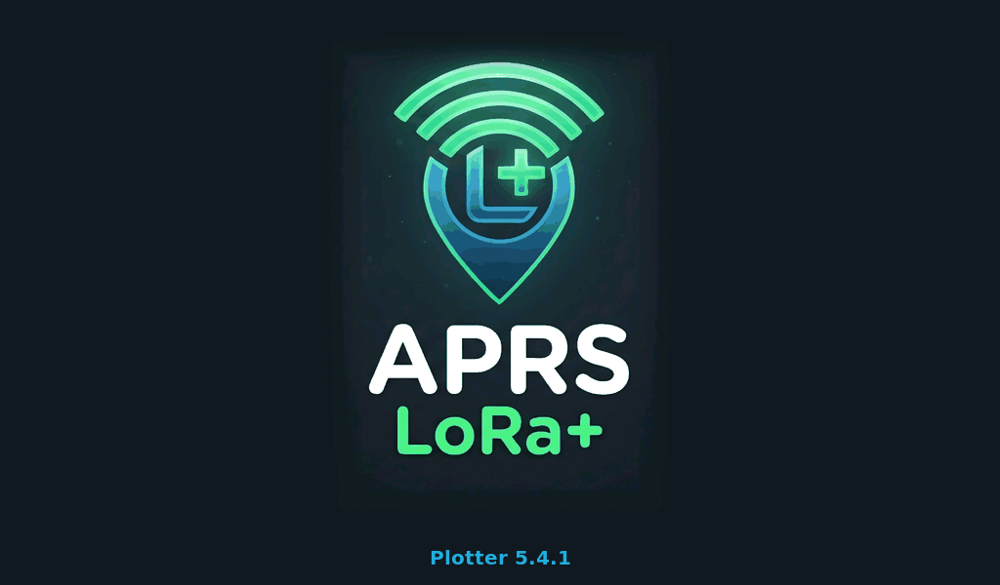

# APRS LoRa+ Plotter — Installation and operation manual

Version 5.4.2 · Waveshare ESP32-S3-Touch-LCD-7B (7", 1024 × 600)

**This is an aid to navigation. It does not replace official charts or a proper lookout.**

> **Status of this version.** The firmware builds and the interface has been rendered and reviewed on a PC, but **it has
> not been tested on the board yet**, nor with real equipment (AIS, NMEA 2000, network, Bluetooth). The riskiest parts
> are the microSD card, RS485, CAN and dragging the chart by touch. If something does not work, section 8 says what to
> check.

The on-screen texts are in Spanish; this manual gives each one in Spanish, with its meaning where it is not obvious.

## 1. What you need

- A **Waveshare ESP32-S3-Touch-LCD-7B** display. The 800 × 480 LCD-7 is not supported.
- A USB-C data cable and a computer to flash the firmware.
- A **FAT32 microSD card** (optional, recommended): charts and waypoints.
- For data, depending on what you have: an AIS receiver or NMEA 0183 instruments, an NMEA 2000 network, on-board
  Wi-Fi, a phone with the APRS LoRa+ app, an APRS LoRa+ tracker or the XIAO gateway.

Power supply, connectors and silkscreen: those of the board. See the Waveshare documentation for the input voltage and
the position of each terminal; this manual does not repeat them, to avoid giving a wrong figure.

## 2. Flashing the firmware

The board has two USB-C ports. Use the **serial converter port (CH343, marked UART)**: flashing and the console go
through it. The other one, the native USB, shares pins with CAN and stops working when NMEA 2000 is on.

### With the web installer (recommended)

1. Open **https://ea7jrs.github.io/APRS-LoRa-Plus/#nautica** in Chrome or Edge (computer, or Android with an OTG cable).
2. Choose the **Náutica** (Nautical) group.
3. Connect the board through the UART port and press **Detect board**, or pick `waveshare_lcd7b` by hand.
4. Press install. **The settings stored in the board are kept.**

It is the same installer used for the tracker, rotor, gateway and display. The plotter shows up in it once its version
has been published.

### With esptool

Each release has two files:

| File | Use | Address |
|---|---|---|
| `aprs-lora-plus-plotter-7b-5.4.2-full.bin` | First install: bootloader, partitions and firmware | `0x0` |
| `aprs-lora-plus-plotter-7b-5.4.2-firmware.bin` | Updating a board that already runs the plotter | `0x10000` |

```
pip install esptool
esptool.py --chip esp32s3 --port PORT --baud 460800 write_flash 0x0 aprs-lora-plus-plotter-7b-5.4.2-full.bin
```

`PORT` is `COM5`, `/dev/ttyACM0`, `/dev/ttyUSB0`... depending on the system. To update:

```
esptool.py --chip esp32s3 --port PORT --baud 460800 write_flash 0x10000 aprs-lora-plus-plotter-7b-5.4.2-firmware.bin
```

If it does not enter flashing mode by itself: hold **BOOT**, press **RESET**, release **BOOT** and run the command again.

Flashing the full image with esptool **erases the saved settings** (network, units, anchor watch...); updating with the firmware
file keeps them. The card is never touched.

### With PlatformIO (from source)

```
git clone https://github.com/EA7JRS/APRS-LoRa-Plus-Plotter
cd APRS-LoRa-Plus-Plotter
pio run -e waveshare_lcd7b -t upload
```

## 3. First start

1. On power-up the APRS LoRa+ welcome screen shows for about 2 seconds (the logo and «Plotter 5.4.2»), the same as in
   the app and in APRS LoRa+ Display.

   

2. Then the **Instrumentos** tab shows data: that is the **simulator**, on by default.
3. Go through the tabs. In **Carta** you will see the boat moving and five AIS targets with made-up names.
4. Without a card the chart says «sin cartas en la tarjeta para esta zona» (no charts on the card for this area): that is normal.
4. When you connect a real source, **turn the simulator off** (Ajustes > Simulador). While it is on, its data takes
   priority over everything else.

### Serial console

On the UART port, at 115200 baud:

| Command | Does |
|---|---|
| `APRS-INFO?` | Returns device, board and version |
| `SIM 0` / `SIM 1` | Turns the simulator off / on |
| `N2K <id> <bytes>` | Injects an NMEA 2000 frame as if it came from the bus. Example: `N2K 09F8012B 14A7B21F6C513C03` |

## 4. The microSD card

| Path | Contents |
|---|---|
| `/charts/osm/<zoom>/<x>/<y>.png` | OpenSeaMap / OpenStreetMap base map |
| `/charts/ihm/<zoom>/<x>/<y>.png` | Spanish IHM charts (not valid for navigation) |
| `/charts/ign/<zoom>/<x>/<y>.jpeg` | Spanish IGN base map |
| `/charts/pnoa/<zoom>/<x>/<y>.jpeg` | PNOA aerial imagery |
| `/waypoints.gpx` | Waypoints and the route; written by the plotter |

Tiles use the usual OpenStreetMap numbering (XYZ, 256 × 256). You have to copy them by hand: the plotter does not
download them yet. Zooms 10 to 15 are enough to sail an area. Respect each provider's terms: do not bulk-download from
the OpenStreetMap servers. More detail in `CARTAS.md` (Spanish).

`waypoints.gpx` is standard GPX: it can be opened and edited with OpenCPN and other programs.

## 5. Data connections

### 5.1 RS485 port (AIS and NMEA 0183)

- Ajustes > **Puerto serie RS485**: 38400 for an AIS receiver, 4800 for classic NMEA.
- A device with **RS-232 or RS-422** output (such as the Comar SLR200G) needs an adapter to RS485 or the right level:
  **do not connect it directly**.
- There is only one port and one speed. A 4800 device (the NASA Target 2 wind, a VHF radio) and an AIS at 38400 cannot
  both come in here: the second one has to arrive through the gateway, the network or Bluetooth.

Sentences read: RMC, GLL, GGA, VTG, DPT, DBT, MWV (apparent wind), HDT, HDG, HDM, VHW, MTW, XDR, RSA, GSV, GSA and AIS
(VDM / VDO: messages 1, 2, 3, 4, 5, 9, 12, 14, 18, 19, 21, 24 and 27).

### 5.2 NMEA 2000 (CAN)

- Ajustes > **NMEA 2000**: on by default. 250 kbit/s.
- The plotter **only listens**: it does not transmit or claim an address on the network.
- With NMEA 2000 on, the board's native USB does not work (they share pins).

Data read: position, course and speed over ground, compass heading, log, depth, wind, temperature, humidity and
pressure, engine rpm, battery, rudder, and class A and B AIS with vessel details.

### 5.3 Network: Wi-Fi

Ajustes > **Red: WiFi, TCP y UDP**. Type the network and its password, choose the server and press **Guardar y
conectar** (Save and connect).

| Type | Usual port | For |
|---|---|---|
| TCP: NMEA 0183 | 10110 | NMEA multiplexer, Signal K (its NMEA output), the phone app |
| TCP: gpsd | 2947 | A gpsd on the network |
| TCP: Signal K | 8375 | Signal K server: own-vessel data and its notifications |
| Puerto UDP (UDP port) | your choice | AIS or NMEA that another device sends to the plotter (AIS-catcher, AIS Dispatcher, the gateway) |

Only **one** TCP server at a time. UDP works alongside TCP.

**The phone as a source**: enable the phone's hotspot, turn on the NMEA server in the APRS LoRa+ app and, on the
plotter, enter that Wi-Fi, «TCP: NMEA 0183», an **empty server** field and port 10110. With the server empty the
plotter connects to the device providing the Wi-Fi.

**OpenWeatherMap key**: on the same screen. With it, the plotter requests the weather at the boat's position every
15 minutes and uses it as a fallback (section 6).

### 5.4 Bluetooth

Ajustes > **Bluetooth** button. When turned on, the plotter scans and connects to the first compatible device,
remembers its address and from then on only connects to that one. Turning it off and on forgets it.

| Device | Notes |
|---|---|
| APRS LoRa+ tracker (T-Beam Supreme) | Enter its **control PIN** in Ajustes > Red («PIN del tracker»). Factory default 123456. Gives position, weather and the APRS stations heard as AIS targets |
| XIAO gateway | Protocol in `BLE_NMEA.md` (Spanish). The gateway has not been adapted yet |
| APRS LoRa+ Wind instrument | Sends the wind; the plotter sends it boat heading and speed once a second so it can compute true wind (section 5.6) |
| NMEA bridge with the Nordic UART service | Accepted |

With the published tracker firmware, the tracker accepts a single Bluetooth connection: either the plotter or the
phone. To use both, connect the phone to the tracker and the plotter to the phone over Wi-Fi (section 5.3).

### 5.5 Autopilot output

**Piloto** tab > «Datos de ruta para el piloto» (route data for the pilot): the pilot (**ST2000+** or **Genérico**,
generic) and the output (Apagado = off, **RS485**, **Red (TCP)** = network, or **Bluetooth**). With an active destination it
sends APB and RMB once a second; with the ST2000+ also VWR (apparent wind, WindTrim mode) and VHW, and waypoints as «W001»...
(it reads four characters). Over the network it uses the TCP server from Ajustes > Red (Pypilot: port 20220); over
Bluetooth, the XIAO gateway.

**Raymarine ST2000+**: NMEA 0183 input at 4800 on its connector: pin 6 (white) NMEA+, pin 5 (green) NMEA−. Through the
RS485: A (+) to white and B (−) to green, with the RS485 at 4800 (the Comar at 38400 stops coming in). Without that clash:
through the XIAO gateway (Bluetooth) with its NMEA output at 4800, or through a WiFi-NMEA adapter (network).

The plotter **only provides data**: the pilot is engaged and commanded from its own control head. Bearings are true.

### 5.6 APRS LoRa+ Wind instrument

An accessory with a 4" screen (Waveshare ESP32-S3-Touch-LCD-4) that reads the NASA Target 2 Wind sensor and passes the
wind to the plotter. On the plotter:

- **NMEA 2000**: nothing to do; the instrument sends PGN 130306 with its own address.
- **Bluetooth**: Ajustes > *Bluetooth* on; it joins the instrument (NMEA data service of `BLE_NMEA.md`). Over the same
  link, once a second, the plotter sends the heading (HDT), course and speed over ground (VTG) and speed through the
  water (VHW) it has, so the instrument can compute true wind even without NMEA 2000.
- **Wi-Fi**: both on the same network and, in Ajustes > Red, *Puerto UDP* (UDP port) 10110.

Installation, wiring and use of the instrument: `WIND_INSTRUMENT_EN.md`. It is flashed with the same web installer
(Náutica group, board `waveshare_lcd4_wind`).

## 6. How it decides which value to show

Each value can arrive by several routes. The highest priority wins:

1. Simulator (while it is on)
2. NMEA 2000
3. RS485 serial port
4. Local network (TCP, UDP, Signal K)
5. Bluetooth
6. Internet

If the source in use goes quiet for 10 seconds (15 for the network, 30 for Bluetooth), the next one takes over. When
it comes back, it leads again. Instrumentos and Meteo show where each value comes from and how old it is. Ajustes >
Estado (Status) shows where the position comes from.

**Internet as a fallback**: true wind, gust, pressure, air temperature, humidity and visibility. Shown in amber and
labelled «estimado», valid for up to 2 hours. Position, heading, speed, depth and apparent wind have no substitute.

**Time**: from GPS (RMC / ZDA from any source, NMEA 2000) and, without GPS, NTP over WiFi: `ntp.roa.es` (Spain's
official time, ROA), with `hora.roa.es` and `pool.ntp.org` as backups. NTP uses UDP port 123: the network must let it out.

## 7. Settings

| Setting | Options |
|---|---|
| Simulador (Simulator) | On / Off |
| Puerto serie RS485 (Serial port) | 38400 (AIS) / 4800 (NMEA) |
| Brillo (Brightness) | 10 to 100 % |
| Unidades (Units) | Náutico (nm, kn, m) / Métrico (km, km/h, wind in m/s) / Imperial (mi, mph, ft, °F) |
| Mapa base (Base map) | OpenSeaMap / IHM / IGN / Ortofoto |
| NMEA 2000 | On / Off |
| Red: WiFi, TCP y UDP (Network) | Section 5.3 |
| Bluetooth | Section 5.4 |

Everything is saved and restored at power-up, including an active anchor watch.

## 8. If something does not work

| Symptom | What to check |
|---|---|
| Black screen | Install again with the web installer or flash the full image at `0x0`. Watch the console at 115200 |
| Card not read | FAT32. Card mounting is unverified on the board: see `HARDWARE.md` (`SD_DUMMY_CS` option) |
| Only simulated data | Turn the simulator off in Ajustes |
| Nothing arrives on RS485 | Right speed, level adapter, A / B wires. Ajustes > Estado counts the lines received |
| Nothing arrives from NMEA 2000 | That it is on in Ajustes; Estado counts the frames |
| Wi-Fi does not connect | Exact name and password (case-sensitive). The status is shown at the top of the network screen |
| «El tracker no acepta el PIN» (the tracker rejects the PIN) | Enter the tracker's control PIN in Ajustes > Red. If you changed it, turn Bluetooth off and on |
| Internet weather does not arrive | OpenWeatherMap key, Wi-Fi with internet access and a valid position. The Meteo tab gives the reason |

## 9. Not in this version

- Alert sound (buzzer).
- Chart download over Wi-Fi; fallback coastline.
- Renaming waypoints, several named routes.
- Tides, weather warnings and navigational warnings, forecast layers.
- Autopilot controls; transmitting on the NMEA 2000 network.
- Lists of Bluetooth devices and Wi-Fi networks to choose from.
- English interface.

APRS LoRa+ · © 2026 Manuel - EA7JRS · GPL-3.0-or-later
