# APRS LoRa+ Wind — Instrumento de viento (accesorio del plotter)

Versión 5.4.5 · Waveshare ESP32-S3-Touch-LCD-4 (4", 480 × 480), revisión V4.0

**Es una ayuda a la navegación. No sustituye a la vigilancia.**

> **Estado de esta versión.** El firmware compila y la interfaz se ha dibujado y revisado en el PC, pero **no se ha
> probado todavía en la placa** ni con la veleta. Lo que más riesgo tiene: el arranque de la pantalla (tiempos del panel
> sin verificar), los pines del RS485 (la tabla de Waveshare se contradice) y el nivel eléctrico de la salida del NASA.
> El apartado 7 dice qué mirar si algo falla.

Pantalla de viento propia para la bañera o la mesa de cartas. Lee la veleta y el anemómetro **NASA Marine Target 2 Wind
(versión 2, con NMEA)**, enseña el viento aparente y el real, y se lo pasa al plotter APRS LoRa+ por **Bluetooth**,
**NMEA 2000** y **WiFi**, a la vez si se quiere.

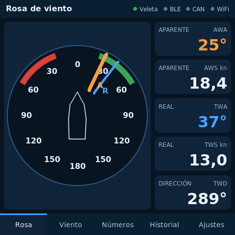

## 1. Qué hace falta

- Pantalla **Waveshare ESP32-S3-Touch-LCD-4** (SKU 28154), **revisión V4.0**. Las revisiones anteriores llevan otro
  expansor de pines y no arrancan con este firmware (lo dice por la consola).
- Veleta y anemómetro **NASA Target 2 Wind v2**, la versión con salida NMEA 0183 (4800 baudios, sentencia MWV).
  No vale la versión analógica antigua de 5 hilos.
- Alimentación de 12 V del barco para la placa (admite de 7 a 36 V por su borna) y para el NASA.
- Cable USB-C de datos para grabar el firmware.
- Para hablar con el plotter, lo que haya a bordo: el propio Bluetooth, la red NMEA 2000 o una WiFi.

## 2. Grabar el firmware

Con el instalador web: abre **https://ea7jrs.github.io/APRS-LoRa-Plus/#nautica** en Chrome o Edge, elige el grupo
**Náutica** y la placa **waveshare_lcd4_wind**, conecta la pantalla por USB y pulsa *Instalar*. Se conservan los ajustes.

Con esptool, la imagen completa de la release (borra los ajustes):

    python -m esptool --chip esp32s3 write_flash 0x0 aprs-lora-plus-wind-lcd4-5.4.5-full.bin

Desde el código: `pio run -e waveshare_lcd4_wind -t upload`.

La consola va por el USB de la placa a 115200 baudios: `APRS-INFO?` responde
`APRS-LoRa-Plus: device=wind board=waveshare_lcd4_wind version=5.4.5 …`, y `SIM 0` / `SIM 1` apagan o encienden el
simulador.

## 3. Conectar la veleta

La salida NMEA del NASA va al **RS485** de la placa (bornas A y B) a 4800 baudios. El NMEA 0183 es compatible con el
receptor RS485:

- Señal NMEA del NASA a **A** y su 0 V a **B** (y al 0 V de la placa).
- Si no llegan datos, Ajustes y enlace > fila **Veleta** dice cuántos bytes y cuántas sentencias han entrado:
  - **0 bytes**: cambia el botón *RS485: RX en GPIO43* a GPIO44 (la tabla de Waveshare no deja claro cuál es la
    recepción) y revisa el cableado.
  - **bytes pero 0 sentencias**: la señal llega al revés; intercambia A y B.
- Mientras no llega nada de la veleta, el instrumento enseña datos del **simulador** (botón *Simulador*). En cuanto la
  veleta manda, el simulador se calla solo.

No se dan colores de hilos ni bornas del NASA: míralos en su documentación.

## 4. Las páginas

Al encender, unos 2 s, la bienvenida de APRS LoRa+ (el logo y «Wind 5.4.5»), como en el plotter y el Display.

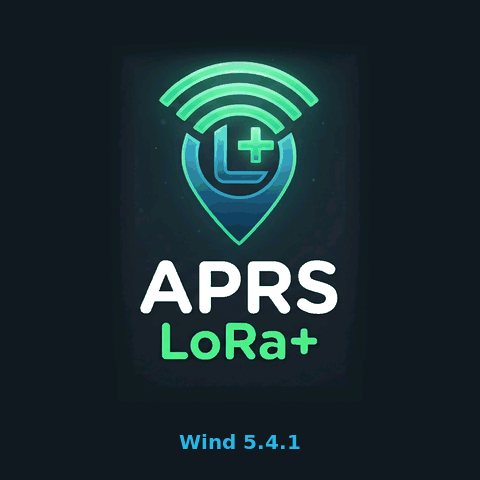

Abajo, cinco pestañas. Arriba, cuatro luces: **Veleta**, **BLE**, **CAN** y **WiFi** (verde = funcionando).

- **Rosa**: la rosa con la proa arriba, sectores de ceñida rojo (babor) y verde (estribor), aguja **A** (aparente,
  naranja) y **R** (real, azul). Tres repartos, a elegir en Ajustes con el botón *Rosa*:
  *columna* (la rosa y los cinco datos a la derecha), *dos bandas* (aparente arriba, real abajo) y *banda* (una banda
  con los cinco datos).

  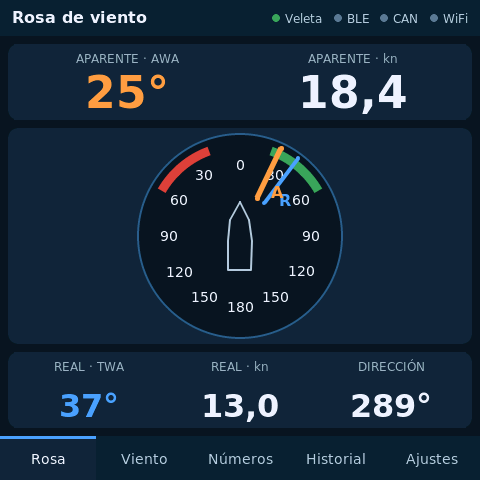 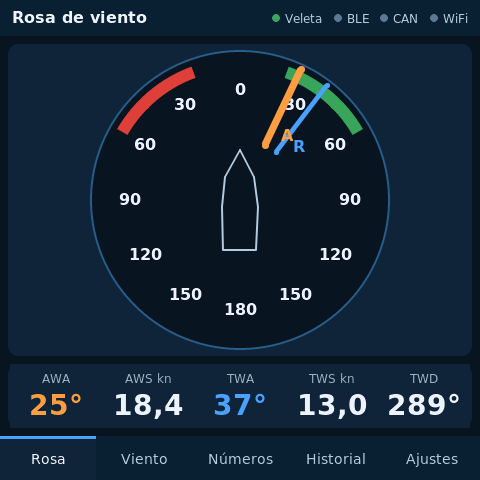

- **Viento**: rosa más pequeña, aparente grande y, debajo, ángulo real, velocidad real, dirección real y deriva.
- **Números**: velocidad y ángulo aparentes y reales en cifras grandes, con la fuerza Beaufort.
- **Historial**: velocidad y dirección del viento real de los últimos 30 minutos (una muestra cada 30 s), con mínimo,
  máximo y media.
- **Ajustes y enlace**: estado de cada enlace y los botones (la página se desplaza hacia abajo).

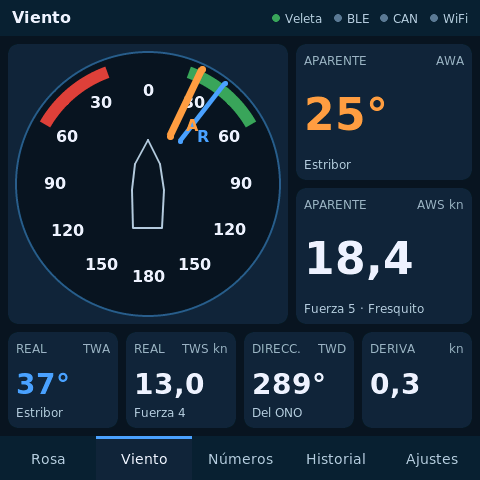 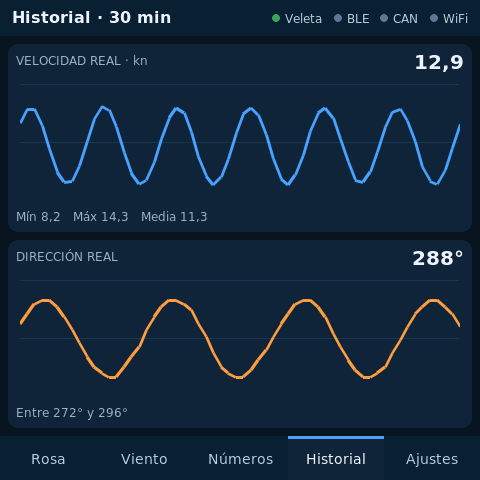

**Modo noche.** Ajustes > *Noche*: toda la pantalla pasa a rojos sobre negro, para no perder la vista nocturna. Baja
además el *Brillo* (20 o 40 %).

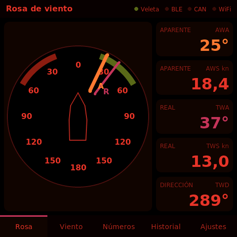

**Alarmas.** Tres, cada una con su botón en Ajustes (apagadas de serie):

- *Alarma real*: viento real por encima de 15 a 40 kn (de 5 en 5).
- *Alarma aparente*: viento aparente por encima de 20 a 45 kn.
- *Alarma rolada*: el viento real cambia de dirección más de 10, 15, 20, 30 o 45 grados respecto a la referencia
  (útil fondeado o en un bordo largo). La referencia se toma a los 30 s de tener dirección real, y la dirección se suaviza
  con 30 s, así que un rolón de pocos segundos no avisa.

Las de velocidad saltan si el viento pasa el límite 5 s seguidos y se apagan cuando baja del límite menos un 5 %
(al menos 1 kn) durante 10 s; una racha suelta no avisa. La rolada salta si pasa el límite 10 s seguidos. Al saltar sale
la ventana **STRONG WIND** o **WIND SHIFT** y suena el zumbador de la placa:

- **SILENCIAR 10 MIN**: calla ventana y zumbador 10 minutos; si sigue, vuelve.
- **CERRAR**: en las de velocidad, no vuelve hasta que el viento baje y vuelva a pasar el límite; en la rolada, la
  dirección de ahora pasa a ser la referencia.

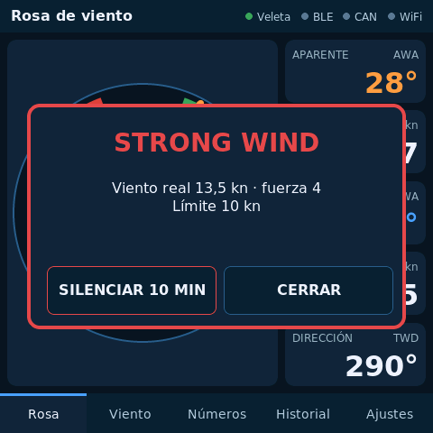

**Viento real y deriva.** El NASA da el viento aparente. El real (TWA, TWS, TWD) se calcula con la velocidad del barco
(en el agua si hay corredera, si no sobre el fondo) y el rumbo. Los toma del **NMEA 2000** y, si no hay, del **plotter
por Bluetooth** (el plotter se los manda una vez por segundo cuando está enlazado; la fila *Bluetooth* de Ajustes dice
«rumbo y velocidad del plotter»). Sin ninguno de los dos sale «--» y «Falta rumbo». La deriva necesita además el rumbo y la velocidad sobre el fondo.

## 5. Enlace con el plotter

| Vía | Qué manda el instrumento | Qué hay que hacer en el plotter |
| --- | --- | --- |
| Bluetooth | MWV aparente y, si se puede calcular, MWV real, 4 veces por segundo, por el servicio de datos NMEA de `docs/BLE_NMEA.md` | Ajustes > *Bluetooth* encendido. Se une al primer equipo con ese servicio y lo recuerda |
| NMEA 2000 | PGN 130306 aparente y real (respecto al norte), 4 veces por segundo, con dirección reclamada | Nada: el plotter ya lee el 130306 |
| WiFi | Las mismas MWV por UDP a toda la red, al puerto elegido (10110) | Ajustes > Red > *Puerto UDP* 10110, en la misma WiFi |

- **Bluetooth**: sin emparejamiento ni PIN (solo datos de viento). Ajustes > botón *Bluetooth* lo apaga. Si a bordo
  hay también la pasarela XIAO con el mismo servicio, el plotter se queda con el primero que encuentra: apaga el
  Bluetooth del otro o enciende el del plotter cuando solo esté este cerca.
- **NMEA 2000**: el botón *NMEA 2000* pasa por *apagado*, *escucha* (solo lee velocidad y rumbo) y *emite* (además
  manda el viento). Al emitir, reclama una dirección del bus (empieza por la 35 y, si otro equipo con prioridad la
  tiene, toma otra libre); la fila **NMEA 2000** enseña la dirección. El NAME usa un código de fabricante sin
  registrar (2046) y la clase *entorno exterior / atmosférico*: **no es un equipo certificado** NMEA 2000. La placa
  tiene resistencia de terminación de 120 Ω; déjala desconectada salvo que el instrumento esté en un extremo del bus.
- **WiFi**: botón *WiFi…* → red, clave y puerto UDP con el teclado, *WiFi: encendido* y *Guardar*. La fila **WiFi**
  enseña la dirección IP y lo enviado.
- **Hora**: el reloj del instrumento se pone con la del GPS del bus NMEA 2000 (PGN 126992 / 129029), con la que manda el
  plotter por Bluetooth (ZDA, una vez por segundo) o, con WiFi, con NTP (`ntp.roa.es`, hora oficial de España). La fila
  **Bluetooth** enseña la hora UTC y de dónde viene.

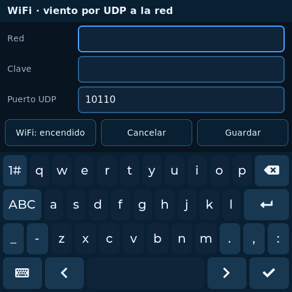 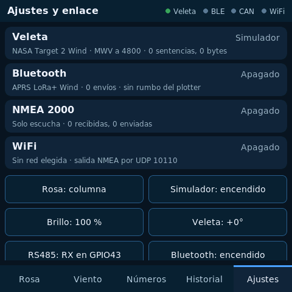

## 6. Ajustes

| Botón | Qué hace |
| --- | --- |
| Rosa | Reparto de la página Rosa: columna, dos bandas o banda |
| Simulador | Datos de prueba mientras no haya veleta |
| Brillo | 20 a 100 % |
| Veleta | Corrección del ángulo de la veleta, de 5 en 5 grados (si no está alineada con la proa) |
| RS485 | Pin de recepción del RS485: GPIO43 o GPIO44 |
| Bluetooth | Encendido o apagado |
| NMEA 2000 | Apagado, escucha o emite |
| WiFi… | Red, clave, puerto UDP y encendido |
| Acerca de | Versión, copyright, licencia, proyecto, créditos y QR del donativo (paypal.me/ea7jrs) |
| Noche | Rojos sobre negro |
| Alarma real | Apagada, 15 a 40 kn |
| Alarma aparente | Apagada, 20 a 45 kn |
| Alarma rolada | Apagada, 10, 15, 20, 30 o 45 grados |

Se guardan en la placa y siguen tras apagarla. El instalador web no los borra; la imagen completa con esptool, sí.

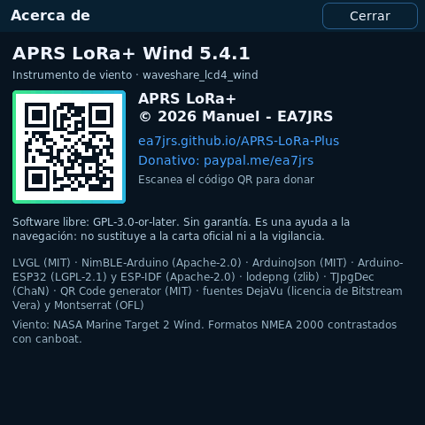

## 7. Si algo no funciona

- **Pantalla negra, luz encendida**: los tiempos del panel están sin verificar. Mira la consola: si dice «panel listo»,
  el fallo está en los tiempos o en la secuencia del ST7701.
- **«esta placa lleva el expansor TCA9554»**: es una revisión anterior a la V4.0, no soportada todavía.
- **El táctil no responde**: la consola dice si el GT911 contestó en 0x5D o 0x14.
- **Sin viento de la veleta**: apartado 3.
- **El plotter no lo ve por Bluetooth**: comprueba que el Bluetooth del instrumento está encendido y que el del
  plotter busca (Ajustes > Bluetooth); si el plotter recordaba otro equipo, apágalo y vuelve a encenderlo.
- **Sin viento real**: hace falta velocidad y rumbo del barco, por el NMEA 2000 o del plotter por Bluetooth.

## 8. Lo que falta en esta versión

- Probarlo en la placa y con el NASA.
- Páginas configurables y paso automático de páginas.
- Que las alarmas avisen también al plotter.
- Recibir rumbo y velocidad del plotter por WiFi (por Bluetooth y NMEA 2000, sí).
- Responder a las peticiones de información de producto del NMEA 2000 (PGN 126996) y guardar la dirección reclamada.
- Revisiones de la placa anteriores a la V4.0.
