# APRS LoRa+ Plotter — Manual de usuario

Versión 5.4.1 · Waveshare ESP32-S3-Touch-LCD-7B (7", 1024 × 600)

**Es una ayuda a la navegación. No sustituye a la carta oficial ni a la vigilancia.**

> Esta primera versión compila y su interfaz se ha revisado en el PC, pero **no se ha probado todavía en la placa** ni
> con equipos reales. Las imágenes de este manual están dibujadas en el PC con el simulador. Úsala para probar.

Instalación, conexiones y solución de problemas: `INSTALACION.md`. Resumen de una página: `GUIA_RAPIDA.md`.

## Índice

1. La pantalla
2. Instrumentos
3. Carta
4. Rutas
5. Radar AIS
6. Viento
7. Piloto
8. Meteo
9. Ajustes
10. Alertas
11. De dónde salen los datos
12. Lo que falta

## 1. La pantalla

Arriba, siempre a la vista:

- El **nombre de la pestaña** y una etiqueta **Simulador** cuando los datos son de prueba.
- La **posición** del barco.
- **Marcar**: guarda un waypoint en la posición actual (WPT 01, WPT 02...).
- **MOB**: hombre al agua (apartado 10).

Abajo, las ocho pestañas: Instrumentos, Carta, Rutas, Radar AIS, Viento, Piloto, Meteo y Ajustes.

## 2. Instrumentos

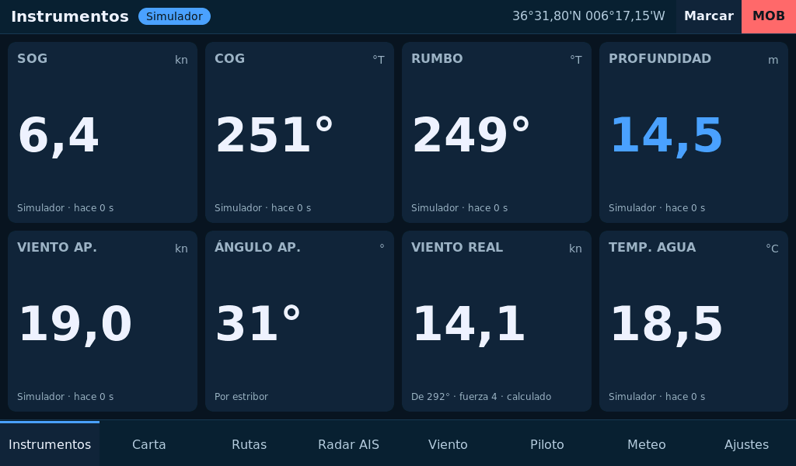

Ocho casillas: velocidad sobre el fondo (SOG), rumbo sobre el fondo (COG), rumbo de compás, profundidad, viento
aparente, ángulo aparente, viento real y temperatura del agua.

Debajo de cada valor sale **de dónde viene** (NMEA 2000, puerto serie, red local, tracker, internet) y **cuánto hace que
llegó**. Si un dato no llega, la casilla dice «Sin datos».

El **viento real** se calcula a bordo con el viento aparente, la velocidad y el rumbo. Si falta el sensor de viento,
se usa el que llegue de otra fuente; el de internet sale en ámbar y con «estimado».

## 3. Carta

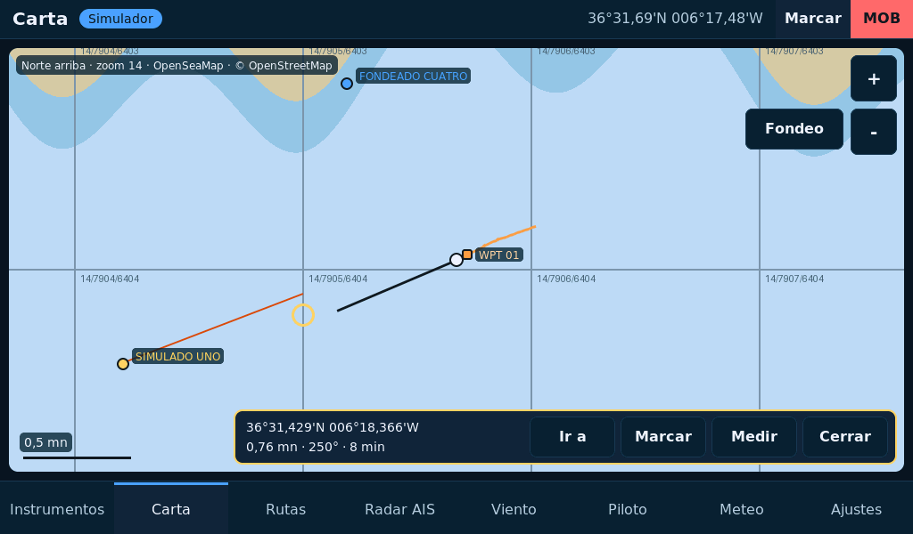

Muestra el mapa de la tarjeta, el barco con un vector de 6 minutos, la derrota, los blancos AIS con su nombre y su
vector, los waypoints, la ruta y la escala.

| Gesto o botón | Hace |
|---|---|
| Arrastrar | Mueve la carta y deja de seguir al barco |
| **+ / −** | Zoom, de 5 a 18 |
| **Centrar barco** | Vuelve a seguir al barco (solo aparece si has movido la carta) |
| Tocar un punto | Abre el panel de abajo con su posición, distancia, demora y tiempo |
| **Fondeo** | Abre el panel de fondeo |

Sin teselas en la tarjeta para la zona, el fondo queda en azul liso y lo demás se ve igual.

### Punto tocado

El panel ofrece:

- **Ir a**: navega a ese punto. El panel pasa a mostrar distancia, demora, tiempo y desvío de la ruta.
- **Marcar**: lo guarda como waypoint.
- **Medir**: empieza una medida desde ese punto.
- **Cerrar**.

Si tocas sobre un waypoint, se elige el waypoint.

### Navegar a un destino

Con un destino activo, la carta dibuja la línea hasta él y el panel dice «A WPT 01 · 1,2 mn · 251° · 12 min» y el
desvío («0,03 mn a estribor»). Botones: **Parar**, **Destino** (centra la carta en él) y, en una ruta, **Siguiente**.

Al llegar a 0,05 mn el panel dice **LLEGADA**. En una ruta, el plotter pasa solo al punto siguiente cuando el actual
queda por el través.

### Medir

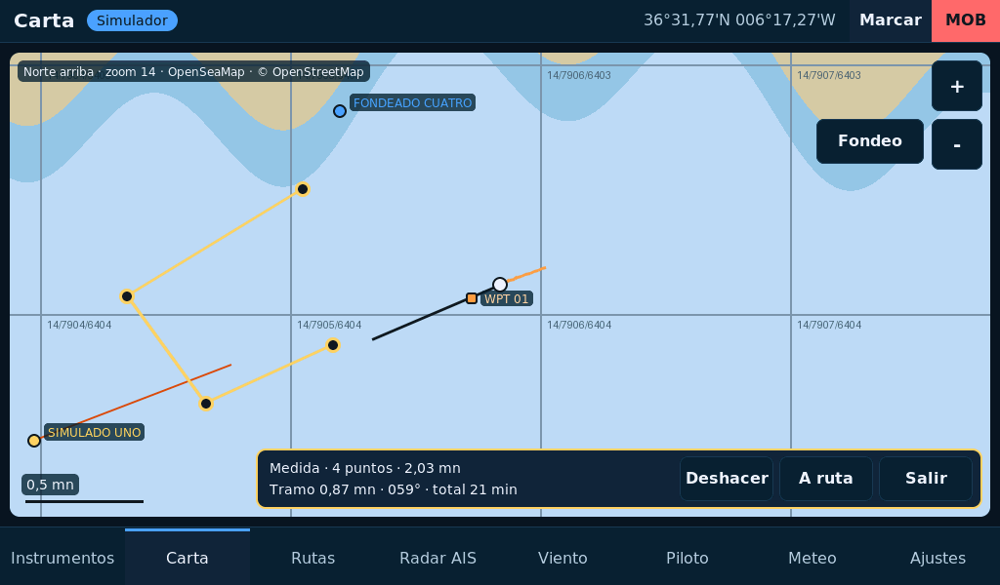

Toca la carta → **Medir** y ve tocando puntos. El panel da el total, el último tramo con su demora y el tiempo a la
velocidad actual.

- **Deshacer**: quita el último punto.
- **A ruta**: convierte la medida en la ruta y abre la pestaña Rutas.
- **Salir**: termina sin guardar.

### Fondeo

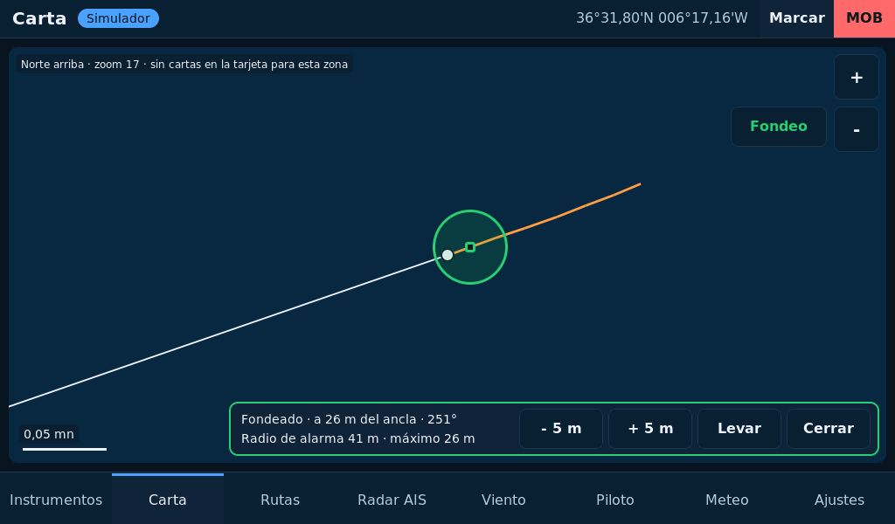

1. Pulsa **Fondeo**.
2. Ajusta la **cadena filada** con **− 5 m / + 5 m**. El panel muestra el fondo de la sonda, la relación cadena / fondo
   y el radio de alarma que resulta (el borneo con esa cadena y ese fondo, más 10 m de margen; sin sonda, toda la cadena).
3. Pulsa **Fondear** en el momento de largar el ancla: el ancla se marca en la posición del barco.

La carta pasa a zoom 17 y dibuja el círculo de alarma en verde. Fondeado, el panel da la distancia y demora al ancla y
la mayor distancia vista; **− 5 m / + 5 m** cambian el radio y **Levar** termina la vigilancia.

Si el barco pasa 10 segundos seguidos fuera del círculo salta **ANCHOR DRAG**; un salto suelto del GPS no la dispara.
Si pasa un minuto sin posición, **ANCHOR WATCH · NO GPS FIX**. El fondeo se guarda: sigue vigilando tras un apagado.

## 4. Rutas

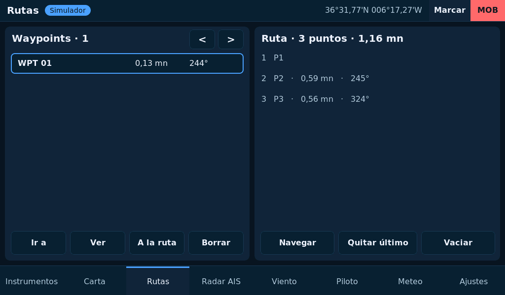

**Izquierda, waypoints**: nombre, distancia y demora desde el barco. Toca uno para elegirlo.

| Botón | Hace |
|---|---|
| **Ir a** | Navega a ese waypoint |
| **Ver** | Lo enseña en la carta |
| **A la ruta** | Lo añade al final de la ruta |
| **Borrar** | Lo elimina |
| **< / >** | Página anterior / siguiente (7 por página, hasta 50) |

**Derecha, la ruta**: hasta 12 puntos, con el tramo y la demora de cada uno y la distancia total.

| Botón | Hace |
|---|---|
| **Navegar / Parar** | Empieza o detiene la navegación por la ruta |
| **Quitar último** | Quita el último punto |
| **Vaciar** | Borra la ruta |

Waypoints y ruta se guardan en `waypoints.gpx` de la tarjeta. Sin tarjeta se pierden al apagar.

## 5. Radar AIS

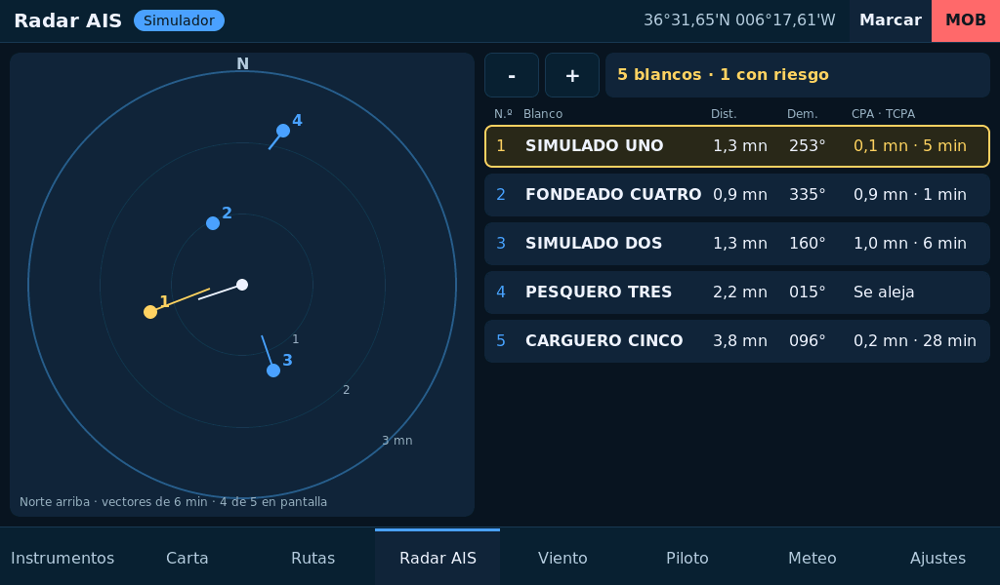

El barco en el centro, norte arriba, tres anillos y los blancos con un vector de 6 minutos. **− / +** cambian el alcance
(0,75 a 12 mn).

La lista de la derecha ordena los blancos con los **peligrosos primero**: distancia, demora y **CPA · TCPA** (distancia
mínima a la que pasará y cuánto falta). «Se aleja» si ya no se acerca.

Un blanco es **peligroso** si pasará a menos de 0,5 mn en menos de 20 minutos: sale en ámbar y abre la alerta
COLLISION RISK. Un blanco se da por **perdido** a los 6 minutos sin señal y desaparece a los 12.

Toca una fila para ver la **ficha del blanco**: tipo, MMSI, clase, distintivo, velocidad, rumbo, eslora y manga. Desde
ahí puedes **silenciar** su alarma.

## 6. Viento

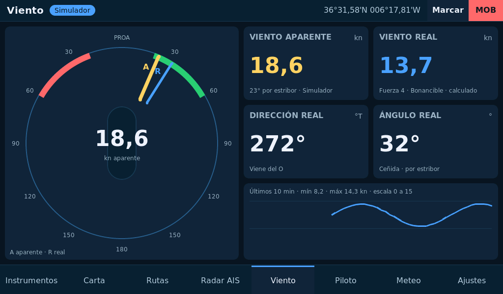

- **Esfera** con la proa arriba. La aguja **A** es el viento aparente y la **R** el real. Los sectores rojo y verde
  marcan la ceñida por babor y por estribor.
- **Viento aparente**: velocidad, ángulo y banda.
- **Viento real**: velocidad, fuerza Beaufort y su nombre.
- **Dirección real**: de dónde viene («Viene del O»).
- **Ángulo real**: y el rumbo de vela (ceñida, través, largo, empopada).
- **Historial** de 10 minutos, con mínimo y máximo.

## 7. Piloto

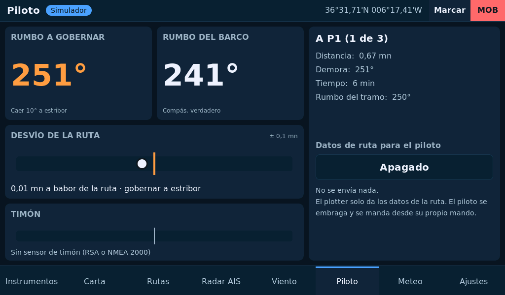

- **Rumbo a gobernar**: la demora al destino, y cuánto hay que caer («Caer 10° a estribor»).
- **Rumbo del barco**: el compás o, si no hay, el rumbo sobre el fondo.
- **Desvío de la ruta**: la línea del centro es la ruta y el punto es el barco. Dice a qué banda estás y hacia dónde
  gobernar.
- **Timón**: si llega el ángulo de timón.
- **Datos de ruta para el piloto**: Apagado, Por el RS485 o Por la red.

El plotter solo da datos al piloto. **No lo embraga ni lo manda**: eso se hace desde su propio mando.

## 8. Meteo

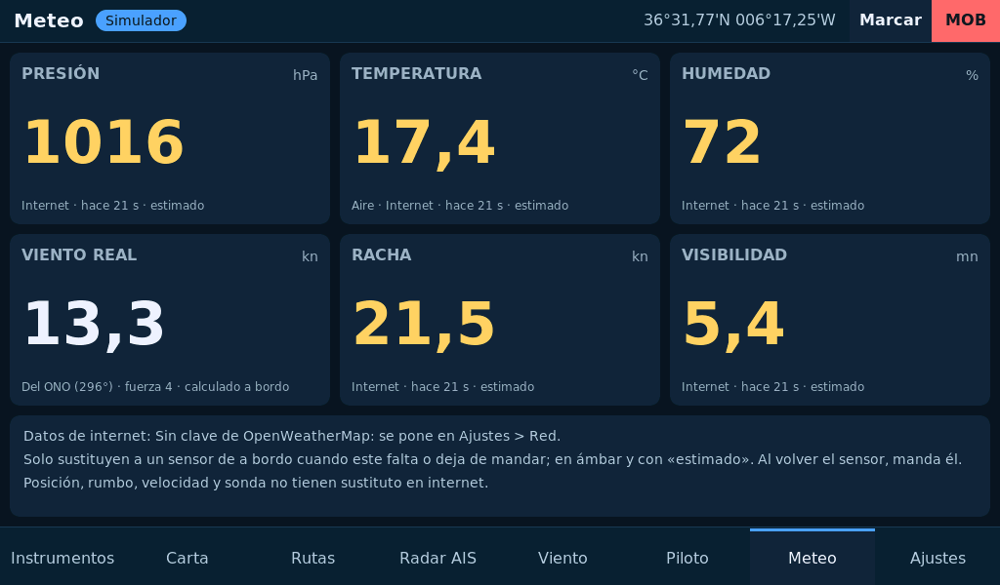

Presión, temperatura del aire, humedad, viento real, racha y visibilidad. Cada casilla dice su fuente y su antigüedad.

Lo que viene **de internet** sale en **ámbar** y con «estimado»: es un dato de una estación o un modelo cercano, no de
tu barco. La nota de abajo dice si la consulta a OpenWeatherMap funciona y de dónde es la observación.

## 9. Ajustes

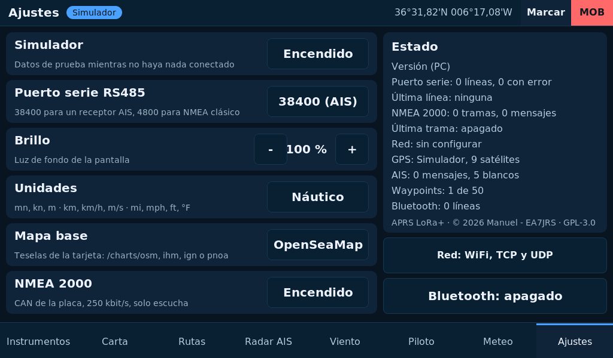

| Ajuste | Qué hace |
|---|---|
| **Simulador** | Datos de prueba. Apágalo con datos reales: mientras está encendido, mandan los suyos |
| **Puerto serie RS485** | 38400 (AIS) o 4800 (NMEA clásico) |
| **Brillo** | Luz de la pantalla |
| **Unidades** | Náutico, métrico o imperial. El fondeo va siempre en metros |
| **Mapa base** | OpenSeaMap, IHM, IGN u ortofoto; cada uno lee su carpeta de la tarjeta |
| **NMEA 2000** | Escucha de la red por el CAN |
| **Red: WiFi, TCP y UDP** | Pantalla de red, con teclado |
| **Bluetooth** | Enlace con el tracker o la pasarela |

**Estado**, a la derecha: versión, líneas recibidas por cada vía, de dónde sale la posición, blancos AIS y waypoints.

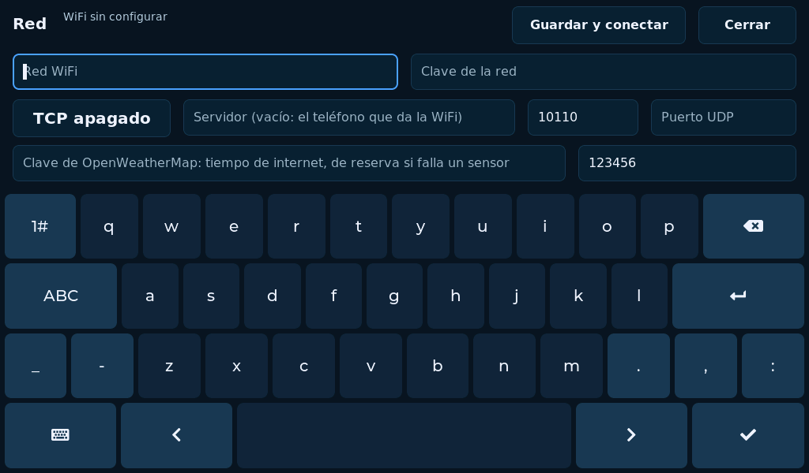

En la pantalla de **Red**: la WiFi y su clave, el tipo de servidor (apagado, NMEA 0183, gpsd o Signal K), su dirección
y puerto, el puerto UDP, la clave de OpenWeatherMap y el PIN del tracker. **Guardar y conectar** aplica los cambios.

## 10. Alertas

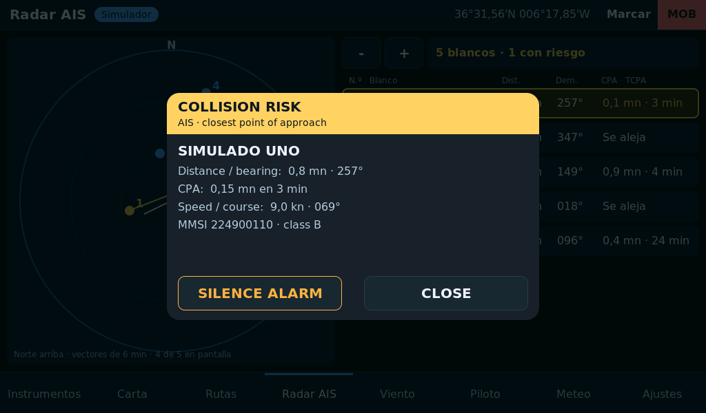

Una alerta abre una ventana sobre cualquier pantalla. Los textos van en inglés, como en la app APRS LoRa+.

| Ventana | Cuándo salta | Botones |
|---|---|---|
| **COLLISION RISK** | Un blanco AIS pasará a menos de 0,5 mn en menos de 20 min | SILENCE ALARM: calla ese buque · CLOSE: no vuelve en 10 min |
| **MAN OVERBOARD** | Has pulsado MOB | CLOSE: la navegación al punto sigue en la carta |
| **ANCHOR DRAG** | 10 s fuera del círculo de fondeo | SILENCE 10 MIN · CLOSE: vuelve en 2 min si sigue |
| **ANCHOR WATCH · NO GPS FIX** | Fondeado y 1 min sin posición | Igual |
| **SIGNAL K ALARM / EMERGENCY** | Aviso del servidor Signal K | Se cierra sola cuando el servidor lo baja de nivel |
| **RS485 COMPARTIDO** | La salida al piloto usa el puerto por el que entran datos | Apagar salida · Seguir así |

Las de abordaje y garreo se cierran solas cuando el peligro pasa.

**MOB**: marca la posición, pone rumbo de vuelta y muestra la distancia, la demora y el tiempo transcurrido.

**En esta versión las alertas no suenan.** No dejes el plotter como única alarma de fondeo o de abordaje.

## 11. De dónde salen los datos

Un mismo dato puede llegar por varias vías. El plotter usa la de más prioridad y, si calla, pasa a la siguiente:

1. Simulador (si está encendido)
2. NMEA 2000
3. Puerto serie RS485
4. Red local
5. Bluetooth
6. Internet

Cuando la fuente mejor vuelve, manda otra vez. No hay que tocar nada.

Internet solo sustituye a la meteorología: viento real, racha, presión, temperatura, humedad y visibilidad. La
**posición, el rumbo, la velocidad y la sonda no tienen sustituto**: si faltan, la casilla dice «Sin datos».

## 12. Lo que falta en esta versión

- Sonido de las alertas.
- Descarga de cartas por WiFi y línea de costa de reserva.
- Renombrar waypoints y guardar varias rutas con nombre.
- Mareas, avisos meteorológicos, radioavisos y capas de previsión.
- Mandos del piloto automático.
- Interfaz en inglés.

APRS LoRa+ · © 2026 Manuel - EA7JRS · GPL-3.0-or-later
