# APRS LoRa+ Plotter — Manual de usuario

Versión 5.4.6 · Waveshare ESP32-S3-Touch-LCD-7B (7", 1024 × 600)

**Es una ayuda a la navegación. No sustituye a la carta oficial ni a la vigilancia.**

> Esta primera versión compila y su interfaz se ha revisado en el PC, pero **no se ha probado todavía en la placa** ni
> con equipos reales. Las imágenes de este manual están dibujadas en el PC con el simulador. Úsala para probar.

Instalación, conexiones y solución de problemas: `INSTALACION.md`. Resumen de una página: `GUIA_RAPIDA.md`.

## Índice

1. La pantalla
2. Instrumentos
3. Carta
4. Rutas
5. Radar AIS
6. Viento
7. Piloto
8. Meteo
9. Ajustes
10. Alertas
11. De dónde salen los datos
12. Lo que falta

## 1. La pantalla

Al arrancar, unos 2 s, la bienvenida de APRS LoRa+: el logo y «Plotter» con la versión; luego pasa sola a la pantalla de
trabajo.

Arriba, siempre a la vista:

- El **nombre de la pestaña** y una etiqueta **Simulador** cuando los datos son de prueba.
- La **posición** del barco.
- **Marcar**: guarda un waypoint en la posición actual (WPT 01, WPT 02...).
- **MOB**: hombre al agua (apartado 10).

Abajo, las ocho pestañas: Instrumentos, Carta, Rutas, Radar AIS, Viento, Piloto, Meteo y Ajustes.

## 2. Instrumentos

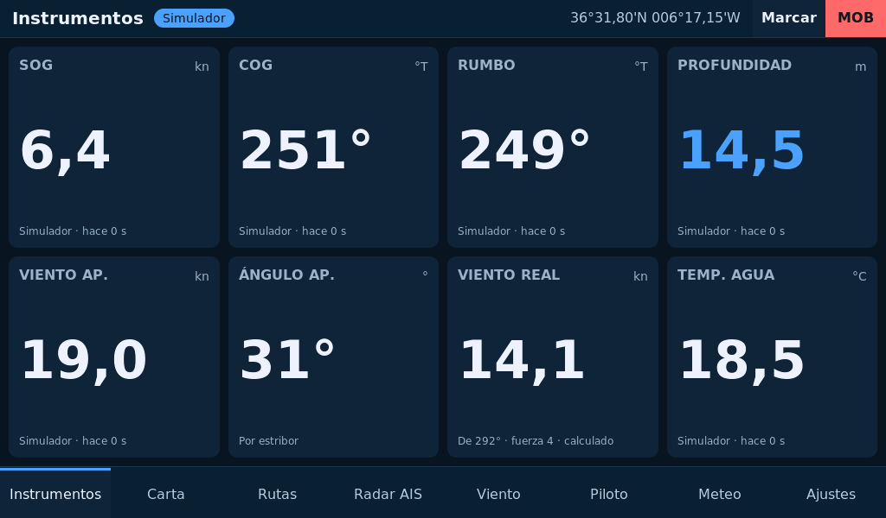

Ocho casillas: velocidad sobre el fondo (SOG), rumbo sobre el fondo (COG), rumbo de compás, profundidad, viento
aparente, ángulo aparente, viento real y temperatura del agua.

Debajo de cada valor sale **de dónde viene** (NMEA 2000, puerto serie, red local, tracker, internet) y **cuánto hace que
llegó**. Si un dato no llega, la casilla dice «Sin datos».

El **viento real** se calcula a bordo con el viento aparente, la velocidad y el rumbo. Si falta el sensor de viento,
se usa el que llegue de otra fuente; el de internet sale en ámbar y con «estimado».

### Motor

Tocando **otra vez** la pestaña Instrumentos (estando ya en ella) las casillas pasan a las del **motor**: régimen, refrigerante, presión de aceite, combustible, batería, consumo, temperatura de aceite y horas de motor. Otro toque vuelve a la navegación.

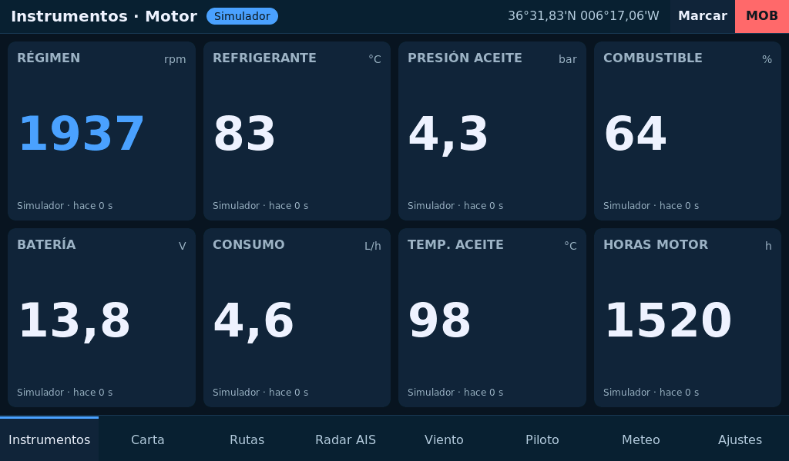

Los datos entran por el bus NMEA 2000 (PGN 127488, 127489, 127505 y 127508, primer motor y primer depósito de combustible) —por ejemplo desde la pasarela **APRS LoRa+ OBD-II**— o directamente de un motor **J1939** que comparta el bus de 250 kbit/s (régimen, carga, temperaturas, presión de aceite, consumo, sobrealimentación, tensión, nivel y horas). Con el simulador encendido se ve un motor de pega. Formatos contrastados con la base de datos de CANboat v9.2.0.

## 3. Carta

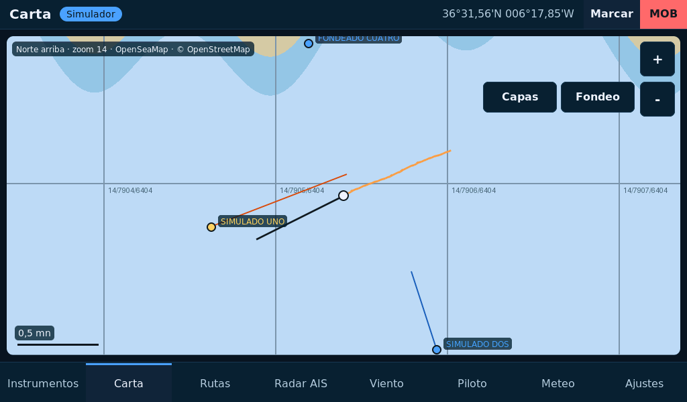

Muestra el mapa de la tarjeta, el barco con un vector de 6 minutos, la derrota, los blancos AIS con su nombre y su
vector, los waypoints, la ruta y la escala.

| Gesto o botón | Hace |
|---|---|
| Arrastrar | Mueve la carta y deja de seguir al barco |
| **+ / −** | Zoom, de 5 a 18 |
| **Centrar barco** | Vuelve a seguir al barco (solo aparece si has movido la carta) |
| Tocar un punto | Abre el panel de abajo con su posición, distancia, demora y tiempo |
| **Fondeo** | Abre el panel de fondeo |

Sin teselas en la tarjeta para la zona, el fondo queda en azul liso y lo demás se ve igual.

### Punto tocado

El panel ofrece:

- **Ir a**: navega a ese punto. El panel pasa a mostrar distancia, demora, tiempo y desvío de la ruta.
- **Marcar**: lo guarda como waypoint.
- **Medir**: empieza una medida desde ese punto.
- **Cerrar**.

Si tocas sobre un waypoint, se elige el waypoint.

### Luces

Si la tarjeta tiene una lista de luces (`/luces.txt`, ver la instalación), la carta dibuja cada luz con su color y su
ritmo (se enciende y se apaga como la real): las de alcance de 15 millas o más desde el zoom 8 y el resto desde el 11,
con el nombre desde el zoom 13 (las principales desde el 10). Si no caben todas, se ven las de más alcance.

Tocar una luz abre su ficha en el panel: nombre, característica, altura, alcance nominal, **a qué distancia se verá**
con la visibilidad que haya (10 millas si no llega ese dato) y la altura del ojo de Astro, y distancia y demora desde el
barco. **Ir a** navega hasta ella.

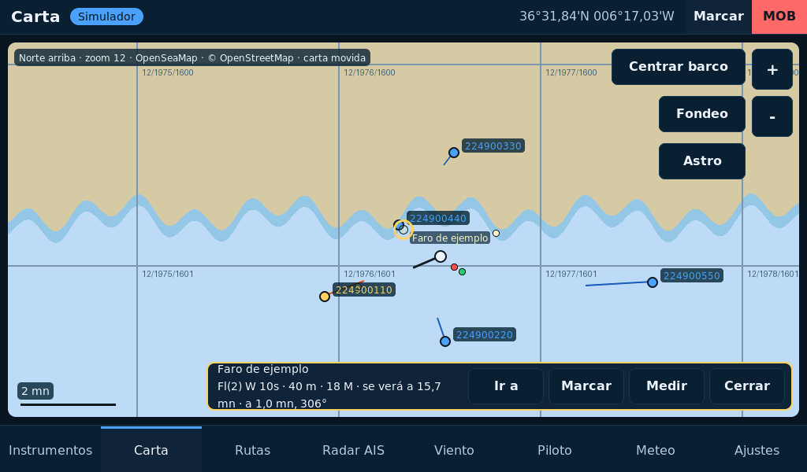

### Navegar a un destino

Con un destino activo, la carta dibuja la línea hasta él y el panel dice «A WPT 01 · 1,2 mn · 251° · 12 min» y el
desvío («0,03 mn a estribor»). Botones: **Parar**, **Destino** (centra la carta en él) y, en una ruta, **Siguiente**.

Al llegar a 0,05 mn el panel dice **LLEGADA**. En una ruta, el plotter pasa solo al punto siguiente cuando el actual
queda por el través.

### Medir

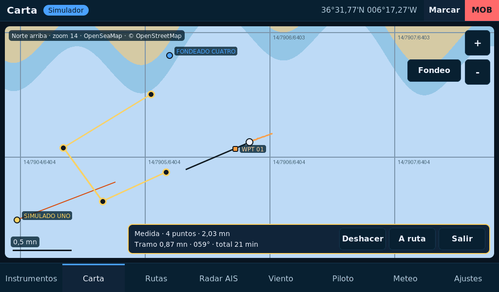

Toca la carta → **Medir** y ve tocando puntos. El panel da el total, el último tramo con su demora y el tiempo a la
velocidad actual.

- **Deshacer**: quita el último punto.
- **A ruta**: convierte la medida en la ruta y abre la pestaña Rutas.
- **Salir**: termina sin guardar.

### Fondeo

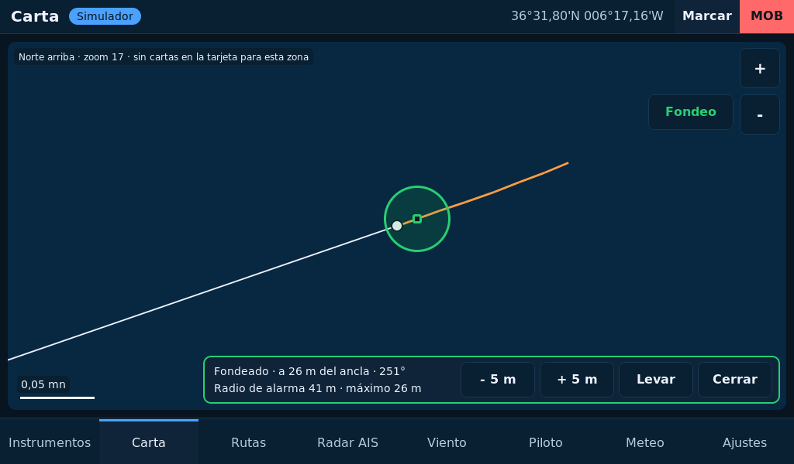

1. Pulsa **Fondeo**.
2. Ajusta la **cadena filada** con **− 5 m / + 5 m**. El panel muestra el fondo de la sonda, la relación cadena / fondo
   y el radio de alarma que resulta (el borneo con esa cadena y ese fondo, más 10 m de margen; sin sonda, toda la cadena).
3. Pulsa **Fondear** en el momento de largar el ancla: el ancla se marca en la posición del barco.

La carta pasa a zoom 17 y dibuja el círculo de alarma en verde. Fondeado, el panel da la distancia y demora al ancla y
la mayor distancia vista; **− 5 m / + 5 m** cambian el radio y **Levar** termina la vigilancia.

Si el barco pasa 10 segundos seguidos fuera del círculo salta **ANCHOR DRAG**; un salto suelto del GPS no la dispara.
Si pasa un minuto sin posición, **ANCHOR WATCH · NO GPS FIX**. El fondeo se guarda: sigue vigilando tras un apagado.

### Corriente

El botón **Corriente** de la carta abre una pantalla con tres cosas:

- **Corriente medida**: si llegan rumbo verdadero, corredera y GPS, el plotter compara el movimiento sobre el fondo (GPS)
  con el movimiento en el agua (rumbo y corredera) y da la corriente (hacia dónde va y cuántos nudos), en media de dos
  minutos. **Medida** la copia a los campos de la corriente.
- **Corriente por la estima**, para cuando no hay corredera: pulsa **Marcar salida** en un punto conocido, gobierna a
  rumbo y velocidad constantes y, pasado un rato (mejor una hora o más), pulsa **Por la estima**. Con el rumbo verdadero
  gobernado (*Rv navegado*; **Proa** lo copia del rumbo del barco), la velocidad en el agua y el abatimiento se calcula la
  estima; la diferencia hasta la situación del GPS es la corriente, que se copia a sus campos.
- **Rumbo a gobernar**: con el rumbo efectivo que quieres hacer (**Destino** pone la demora al destino activo), la
  velocidad en el agua (**Corredera** la copia), el abatimiento (+ a estribor, − a babor) y la corriente, da el **rumbo
  verdadero a gobernar**, cuánto corrige y la velocidad efectiva; el **rumbo de aguja** con la declinación del WMM y, si
  hay tablilla de desvíos, con el desvío; y, navegando a un destino, el tiempo hasta él. Si la corriente cruza más rápido
  que el barco o lo frena del todo, lo dice.

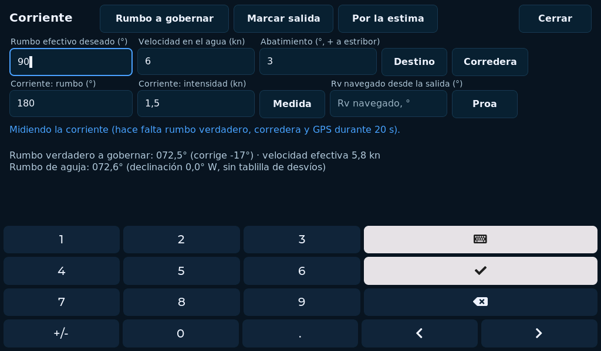

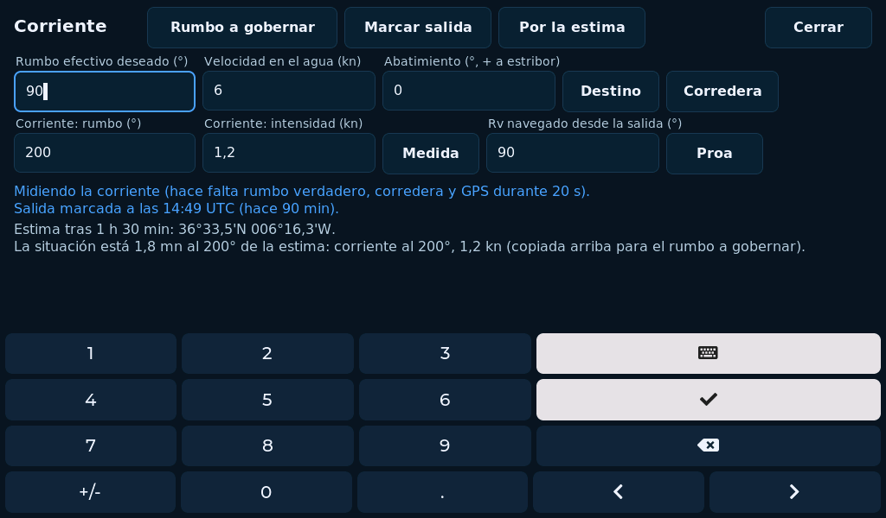

### Astro: recta de altura

El botón **Astro** de la carta abre *Recta de altura*, para situarse con el sextante sin tablas ni almanaque:

1. Elige el astro: el botón *Astro* pasa por **Sol** y **Luna** (limbo inferior o superior), **Venus**, **Marte**, **Júpiter**, **Saturno** y **Estrella**; con `<` y `>` se recorren las 57 estrellas de navegación y la Polar y, detrás, otras 99 estrellas brillantes de los almanaques (Caph, Mimosa, Castor, Mizar...). De la Luna, los planetas y cada estrella se dice la altura y el azimut que tiene ahora, para reconocerla.
   **Visibles** abre la lista de lo que hay ahora entre 10° y 80° de altura (Sol, Luna, planetas y estrellas), ordenada por azimut, con altura y azimut de cada uno; tocar uno lo elige. En blanco, los de las tablas diarias del almanaque; en gris, las demás estrellas. **En amarillo, las tres estrellas que mejor reparten el horizonte** (las más separadas en azimut, lo ideal 120°, y entre parecidas las más brillantes). Avisa si es de día, crepúsculo (el buen momento) o noche cerrada.

   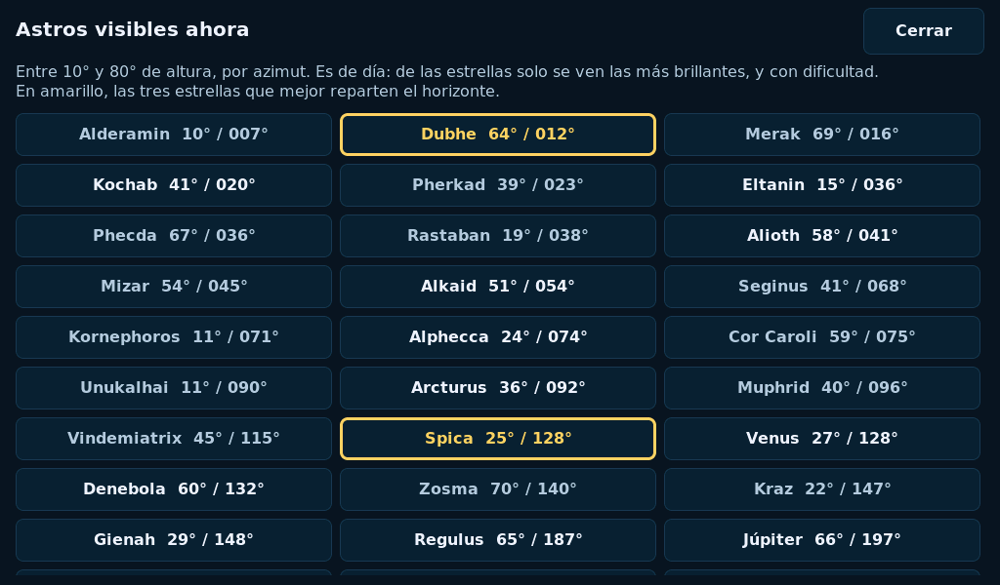

2. En el instante de la medida pulsa **Ahora** (o escribe la hora UTC como `hhmmss`).
3. Escribe la altura del sextante (grados y minutos), el error de índice en minutos (positivo si el sextante marca de más) y la elevación del ojo en metros. Estos dos últimos se recuerdan para la próxima vez.
4. **Calcular y trazar**: se aplican la depresión del horizonte, la refracción, el semidiámetro y el paralaje (del Sol, de la Luna —hasta 1° — y de los planetas), y sale la altura observada, la calculada, el azimut y el **determinante** (millas hacia el astro o en contra). La recta queda dibujada en la carta, en amarillo, con el astro y la hora.

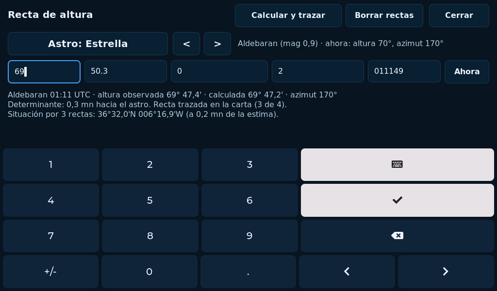

La estima es la posición del barco en la carta en ese momento. Se guardan hasta cuatro rectas; con dos o más que se corten bien se calcula la **situación** (círculo amarillo en la carta) y su distancia a la estima. Las rectas anteriores se **trasladan** solas por lo navegado desde que se tomaron (la diferencia de posición del barco entre una medida y la siguiente) y salen marcadas «(trasl.)»: valen tanto para un crepúsculo de estrellas como para dos rectas de Sol con horas de diferencia. La situación corresponde al instante de la última medida. *Borrar rectas* las quita. Si la medida no cuadra con el astro y la hora (más de 120 millas), no se traza y se avisa.

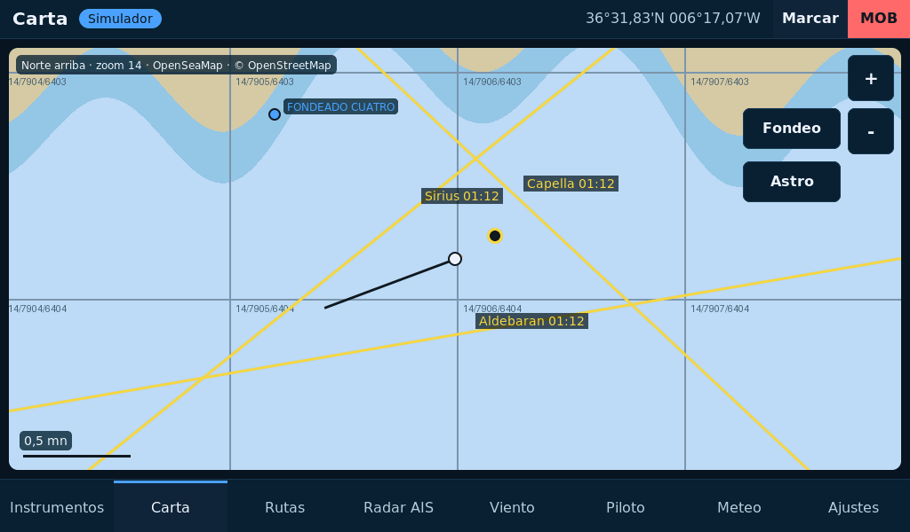

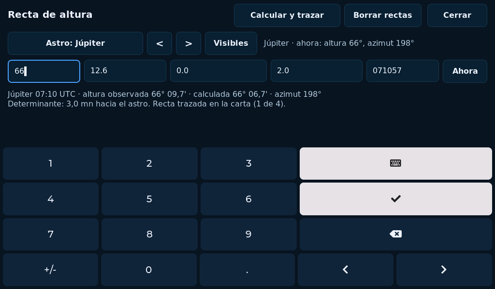

**Latitud** usa la misma medida para dar la latitud directamente, sin trazar:

- **Por la meridiana**: mide el Sol (u otro astro) en su paso por el meridiano, cuando deja de subir. El resultado es la
  latitud y su diferencia con la estima. Además se dice **a qué hora UTC pasa por el meridiano** y con qué altura
  verdadera, con la longitud de la estima, para estar preparado.
- **Por la Polar**: el botón **Polar** elige la estrella Polar; de noche, su altura da la latitud a cualquier hora (se
  calcula con su posición exacta de la fecha, sin tablas) y se dice la corrección de la Polar en ese momento.
- Fuera del meridiano también da una latitud, pero depende de la longitud de la estima y se avisa con el horario local.

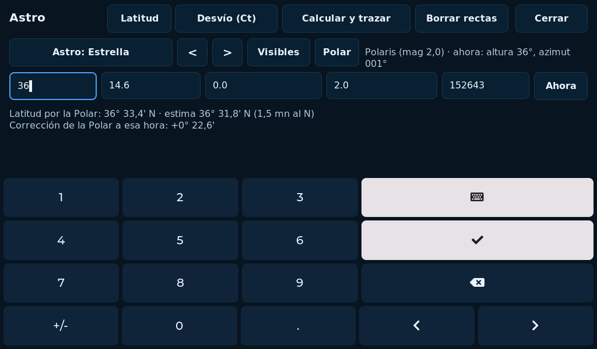

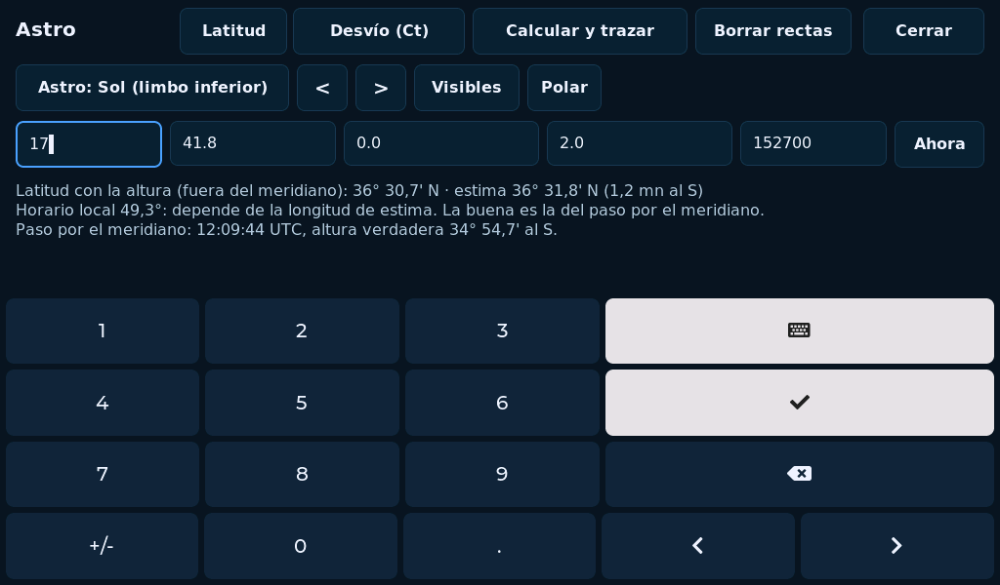

El Sol, Aries y las estrellas se calculan a bordo con precisión de almanaque (0,1′), contrastados con un almanaque náutico de 2026. Los planetas, a 0,1′ (contra PyEphem); la **Luna**, a unos 0,3′ (contra las efemérides DE421 del JPL): su recta vale, pero con algo menos de precisión que las del Sol o las estrellas. Hace falta que el reloj tenga fecha y hora (GPS o internet): un segundo de error son hasta 0,25 millas.

**Cómo calcula.** Es el método de Marcq Saint-Hilaire (altura y azimut desde la estima), sin almanaque ni tablas de reducción:

- *Efemérides*: el horario (AHG) y la declinación del astro en el segundo de la medida, calculados a bordo: Sol y planetas con las series VSOP87, Luna con las tablas de Meeus, estrellas con su catálogo corregido de precesión, nutación y aberración.
- *Altura observada (Ho)*: a la del sextante se le aplican el error de índice, la depresión del horizonte por la elevación del ojo, la refracción y, en el Sol y la Luna, el semidiámetro del limbo y el paralaje.
- *Altura calculada y azimut (Hc, Zn)*: se resuelve el triángulo de posición desde la estima.
- *Determinante*: Ho − Hc en millas; positivo, hacia el astro. La recta es la perpendicular al azimut por ese punto.
- *Situación*: con dos o más rectas, el punto que mejor las cumple todas (mínimos cuadrados), después de trasladar las anteriores por lo navegado. Si se cortan casi en paralelo no se da situación.

### Astro > Desvío (Ct): corrección total y tablilla de desvíos

El botón **Desvío (Ct)** de *Recta de altura* abre *Corrección total y desvío*, para comprobar el compás con un astro:

1. Elige el astro (Sol, Luna, planetas o una estrella; **Polar** la elige directamente). El limbo no importa.
2. Toma con la aguja la **demora del astro** y pulsa **Ahora** en ese instante (hora UTC `hhmmss`).
3. Escribe la demora de aguja y el **rumbo de aguja** del barco en ese momento (**Proa** pone el del compás electrónico si llega por HDM / HDG o NMEA 2000).
4. **Calcular**: sale el azimut verdadero del astro (calculado a bordo, como en la recta de altura), la **corrección total** Ct = Zv − Za, la declinación magnética del lugar (Modelo Magnético Mundial) y el **desvío** = Ct − dm al rumbo de aguja. Signo: + es E (la aguja marca de menos), − es W.

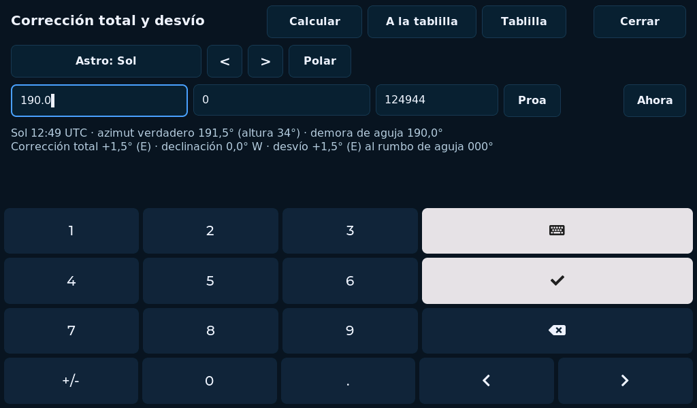

Mejor con el astro bajo (Sol al salir o al ponerse, la Polar): con más de 60° de altura se avisa de que la demora es poco precisa. Si el desvío pasa de 20° no se acepta (revisa astro, hora y demora).

**A la tablilla** guarda la observación (rumbo de aguja y desvío). Con una misma proa (a menos de 5°) se sustituye la anterior; caben 24. **Tablilla** enseña lo guardado: los coeficientes aproximados A, B, C, D y E (desvío = A + B·sen Ra + C·cos Ra + D·sen 2Ra + E·cos 2Ra, ajustados por mínimos cuadrados; con menos de cinco rumbos repartidos, solo A, B y C, o solo A), el residuo, el desvío cada 30° de rumbo de aguja y la lista de observaciones (toca una para quitarla). *Vaciar* las borra todas. Se guarda entre arranques.

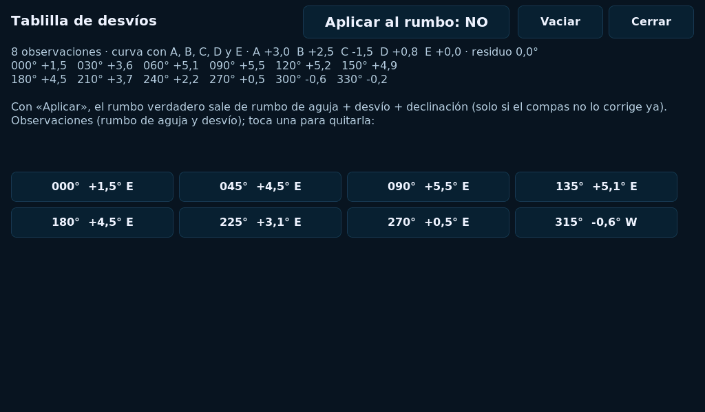

**Aplicar al rumbo** (apagado de serie): el rumbo verdadero del plotter sale entonces de rumbo de aguja + desvío de la tablilla + declinación, cuando el compás solo da rumbo magnético (HDM / HDG, o 127250 sin declinación). No lo actives si el compás ya se corrige solo (los electrónicos que se calibran girando suelen hacerlo).

## 4. Rutas

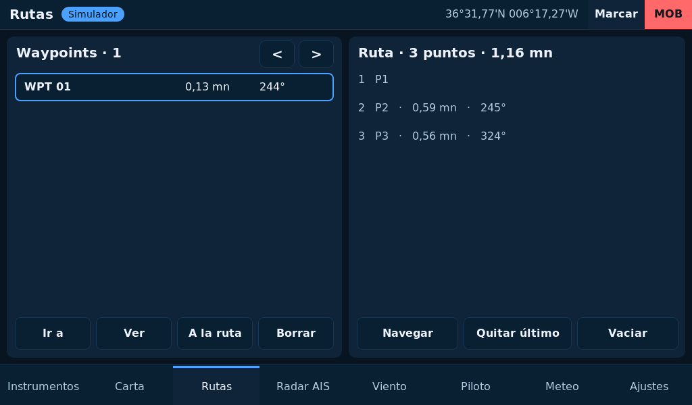

**Izquierda, waypoints**: nombre, distancia y demora desde el barco. Toca uno para elegirlo.

| Botón | Hace |
|---|---|
| **Ir a** | Navega a ese waypoint |
| **Ver** | Lo enseña en la carta |
| **A la ruta** | Lo añade al final de la ruta |
| **Borrar** | Lo elimina |
| **< / >** | Página anterior / siguiente (7 por página, hasta 50) |

**Derecha, la ruta**: hasta 12 puntos, con el tramo y la demora de cada uno y la distancia total.

| Botón | Hace |
|---|---|
| **Navegar / Parar** | Empieza o detiene la navegación por la ruta |
| **Quitar último** | Quita el último punto |
| **Vaciar** | Borra la ruta |

Waypoints y ruta se guardan en `waypoints.gpx` de la tarjeta. Sin tarjeta se pierden al apagar.

## 5. Radar AIS

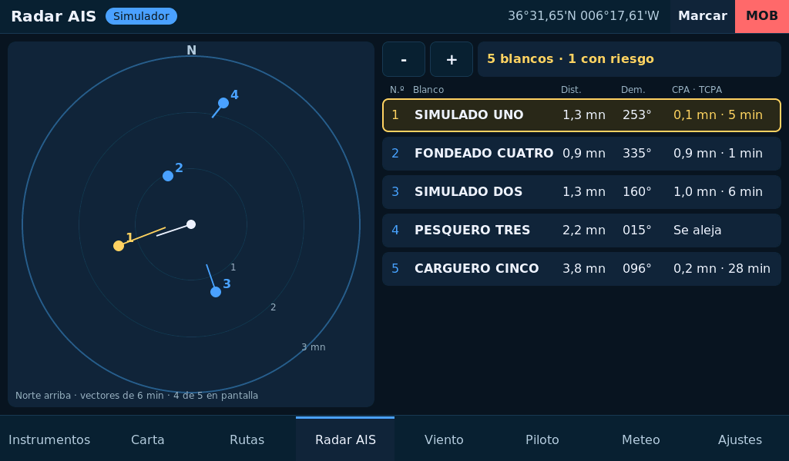

El barco en el centro, norte arriba, tres anillos y los blancos con un vector de 6 minutos. **− / +** cambian el alcance
(0,75 a 12 mn).

La lista de la derecha ordena los blancos con los **peligrosos primero**: distancia, demora y **CPA · TCPA** (distancia
mínima a la que pasará y cuánto falta). «Se aleja» si ya no se acerca.

Un blanco es **peligroso** si pasará a menos de 0,5 mn en menos de 20 minutos: sale en ámbar y abre la alerta
COLLISION RISK. Un blanco se da por **perdido** a los 6 minutos sin señal y desaparece a los 12.

Toca una fila para ver la **ficha del blanco**: tipo, MMSI, clase, distintivo, velocidad, rumbo, eslora y manga. Desde
ahí puedes **silenciar** su alarma.

## 6. Viento

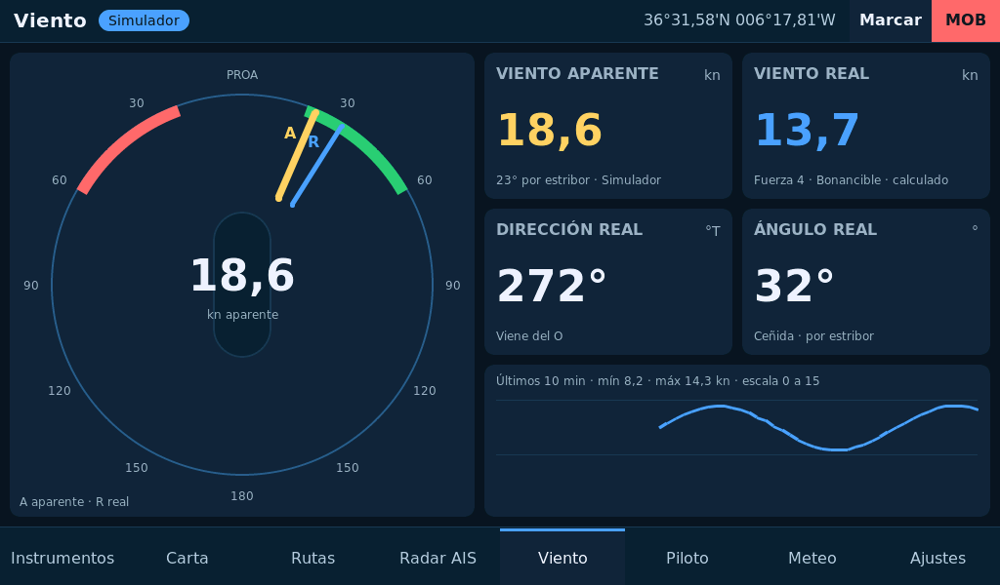

- **Esfera** con la proa arriba. La aguja **A** es el viento aparente y la **R** el real. Los sectores rojo y verde
  marcan la ceñida por babor y por estribor.
- **Viento aparente**: velocidad, ángulo y banda.
- **Viento real**: velocidad, fuerza Beaufort y su nombre.
- **Dirección real**: de dónde viene («Viene del O»).
- **Ángulo real**: y el rumbo de vela (ceñida, través, largo, empopada).
- **Historial** de 10 minutos, con mínimo y máximo.

El viento puede venir del **instrumento de viento APRS LoRa+ Wind** (pantalla de 4" con la veleta NASA Target 2
Wind), que se lo pasa al plotter por NMEA 2000, Bluetooth o WiFi: ver `INSTRUMENTO_VIENTO.md`.

## 7. Piloto

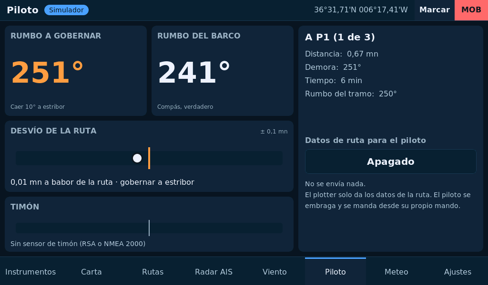

- **Rumbo a gobernar**: la demora al destino, y cuánto hay que caer («Caer 10° a estribor»).
- **Rumbo del barco**: el compás o, si no hay, el rumbo sobre el fondo.
- **Desvío de la ruta**: la línea del centro es la ruta y el punto es el barco. Dice a qué banda estás y hacia dónde
  gobernar.
- **Timón**: si llega el ángulo de timón.
- **Datos de ruta para el piloto**: dos botones. El de la izquierda elige el piloto: **ST2000+** (el Raymarine ST2000 Plus
  de cana, de serie) o **Genérico**. El de la derecha, por dónde sale: Apagado, **RS485**, **Red (TCP)**, **Bluetooth**
  (la pasarela XIAO lo saca hacia el piloto) o **NMEA 2000** (por el bus CAN de la placa).

Con **NMEA 2000** el plotter reclama una dirección en el bus y emite, con la ruta activa y una vez por segundo, **129283**
(error de cross-track) y **129284** (datos de navegación: demora y distancia al destino, posición del waypoint, círculo de
llegada), que es lo que un piloto del bus (Garmin, Raymarine por NMEA 2000, etc.) necesita para seguir la ruta. Requiere
**NMEA 2000 encendido** en Ajustes. ⚠️ **Sin certificar y sin probar en un piloto real: compruébalo con cuidado antes de
confiarle el gobierno en navegación.**

Con el **ST2000+**, una vez por segundo: **RMB** y **APB** con destino (para su modo Track), **VWR** con el viento aparente
(para su modo WindTrim, aunque no haya destino) y **VHW** con la velocidad en el agua. Los waypoints van como «W001»,
«W002»...: el ST2000+ solo lee las cuatro primeras letras del nombre y con «WPT 01», «WPT 02» no vería el cambio de
waypoint. El ST2000+ escucha a **4800 baudios** por su conector (pin 6 blanco NMEA+, pin 5 verde NMEA−): si sale por el
RS485, ponlo a 4800 en Ajustes, y entonces no entra el AIS del Comar (va a 38400). Con el genérico, APB y RMB con los
nombres de los waypoints.

El plotter solo da datos al piloto. **No lo embraga ni lo manda**: eso se hace desde su propio teclado.

## 8. Meteo

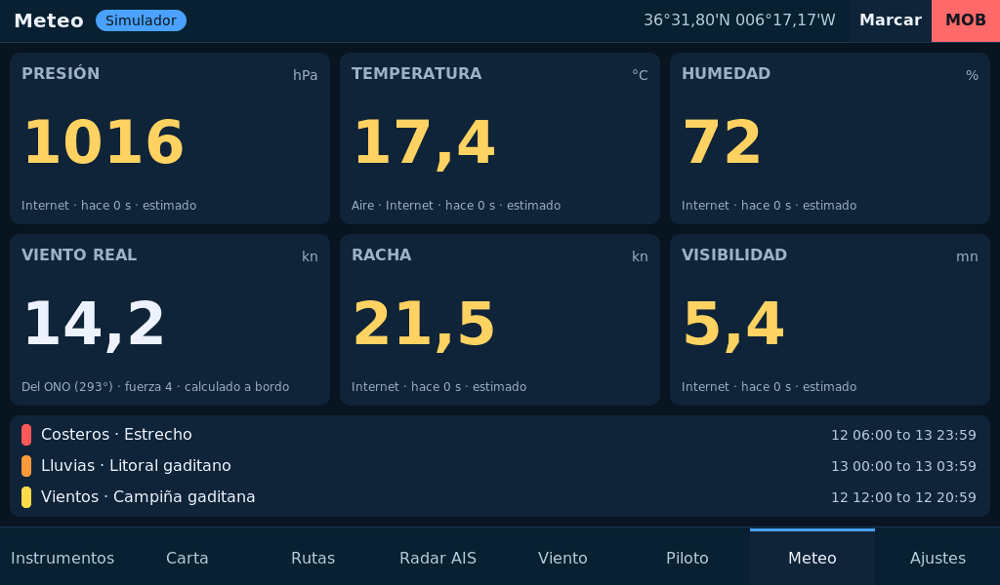

Presión, temperatura del aire, humedad, viento real, racha y visibilidad. Cada casilla dice su fuente y su antigüedad.

Lo que viene **de internet** sale en **ámbar** y con «estimado»: es un dato de una estación o un modelo cercano, no de
tu barco. La nota de abajo dice si la consulta a OpenWeatherMap funciona y de dónde es la observación.

Cálculos a bordo: la casilla de temperatura da la **sensación térmica** (enfriamiento por el viento real con frío,
índice de calor con calor y humedad) cuando se aparta medio grado del aire, y la de humedad el **punto de rocío**
(fórmula de Magnus). Arriba de la nota, el **sol** (salida y puesta con menos de un segundo de error, crepúsculo civil y náutico) y la **luna** (fase, iluminada y
horas de salida y puesta) del día en la posición del barco, en hora UTC.

### NAVTEX

El botón **NAVTEX** de la nota abre la lista de mensajes NAVTEX recibidos, el más nuevo arriba: identificador (estación,
asunto y número, «GA05»), frecuencia, asunto, hora UTC y texto. Llegan en sentencias **NRX** de NMEA 0183, por el RS485,
la red o Bluetooth: de un receptor NAVTEX de a bordo (Furuno, ICS, Nasa...) o de la **app APRS LoRa+**, que los decodifica
(Modos > NAVTEX) y los manda por su servidor NMEA. Una repetición del mismo mensaje sustituye a la anterior. Tocar uno con
posiciones en el texto («36-07.5N 005-21.2W», «3810N 00012W») pone rumbo a la primera en la carta.

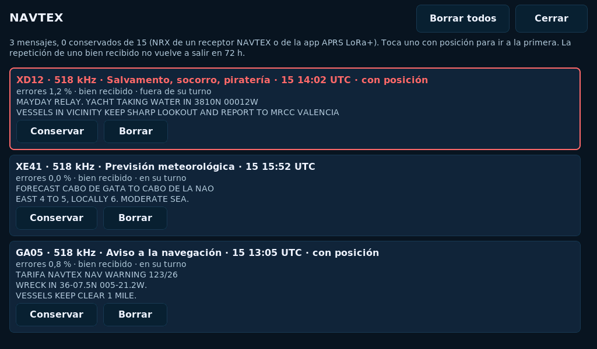

Un mensaje de asunto **D** (búsqueda y salvamento, socorro, piratería) abre la ventana **NAVTEX SAR / DISTRESS** con el
texto; *LIST* lleva a la lista y *CLOSE* la cierra (ese mensaje no vuelve a abrirla).

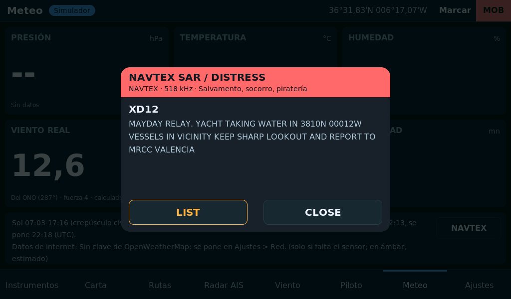

El NAVTEX del plotter no sustituye al receptor oficial de a bordo.

### LSD / DSC

El botón **LSD** de la nota abre la lista de llamadas de llamada selectiva digital (DSC) recibidas, la más nueva arriba:
formato (alerta de socorro, todos los buques, individual, grupo, zona), categoría, quién llama (MMSI y si es buque, estación
costera, grupo, SART...), hora y, en las de socorro, la naturaleza, la posición con su hora, la distancia y la demora. La
misma llamada repetida en 10 minutos solo suma una repetición («×3»). Llegan en la sentencia **DSC** de NMEA 0183 por el
RS485, la red o Bluetooth: de una emisora con LSD (Icom IC-M423GE / IC-M330GE, Standard Horizon, Garmin...) o de la **app
APRS LoRa+**, que las decodifica del canal 70 o de MF / HF (Modos > DSC VHF / DSC HF) y las manda por su servidor NMEA. Tocar
una con posición pone rumbo a ella en la Carta.

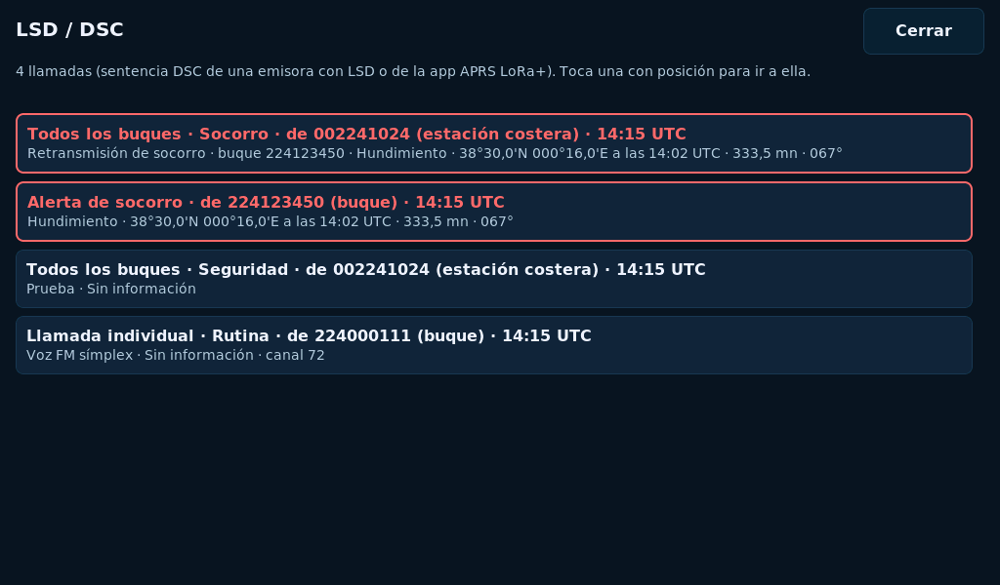

Una alerta de socorro, o la retransmisión o el acuse de una, abre la ventana **DSC DISTRESS** con el MMSI del buque en
peligro, la naturaleza, la posición y quién la envía; **IR A** pone rumbo a la posición (o abre la lista si no la trae) y
**CLOSE** la cierra.

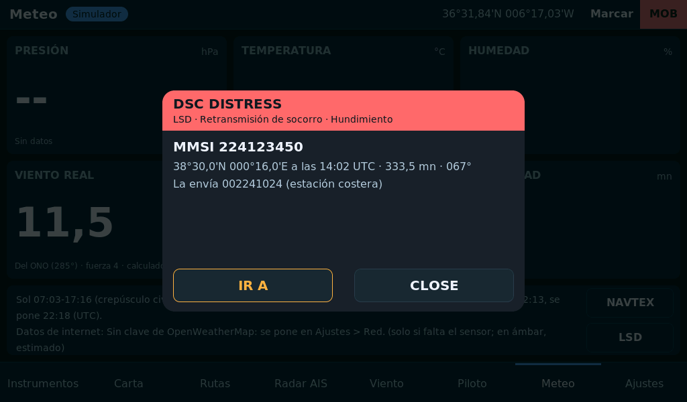

El plotter solo muestra lo que recibe la emisora: no transmite ni contesta llamadas LSD.

## 9. Ajustes

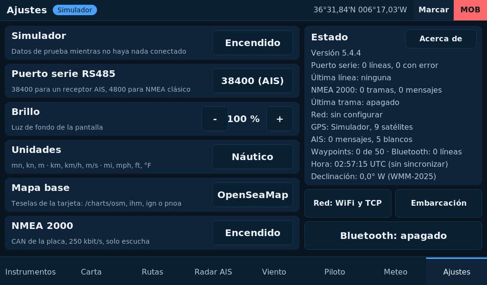

| Ajuste | Qué hace |
|---|---|
| **Simulador** | Datos de prueba. Apágalo con datos reales: mientras está encendido, mandan los suyos |
| **Puerto serie RS485** | 38400 (AIS) o 4800 (NMEA clásico) |
| **Brillo** | Luz de la pantalla |
| **Unidades** | Náutico, métrico o imperial. El fondeo va siempre en metros |
| **Mapa base** | OpenSeaMap, IHM, IGN u ortofoto; cada uno lee su carpeta de la tarjeta |
| **NMEA 2000** | Escucha de la red por el CAN |
| **Red: WiFi y TCP** | Pantalla de red, con teclado |
| **Embarcación** | Datos del barco: nombre, MMSI, distintivo marítimo (el de la licencia de la estación de barco del MMSI), CALLSIGN (indicativo de radioaficionado), tipo, eslora, manga y calado, y la validación del CALLSIGN |
| **Bluetooth** | Enlace con el tracker, la pasarela o el instrumento de viento |

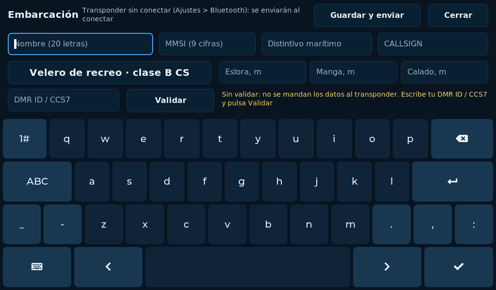

En **Embarcación**, **Guardar y enviar** guarda los datos y, si hay un **APRS LoRa+ MAPRS transponder** (o un tracker con
el perfil náutico AIS) enlazado por Bluetooth, se los manda: el transponder los pone en su baliza AIS. Al enlazarse, el
plotter le pide los suyos; si el plotter no tiene datos, toma los del transponder, y si los tiene y son distintos, manda
los suyos. El transponder ajusta lo que AIS no admite (nombre en mayúsculas, eslora de clase B de 6 a 24 m) y el plotter se
queda con lo que confirma. Con el MAPRS (clase B) el botón de tipo alterna entre los dos de clase B: velero de recreo (B «CS») y lancha de recreo (B «SO»). Arriba se ve el estado:
«mismos datos que el plotter», «enviando», «los ha ajustado» o «sin conectar».

**Validación del CALLSIGN**, como en la app: escribe tu **DMR ID / CCS7** (7 cifras) y pulsa **Validar**. El plotter
pregunta a RadioID.net (hace falta la WiFi con internet, Ajustes > Red) si ese CALLSIGN tiene ese DMR ID o CCS7, que
RadioID solo da tras comprobar la licencia de radioaficionado. Si es así, sale en verde «EA7JRS validado en RadioID»; se
guarda y se vuelve a comprobar cada 90 días (sin conexión se conserva). **Sin CALLSIGN validado el plotter no manda los
datos al transponder** (cambian lo que emite): solo lee los suyos. Si cambias el CALLSIGN hay que validarlo otra vez.

**Distintivo marítimo comprobado**: el transponder solo lo emite comprobado. Con la clave de la API de MarineTraffic (de
pago, 40 caracteres) en *Clave API MarineTraffic*, el botón **MarineTraffic** busca el MMSI y compara el distintivo
(MarineTraffic solo conoce barcos que ha recibido por AIS de verdad). **Sin clave**, el aviso de la pantalla da la ficha
pública del barco (marinetraffic.com/es/ais/details/ships/mmsi:…): mírala en el móvil o el ordenador y, si el distintivo
coincide, pulsa **MarineTraffic** para darlo por comprobado («MarineTraffic: OK»; otra pulsación lo quita). Sus condiciones
no dejan que un programa lea esa página, por eso la mira la persona. Si no está, búscalo en el **MARS de la UIT**
(itu.int/mmsapp/ShipStation/list, el registro oficial) y pulsa **MARS UIT** para confirmarlo a mano («MARS: OK»). El
resultado se manda al transponder. Si cambias el MMSI o el distintivo, hay que comprobarlo otra vez.

**Estado**, a la derecha: versión, líneas recibidas por cada vía, de dónde sale la posición, blancos AIS y waypoints.
Arriba, el botón **Acerca de**: versión y placa, copyright, licencia, proyecto, créditos de las librerías y de las cartas,
y el QR del donativo (paypal.me/ea7jrs).

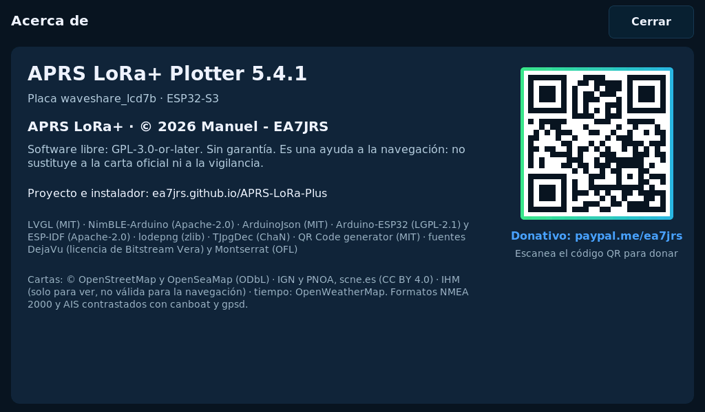

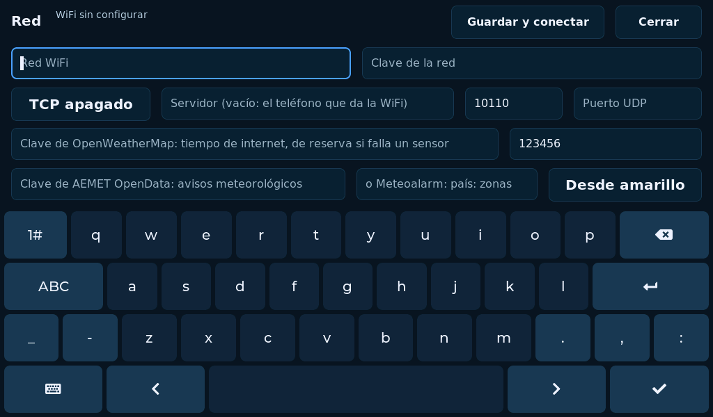

En la pantalla de **Red**: la WiFi y su clave, el tipo de servidor (apagado, NMEA 0183, gpsd o Signal K), su dirección
y puerto, el puerto UDP, la clave de OpenWeatherMap y el PIN del tracker. **Guardar y conectar** aplica los cambios.

## 10. Alertas

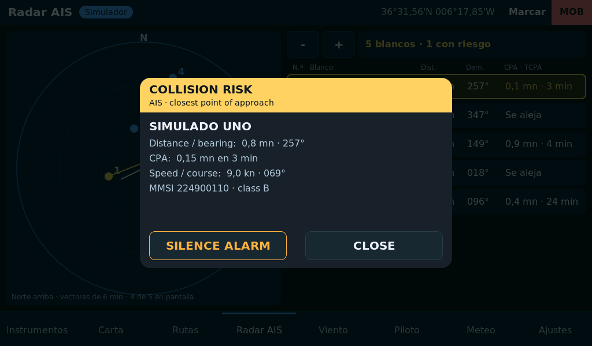

Una alerta abre una ventana sobre cualquier pantalla. Los textos van en inglés, como en la app APRS LoRa+.

| Ventana | Cuándo salta | Botones |
|---|---|---|
| **COLLISION RISK** | Un blanco AIS pasará a menos de 0,5 mn en menos de 20 min | SILENCE ALARM: calla ese buque · CLOSE: no vuelve en 10 min |
| **MAN OVERBOARD** | Has pulsado MOB | CLOSE: la navegación al punto sigue en la carta |
| **ANCHOR DRAG** | 10 s fuera del círculo de fondeo | SILENCE 10 MIN · CLOSE: vuelve en 2 min si sigue |
| **ANCHOR WATCH · NO GPS FIX** | Fondeado y 1 min sin posición | Igual |
| **SIGNAL K ALARM / EMERGENCY** | Aviso del servidor Signal K | Se cierra sola cuando el servidor lo baja de nivel |
| **RS485 COMPARTIDO** | La salida al piloto usa el puerto por el que entran datos | Apagar salida · Seguir así |
| **RED / ORANGE / YELLOW WARNING, EARTHQUAKE, TSUNAMI, SPACE WEATHER** | Aviso oficial nuevo para la zona (por internet, ver abajo) | LIST: pestaña Meteo · CLOSE: no vuelve salvo que suba de nivel |

Las de abordaje y garreo se cierran solas cuando el peligro pasa.

**MOB**: marca la posición, pone rumbo de vuelta y muestra la distancia, la demora y el tiempo transcurrido.

**Avisos oficiales** (con WiFi con salida a internet, *Ajustes > Red*): meteorológicos (AEMET en España: con posición, los avisos
cuyo polígono tiene dentro el barco, sacados del paquete público con todos los CAP; sin posición, el RSS de Meteoalerta; MeteoAlarm en el resto de Europa, con el país en *País ISO*; NWS en EE. UU.), tsunamis (tsunami.gov), terremotos (USGS y
EMSC: por magnitud y distancia, por ejemplo M5 a menos de 600 km) y tiempo espacial (SWPC de la NOAA: escalas G / R / S, Kp, flujo
solar), cada 15 min en su propia tarea. *Avisos: zonas* filtra por las palabras de la zona cuando no hay polígono («Huelva, Cádiz»; sin poner nada, todo el
país, y con MeteoAlarm solo salta la ventana de los rojos). La pestaña Meteo los resume, con el tiempo espacial.

**En esta versión las alertas no suenan.** No dejes el plotter como única alarma de fondeo o de abordaje.

## 11. De dónde salen los datos

Un mismo dato puede llegar por varias vías. El plotter usa la de más prioridad y, si calla, pasa a la siguiente:

1. Simulador (si está encendido)
2. NMEA 2000
3. Puerto serie RS485
4. Red local
5. Bluetooth
6. Internet

Cuando la fuente mejor vuelve, manda otra vez. No hay que tocar nada.

Internet solo sustituye a la meteorología: viento real, racha, presión, temperatura, humedad y visibilidad. La
**posición, el rumbo, la velocidad y la sonda no tienen sustituto**: si faltan, la casilla dice «Sin datos».

### La hora

El reloj interno se pone solo, en UTC, por este orden:

1. **GPS**: la hora de las sentencias RMC o ZDA que lleguen por cualquier vía (receptor AIS, tracker, gpsd, el móvil) y
   la del bus NMEA 2000 (PGN 126992 y 129029). Hacen falta dos horas seguidas que cuadren entre sí: la primera de un GPS
   recién encendido puede venir mal.
2. **NTP** por internet, con la WiFi de Ajustes > Red: `ntp.roa.es`, la hora oficial de España (Real Instituto y
   Observatorio de la Armada), y de reserva `hora.roa.es` y `pool.ntp.org`.

Mientras la hora del GPS esté al día (6 horas), NTP no la sustituye. Ajustes > Estado > *Hora* dice la hora UTC y quién la
puso. El plotter pasa su hora al instrumento de viento por Bluetooth (sentencia ZDA) si viene del GPS o de NTP. La hora del
simulador no cuenta.

**Declinación magnética**: el plotter lleva el Modelo Magnético Mundial (WMM2025, de NOAA y el British Geological Survey,
válido hasta 2030) y calcula la declinación en la posición del barco. Ajustes > Estado > *Declinación* la muestra. Si
solo llega el rumbo magnético (HDM / HDG, PGN 127250 magnético, Signal K `headingMagnetic`), el rumbo verdadero sale de
sumarle la declinación (calidad «calculado»); un rumbo verdadero medido manda siempre.

## 12. Lo que falta en esta versión

- Sonido de las alertas.
- Descarga de cartas por WiFi y línea de costa de reserva.
- Renombrar waypoints y guardar varias rutas con nombre.
- Mareas, avisos meteorológicos, radioavisos y capas de previsión.
- Mandos del piloto automático.
- Interfaz en inglés.

APRS LoRa+ · © 2026 Manuel - EA7JRS · GPL-3.0-or-later
