# APRS LoRa+ Plotter — User manual

Version 5.4.4 · Waveshare ESP32-S3-Touch-LCD-7B (7", 1024 × 600)

**This is an aid to navigation. It does not replace official charts or a proper lookout.**

> This first version builds and its interface has been reviewed on a PC, but **it has not been tested on the board
> yet**, nor with real equipment. The pictures in this manual were rendered on a PC with the simulator. Use it for testing.

The on-screen texts are in Spanish; this manual gives each one in Spanish, with its meaning.

Installation, connections and troubleshooting: `INSTALLATION_EN.md`. One-page summary: `QUICK_GUIDE_EN.md`.

## Contents

1. The screen
2. Instrumentos (Instruments)
3. Carta (Chart)
4. Rutas (Routes)
5. Radar AIS
6. Viento (Wind)
7. Piloto (Pilot)
8. Meteo (Weather)
9. Ajustes (Settings)
10. Alerts
11. Where the data comes from
12. Not in this version

## 1. The screen

At start-up, for about 2 s, the APRS LoRa+ welcome screen: the logo and «Plotter» with the version; then it moves on
by itself to the working screen.

At the top, always visible:

- The **tab name** and a **Simulador** badge when the data is test data.
- The boat's **position**.
- **Marcar** (Mark): saves a waypoint at the current position (WPT 01, WPT 02...).
- **MOB**: man overboard (section 10).

At the bottom, the eight tabs: Instrumentos, Carta, Rutas, Radar AIS, Viento, Piloto, Meteo and Ajustes.

## 2. Instrumentos (Instruments)

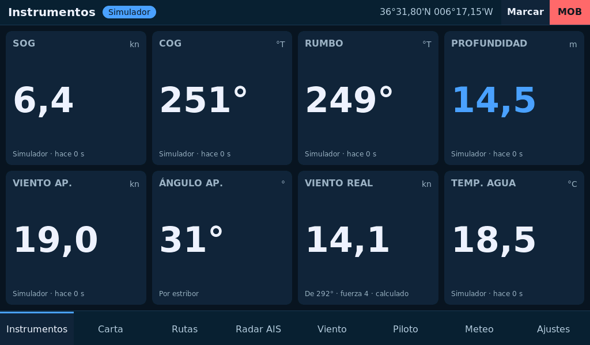

Eight tiles: speed over ground (SOG), course over ground (COG), compass heading (RUMBO), depth (PROFUNDIDAD), apparent
wind (VIENTO AP.), apparent angle (ÁNGULO AP.), true wind (VIENTO REAL) and water temperature (TEMP. AGUA).

Under each value you can see **where it comes from** (NMEA 2000, serial port, local network, tracker, internet) and
**how long ago it arrived**. If a value is not arriving, the tile says «Sin datos» (no data).

**True wind** is computed on board from apparent wind, speed and heading. If the wind sensor is missing, the one
arriving from another source is used; the internet one is shown in amber and labelled «estimado» (estimated).

## 3. Carta (Chart)

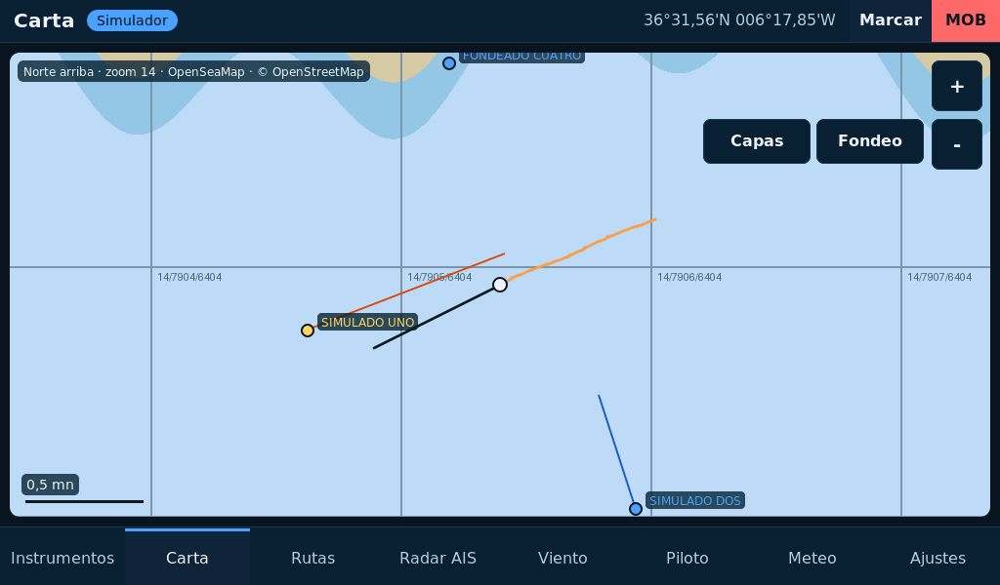

It shows the map from the card, the boat with a 6-minute vector, the track, AIS targets with name and vector,
waypoints, the route and the scale.

| Gesture or button | Does |
|---|---|
| Drag | Moves the chart and stops following the boat |
| **+ / −** | Zoom, 5 to 18 |
| **Centrar barco** (Centre boat) | Follows the boat again (only shown after you move the chart) |
| Tap a point | Opens the bottom panel with its position, distance, bearing and time |
| **Fondeo** (Anchoring) | Opens the anchoring panel |

With no tiles on the card for the area, the background stays plain blue and everything else is shown as usual.

### Tapped point

The panel offers:

- **Ir a** (Go to): navigates to that point. The panel then shows distance, bearing, time and cross-track error.
- **Marcar** (Mark): saves it as a waypoint.
- **Medir** (Measure): starts a measurement from that point.
- **Cerrar** (Close).

If you tap on a waypoint, the waypoint is selected.

### Navigating to a destination

With an active destination the chart draws the line to it and the panel says «A WPT 01 · 1,2 mn · 251° · 12 min» (to
WPT 01, 1.2 nm, 251°, 12 min) and the cross-track error. Buttons: **Parar** (Stop), **Destino** (centres the chart on
it) and, on a route, **Siguiente** (Next).

Within 0.05 nm the panel says **LLEGADA** (arrival). On a route, the plotter moves on to the next point by itself when
the current one is abeam.

### Measuring

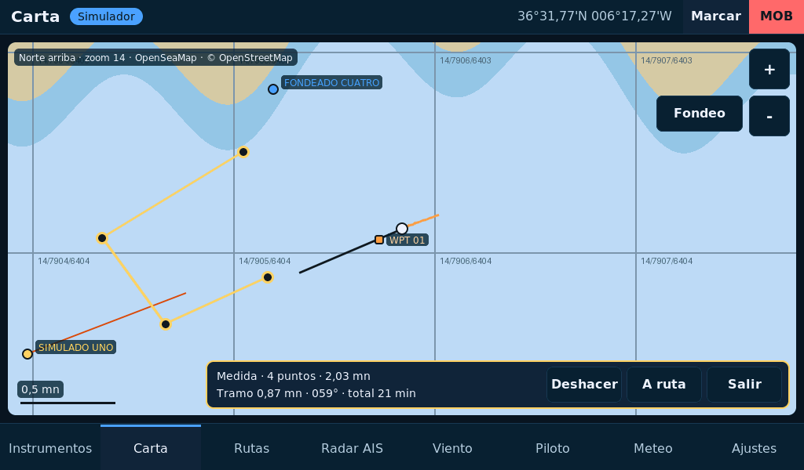

Tap the chart → **Medir** and keep tapping points. The panel gives the total, the last leg with its bearing and the
time at the current speed.

- **Deshacer** (Undo): removes the last point.
- **A ruta** (To route): turns the measurement into the route and opens the Rutas tab.
- **Salir** (Exit): ends without saving.

### Anchoring

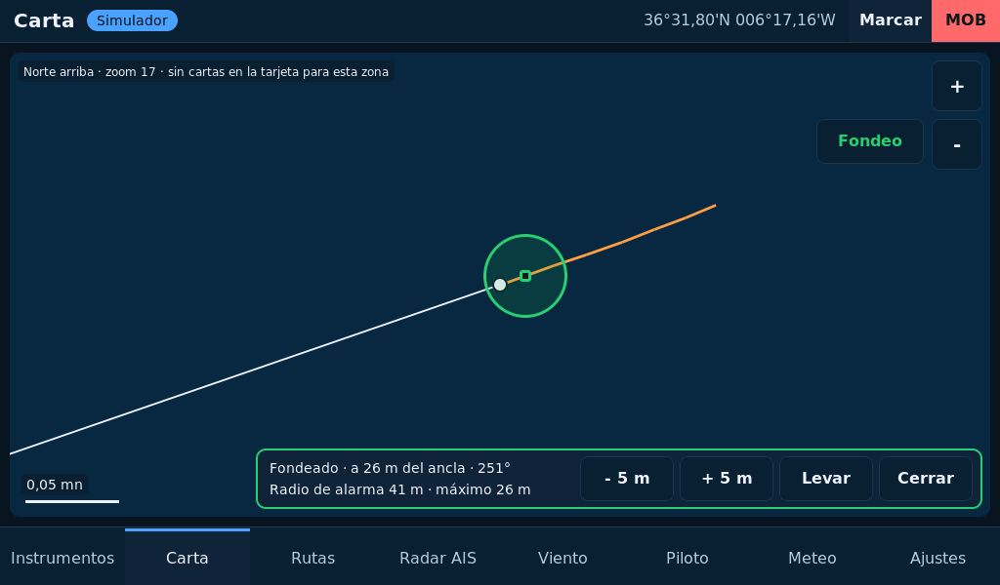

1. Press **Fondeo**.
2. Set the **rode paid out** with **− 5 m / + 5 m**. The panel shows the sounder depth, the scope ratio and the
   resulting alarm radius (the swing radius for that rode and depth, plus a 10 m margin; with no sounder, the whole rode).
3. Press **Fondear** (Anchor) as you drop the anchor: the anchor is marked at the boat's position.

The chart goes to zoom 17 and draws the alarm circle in green. Once anchored, the panel gives distance and bearing to
the anchor and the largest distance seen; **− 5 m / + 5 m** change the radius and **Levar** (Weigh) ends the watch.

If the boat stays outside the circle for 10 seconds, **ANCHOR DRAG** is raised; a single GPS jump does not trigger it.
After one minute without a position, **ANCHOR WATCH · NO GPS FIX**. The anchor watch is saved: it keeps watching after a
power cycle.

## 4. Rutas (Routes)

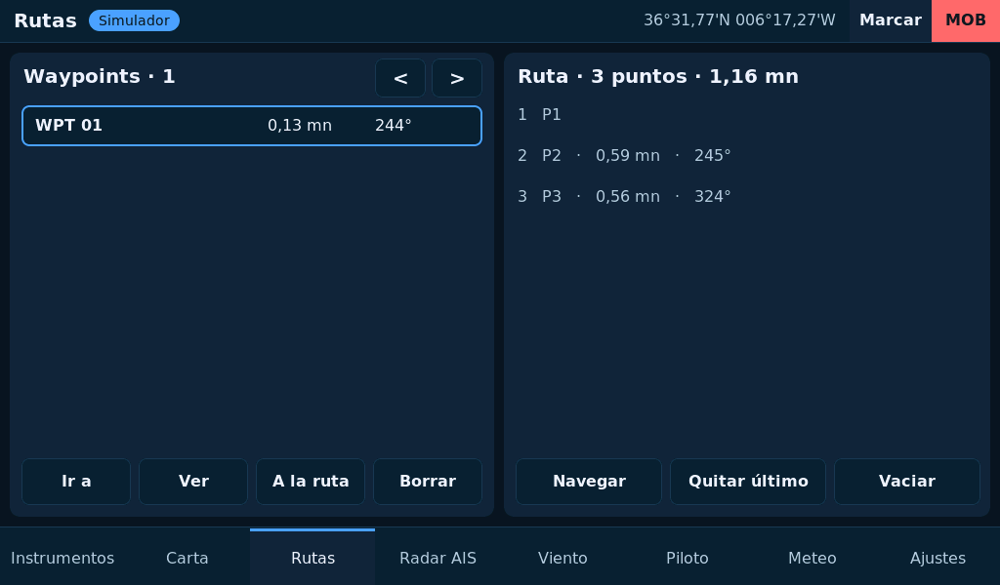

**Left, waypoints**: name, distance and bearing from the boat. Tap one to select it.

| Button | Does |
|---|---|
| **Ir a** | Navigates to that waypoint |
| **Ver** (View) | Shows it on the chart |
| **A la ruta** (To the route) | Appends it to the route |
| **Borrar** (Delete) | Removes it |
| **< / >** | Previous / next page (7 per page, up to 50) |

**Right, the route**: up to 12 points, with the leg and bearing of each one and the total distance.

| Button | Does |
|---|---|
| **Navegar / Parar** | Starts or stops navigating the route |
| **Quitar último** (Remove last) | Removes the last point |
| **Vaciar** (Clear) | Deletes the route |

Waypoints and route are saved in `waypoints.gpx` on the card. Without a card they are lost at power-off.

## 5. Radar AIS

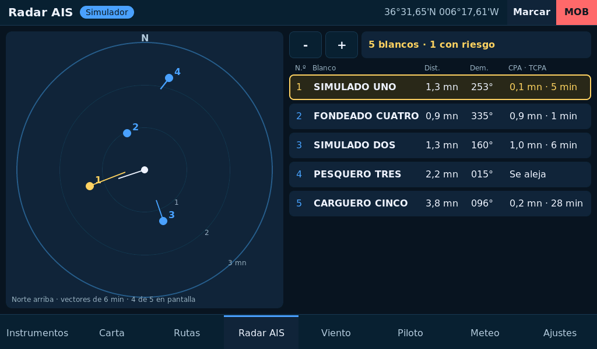

The boat in the centre, north up, three rings and the targets with a 6-minute vector. **− / +** change the range (0.75
to 12 nm).

The list on the right sorts targets with the **dangerous ones first**: distance, bearing and **CPA · TCPA** (closest
distance it will pass at, and how long until then). «Se aleja» (moving away) if it is no longer closing.

A target is **dangerous** if it will pass within 0.5 nm in less than 20 minutes: it is shown in amber and opens the
COLLISION RISK alert. A target is considered **lost** after 6 minutes without signal and removed after 12.

Tap a row to see the **target card**: type, MMSI, class, call sign, speed, course, length and beam. From there you can
**silence** its alarm.

## 6. Viento (Wind)

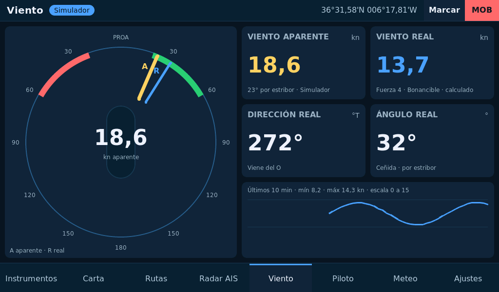

- **Dial** with the bow up. Needle **A** is apparent wind and **R** is true wind. The red and green sectors mark
  close-hauled on port and starboard.
- **Viento aparente** (apparent wind): speed, angle and side.
- **Viento real** (true wind): speed, Beaufort force and its name.
- **Dirección real** (true direction): where it comes from («Viene del O» = from the west).
- **Ángulo real** (true angle): and the point of sail (ceñida = close-hauled, través = beam reach, largo = broad reach,
  empopada = running).
- **History** of 10 minutes, with minimum and maximum.

Wind can come from the **APRS LoRa+ Wind instrument** (4" screen with the NASA Target 2 Wind sensor), which passes it
to the plotter over NMEA 2000, Bluetooth or Wi-Fi: see `WIND_INSTRUMENT_EN.md`.

## 7. Piloto (Pilot)

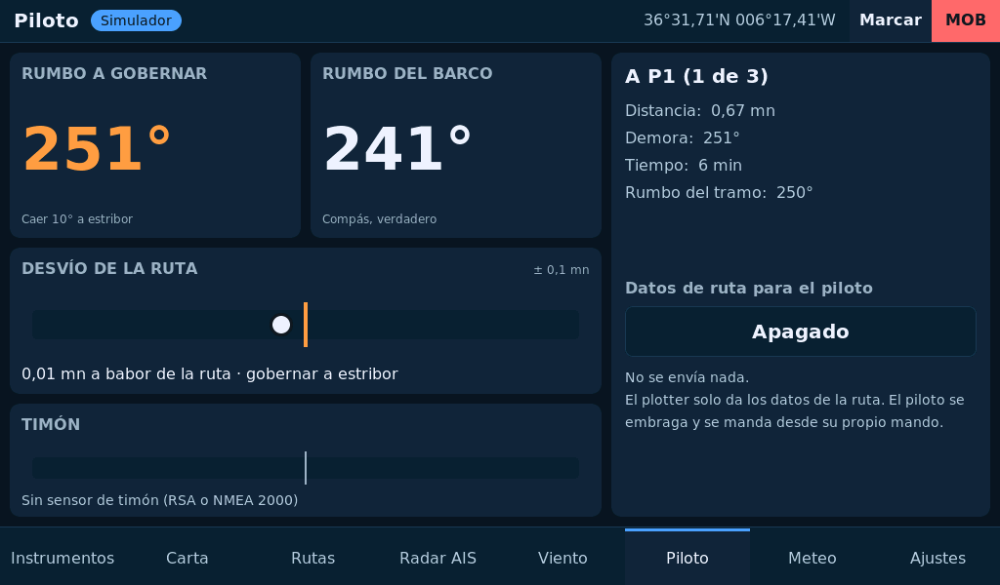

- **Rumbo a gobernar** (course to steer): the bearing to the destination, and how much to turn («Caer 10° a estribor» =
  turn 10° to starboard).
- **Rumbo del barco** (boat heading): the compass or, without one, the course over ground.
- **Desvío de la ruta** (cross-track error): the centre line is the route and the dot is the boat. It tells you which
  side you are on and which way to steer.
- **Timón** (rudder): if the rudder angle is available.
- **Datos de ruta para el piloto** (route data for the pilot): two buttons. The left one picks the pilot: **ST2000+** (the
  Raymarine ST2000 Plus tiller pilot, the default) or **Genérico** (generic). The right one picks the route: Apagado (off),
  **RS485**, **Red (TCP)** (network) or **Bluetooth** (the XIAO gateway passes it on to the pilot).

With the **ST2000+**, once a second: **RMB** and **APB** with a destination (for its Track mode), **VWR** with the apparent
wind (for its WindTrim mode, even without a destination) and **VHW** with the speed through the water. Waypoints are sent
as «W001», «W002»...: the ST2000+ only reads the first four characters of the name, and with «WPT 01», «WPT 02» it would not
see the waypoint change. The ST2000+ listens at **4800 baud** on its connector (pin 6 white NMEA+, pin 5 green NMEA−): if
the output goes through the RS485, set it to 4800 in Ajustes, and then the Comar AIS (38400) no longer comes in. The generic
pilot gets APB and RMB with the waypoint names.

The plotter only gives data to the pilot. **It does not engage or command it**: that is done from its own keypad.

## 8. Meteo (Weather)

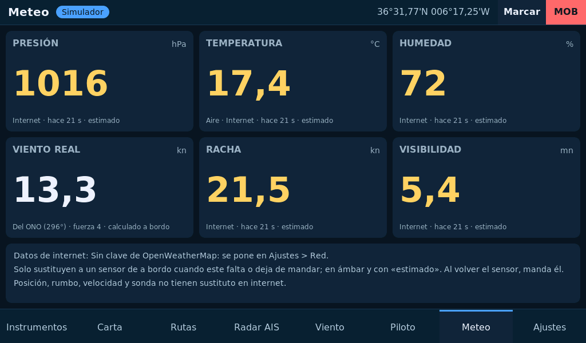

Pressure, air temperature, humidity, true wind, gust and visibility. Each tile shows its source and age.

Anything coming **from the internet** is shown in **amber** and labelled «estimado»: it is a value from a nearby
station or model, not from your boat. The note at the bottom says whether the OpenWeatherMap request works and where
the observation is from.

On-board calculations: the temperature tile gives the **feels-like temperature** (wind chill with the true wind when
cold, heat index when hot and humid) when it differs from the air by half a degree, and the humidity tile the **dew
point** (Magnus formula). Above the note, the **sun** (rise and set, civil twilight) and the **moon** (phase, lit
fraction, rise and set) for the day at the boat's position, in UTC.

## 9. Ajustes (Settings)

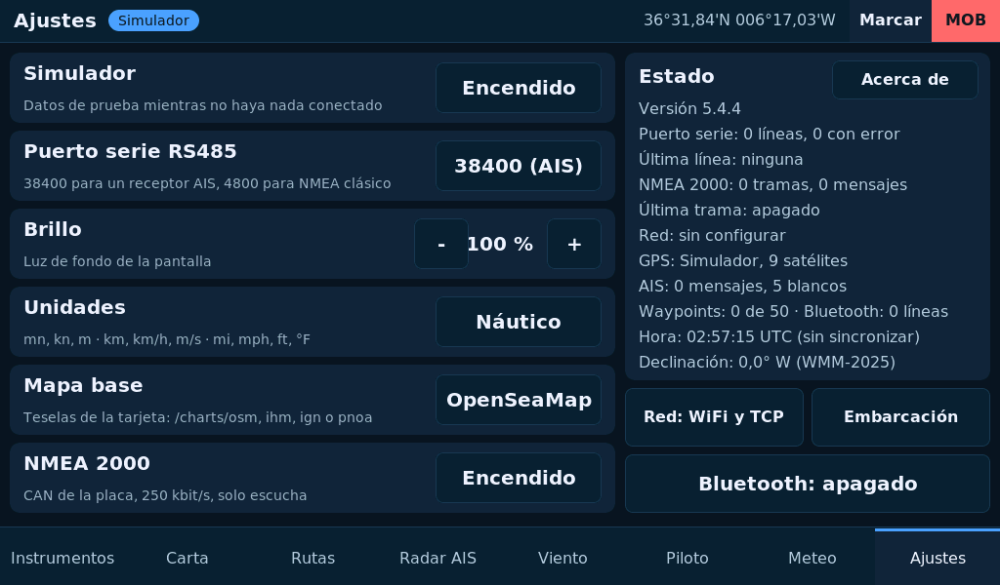

| Setting | What it does |
|---|---|
| **Simulador** | Test data. Turn it off with real data: while it is on, its data wins |
| **Puerto serie RS485** | 38400 (AIS) or 4800 (classic NMEA) |
| **Brillo** | Screen backlight |
| **Unidades** | Nautical, metric or imperial. Anchoring is always in metres |
| **Mapa base** | OpenSeaMap, IHM, IGN or aerial imagery; each reads its own folder on the card |
| **NMEA 2000** | Listening to the network over CAN |
| **Red: WiFi y TCP** | Network screen, with a keyboard |
| **Embarcación** (Vessel) | Vessel data: name, MMSI, CALLSIGN, type, length, beam and draught, and the CALLSIGN check |
| **Bluetooth** | Link with the tracker, the gateway or the wind instrument |

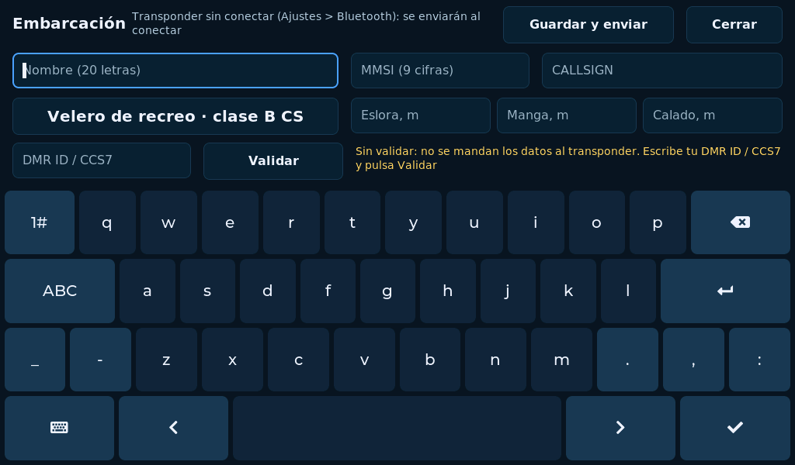

In **Embarcación**, **Guardar y enviar** ("Save and send") stores the data and, if an **APRS LoRa+ MAPRS transponder** (or a
tracker with the nautical AIS profile) is linked over Bluetooth, sends them: the transponder puts them in its AIS beacon.
When it links, the plotter asks for the transponder's data; if the plotter has none, it takes the transponder's, and if it
has different ones, it sends its own. The transponder adjusts what AIS does not accept (upper-case name, class B length of
6 to 24 m) and the plotter keeps what it confirms. With the MAPRS (class B) the type button switches between the two class B types: sailing yacht (B "CS") and power boat (B "SO").
The status is shown at the top: «mismos datos que el plotter» (same data), «enviando» (sending), «los ha ajustado»
(adjusted) or «sin conectar» (not linked).

**CALLSIGN check**, as in the app: type your **DMR ID / CCS7** (7 digits) and press **Validar** ("Validate"). The plotter
asks RadioID.net (Wi-Fi with internet needed, Ajustes > Red) whether that CALLSIGN has that DMR ID or CCS7, which RadioID only
gives after checking the amateur radio licence. If so, «EA7JRS validado en RadioID» shows in green; it is stored and checked
again every 90 days (kept if there is no connection). **Without a validated CALLSIGN the plotter does not send the data to
the transponder** (they change what it transmits): it only reads the transponder's. A new CALLSIGN must be validated again.

**Estado** (Status), on the right: version, lines received on each route, where the position comes from, AIS targets
and waypoints. At its top, the **Acerca de** (About) button: version and board, copyright, licence, project, library
and chart credits, and the donation QR code (paypal.me/ea7jrs).

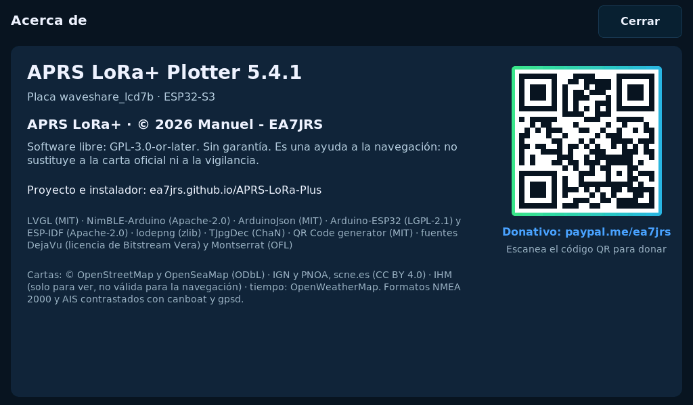

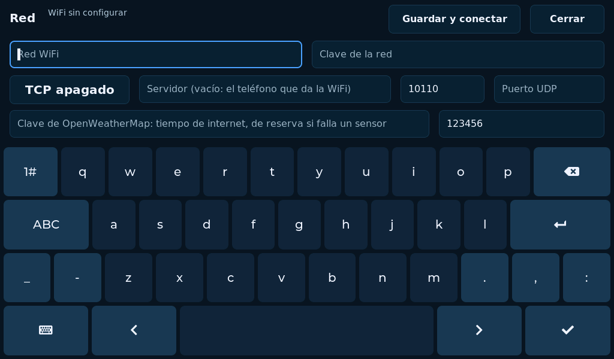

On the **Red** (Network) screen: the Wi-Fi and its password, the server type (off, NMEA 0183, gpsd or Signal K), its
address and port, the UDP port, the OpenWeatherMap key and the tracker PIN. **Guardar y conectar** applies the changes.

## 10. Alerts

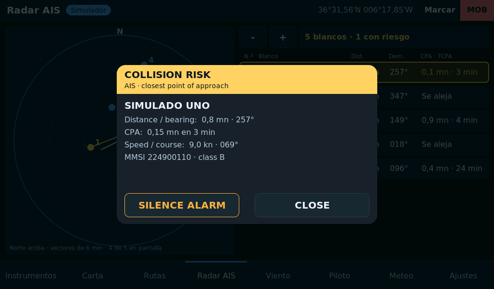

An alert opens a window over any screen. Alert texts are in English, as in the APRS LoRa+ app.

| Window | Raised when | Buttons |
|---|---|---|
| **COLLISION RISK** | An AIS target will pass within 0.5 nm in less than 20 min | SILENCE ALARM: mutes that vessel · CLOSE: does not return for 10 min |
| **MAN OVERBOARD** | You pressed MOB | CLOSE: navigation to the point continues on the chart |
| **ANCHOR DRAG** | 10 s outside the anchor circle | SILENCE 10 MIN · CLOSE: returns in 2 min if it persists |
| **ANCHOR WATCH · NO GPS FIX** | Anchored and 1 min without a position | Same |
| **SIGNAL K ALARM / EMERGENCY** | Notification from the Signal K server | Closes by itself when the server lowers its level |
| **RS485 COMPARTIDO** (shared RS485) | The pilot output uses the port data is coming in on | Apagar salida (turn output off) · Seguir así (keep going) |
| **RED / ORANGE / YELLOW WARNING, EARTHQUAKE, TSUNAMI, SPACE WEATHER** | New official alert for the area (from the internet, see below) | LIST: Meteo tab · CLOSE: it does not come back unless its level rises |

Collision and anchor alerts close by themselves when the danger is over.

**MOB**: marks the position, sets the course back and shows distance, bearing and elapsed time.

**In this version alerts make no sound.** Do not rely on the plotter as your only anchor or collision alarm.

**Official alerts** (Wi-Fi with internet access, *Ajustes > Red*): weather (AEMET in Spain, from the public Meteoalerta RSS;
MeteoAlarm in the rest of Europe, with the country in *País ISO*; NWS in the US), tsunamis (tsunami.gov), earthquakes (USGS and EMSC, by
magnitude and distance, e.g. M5 under 600 km) and space weather (NOAA SWPC: G / R / S scales, Kp, solar flux), every 15 min in their own
task. *Avisos: zonas* filters by words of the zone ("Huelva, Cádiz"; empty = the whole country, and with MeteoAlarm only red alerts open
the window). The Meteo tab sums them up, with the space weather.

## 11. Where the data comes from

The same value can arrive by several routes. The plotter uses the highest-priority one and, if it goes quiet, moves on
to the next:

1. Simulator (if it is on)
2. NMEA 2000
3. RS485 serial port
4. Local network
5. Bluetooth
6. Internet

When the better source returns, it leads again. Nothing needs to be touched.

The internet only stands in for weather: true wind, gust, pressure, temperature, humidity and visibility.
**Position, heading, speed and depth have no substitute**: if they are missing, the tile says «Sin datos».

### The time

The internal clock sets itself, in UTC, in this order:

1. **GPS**: the time in RMC or ZDA sentences arriving by any route (AIS receiver, tracker, gpsd, the phone) and the time on
   the NMEA 2000 bus (PGN 126992 and 129029). Two consecutive times that agree are needed: the first one from a GPS that
   has just been switched on can be wrong.
2. **NTP** over the internet, with the WiFi in Ajustes > Red: `ntp.roa.es`, Spain's official time (Real Instituto y
   Observatorio de la Armada), with `hora.roa.es` and `pool.ntp.org` as backups.

While the GPS time is current (6 hours), NTP does not replace it. Ajustes > Estado > *Hora* («Time») shows the UTC time and
who set it. The plotter passes its time to the wind instrument over Bluetooth (ZDA sentence) when it comes from GPS or NTP.
The simulator time does not count.

**Magnetic declination**: the plotter carries the World Magnetic Model (WMM2025, by NOAA and the British Geological
Survey, valid until 2030) and computes the declination at the boat's position. Ajustes > Estado > *Declinación* shows
it. If only the magnetic heading arrives (HDM / HDG, PGN 127250 magnetic, Signal K `headingMagnetic`), the true heading
is the magnetic one plus the declination (quality «calculated»); a measured true heading always wins.

## 12. Not in this version

- Alert sound.
- Chart download over Wi-Fi and a fallback coastline.
- Renaming waypoints and saving several named routes.
- Tides, weather warnings, navigational warnings and forecast layers.
- Autopilot controls.
- English interface.

APRS LoRa+ · © 2026 Manuel - EA7JRS · GPL-3.0-or-later
