# APRS LoRa+ Plotter — User manual

Version 5.5.0 · Waveshare ESP32-S3-Touch-LCD-7B (7", 1024 × 600)

**This is an aid to navigation. It does not replace official charts or a proper lookout.**

> This first version builds and its interface has been reviewed on a PC, but **it has not been tested on the board
> yet**, nor with real equipment. The pictures in this manual were rendered on a PC with the simulator. Use it for testing.

The on-screen texts are in Spanish; this manual gives each one in Spanish, with its meaning.

Installation, connections and troubleshooting: `INSTALLATION_EN.md`. One-page summary: `QUICK_GUIDE_EN.md`.

## Contents

1. The screen
2. Instrumentos (Instruments)
3. Carta (Chart)
4. Rutas (Routes)
5. Radar AIS
6. Viento (Wind)
7. Piloto (Pilot)
8. Meteo (Weather)
9. Ajustes (Settings)
10. Alerts
11. Where the data comes from
12. Not in this version

## 1. The screen

At start-up, for about 2 s, the APRS LoRa+ welcome screen: the logo and «Plotter» with the version; then it moves on
by itself to the working screen.

At the top, always visible:

- The **tab name** and a **Simulador** badge when the data is test data.
- The boat's **position**.
- **Marcar** (Mark): saves a waypoint at the current position (WPT 01, WPT 02...).
- **Radio**: MAYDAY, PAN PAN and SÉCURITÉ messages to read on channel 16 (section 10).
- **MOB**: man overboard (section 10).

At the bottom, the eight tabs: Instrumentos, Carta, Rutas, Radar AIS, Viento, Piloto, Meteo and Ajustes.

## 2. Instrumentos (Instruments)

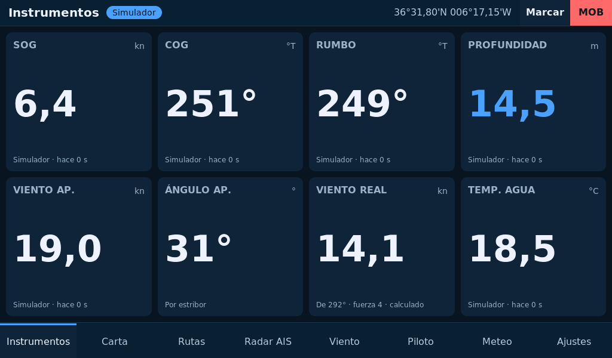

Eight tiles: speed over ground (SOG), course over ground (COG), compass heading (RUMBO), depth (PROFUNDIDAD), apparent
wind (VIENTO AP.), apparent angle (ÁNGULO AP.), true wind (VIENTO REAL) and water temperature (TEMP. AGUA).

Under each value you can see **where it comes from** (NMEA 2000, serial port, local network, tracker, internet) and
**how long ago it arrived**. If a value is not arriving, the tile says «Sin datos» (no data).

**True wind** is computed on board from apparent wind, speed and heading. If the wind sensor is missing, the one
arriving from another source is used; the internet one is shown in amber and labelled «estimado» (estimated).

### Motor (Engine)

Tapping the Instrumentos tab **again** (while already on it) switches the tiles to the **engine**: RÉGIMEN (rpm), REFRIGERANTE (coolant), PRESIÓN ACEITE (oil pressure), COMBUSTIBLE (fuel), BATERÍA (battery), CONSUMO (fuel rate), TEMP. ACEITE (oil temperature) and HORAS MOTOR (engine hours). Another tap goes back to navigation.

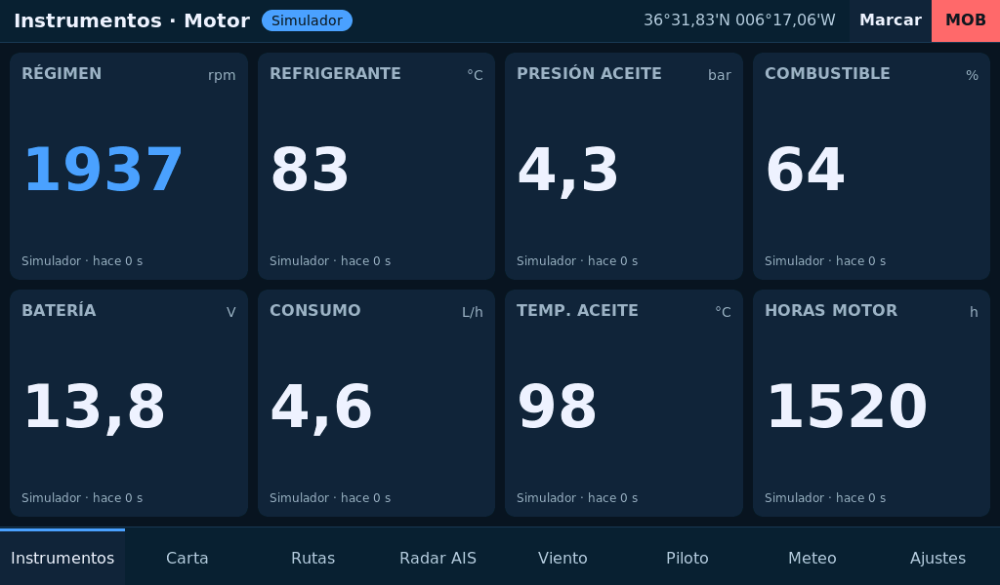

Data comes from the NMEA 2000 bus (PGNs 127488, 127489, 127505 and 127508, first engine and first fuel tank) — for instance from the **APRS LoRa+ OBD-II** gateway — or straight from a **J1939** engine sharing the 250 kbit/s bus (speed, load, temperatures, oil pressure, fuel rate, boost, voltage, level and hours). With the simulator on, a dummy engine is shown. Formats checked against the CANboat database v9.2.0.

## 3. Carta (Chart)

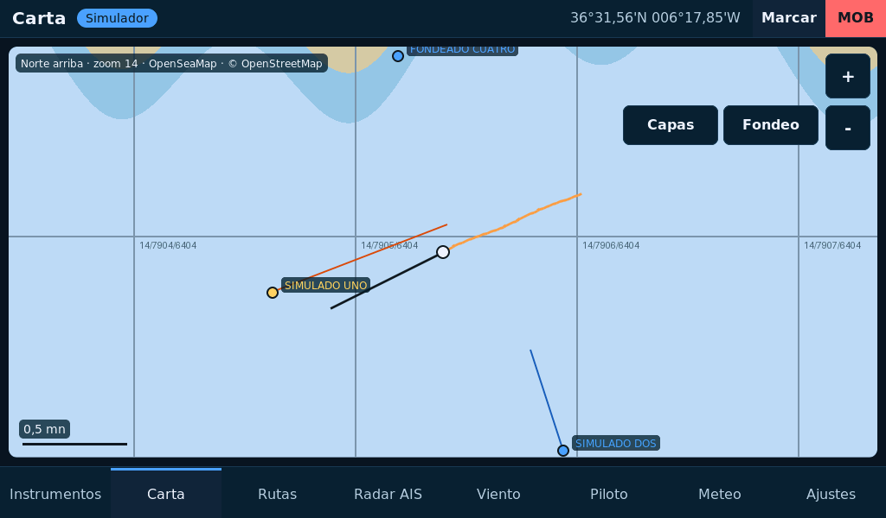

It shows the map from the card, the boat with a 6-minute vector, the track, AIS targets with name and vector,
waypoints, the route and the scale.

| Gesture or button | Does |
|---|---|
| Drag | Moves the chart and stops following the boat |
| **+ / −** | Zoom, 5 to 18 |
| **Centrar barco** (Centre boat) | Follows the boat again (only shown after you move the chart) |
| Tap a point | Opens the bottom panel with its position, distance, bearing and time |
| **Fondeo** (Anchoring) | Opens the anchoring panel |

With no tiles on the card for the area, the background stays plain blue and everything else is shown as usual.

### Tapped point

The panel offers:

- **Ir a** (Go to): navigates to that point. The panel then shows distance, bearing, time and cross-track error.
- **Marcar** (Mark): saves it as a waypoint.
- **Medir** (Measure): starts a measurement from that point.
- **Cerrar** (Close).

If you tap on a waypoint, the waypoint is selected.

### Lights

If the card has a light list (`/luces.txt`, see the installation guide), the chart draws each light in its colour and
with its rhythm (it goes on and off like the real one): lights of 15 miles' range or more from zoom 8 and the rest from
11, with names from zoom 13 (the main ones from 10). If they do not all fit, the longest-range ones are shown.

Tapping a light opens its details in the panel: name, characteristic, height, nominal range, **the distance at which it
will be seen** («se verá a», with the current visibility, 10 miles if there is none, and the eye height set in Astro),
and distance and bearing from the boat. **Ir a** (Go to) navigates to it.

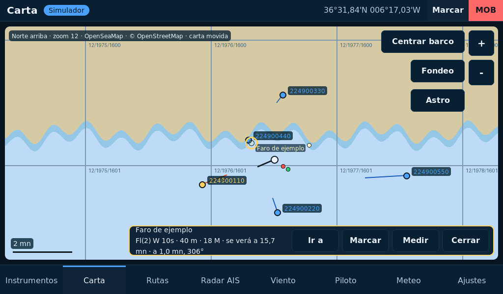

### Navigating to a destination

With an active destination the chart draws the line to it and the panel says «A WPT 01 · 1,2 mn · 251° · 12 min» (to
WPT 01, 1.2 nm, 251°, 12 min) and the cross-track error. Buttons: **Parar** (Stop), **Destino** (centres the chart on
it) and, on a route, **Siguiente** (Next).

Within 0.05 nm the panel says **LLEGADA** (arrival). On a route, the plotter moves on to the next point by itself when
the current one is abeam.

### Measuring

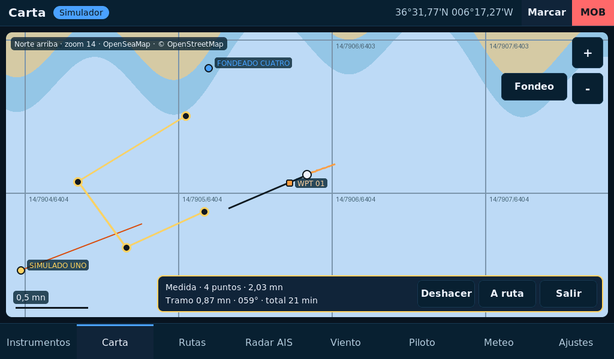

Tap the chart → **Medir** and keep tapping points. The panel gives the total, the last leg with its bearing and the
time at the current speed.

- **Deshacer** (Undo): removes the last point.
- **A ruta** (To route): turns the measurement into the route and opens the Rutas tab.
- **Salir** (Exit): ends without saving.

### Anchoring

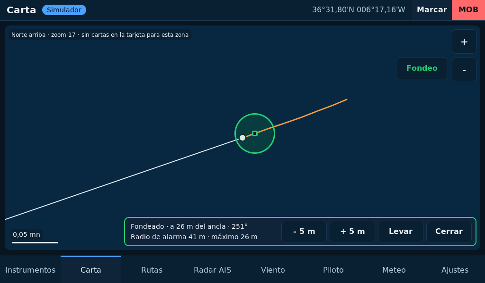

1. Press **Fondeo**.
2. Set the **rode paid out** with **− 5 m / + 5 m**. The panel shows the sounder depth, the scope ratio and the
   resulting alarm radius (the swing radius for that rode and depth, plus a 10 m margin; with no sounder, the whole rode).
3. Press **Fondear** (Anchor) as you drop the anchor: the anchor is marked at the boat's position.

The chart goes to zoom 17 and draws the alarm circle in green. Once anchored, the panel gives distance and bearing to
the anchor and the largest distance seen; **− 5 m / + 5 m** change the radius and **Levar** (Weigh) ends the watch.

If the boat stays outside the circle for 10 seconds, **ANCHOR DRAG** is raised; a single GPS jump does not trigger it.
After one minute without a position, **ANCHOR WATCH · NO GPS FIX**. The anchor watch is saved: it keeps watching after a
power cycle.

### Corriente (current)

The chart's **Corriente** button opens a screen with three things:

- **Measured current** (*Corriente medida*): when true heading, log speed and GPS are all coming in, the plotter
  compares the motion over the ground (GPS) with the motion through the water (heading and log) and shows the current
  (where it is going and how many knots), averaged over two minutes. **Medida** copies it into the current fields.
- **Current from dead reckoning** (*Por la estima*), for when there is no log: press **Marcar salida** (mark departure) at
  a known point, steer a steady course and speed and, after a while (an hour or more is best), press **Por la estima**.
  From the true course steered (*Rv navegado*; **Proa** copies the boat's heading), the speed through the water and the
  leeway, the DR position is worked out; the difference to the GPS position is the current, copied into its fields.
- **Course to steer** (*Rumbo a gobernar*): from the course you want to make good (**Destino** fills in the bearing to the
  active destination), the speed through the water (**Corredera** copies the log), the leeway (+ to starboard, − to port)
  and the current, it gives the **true course to steer**, the correction and the speed made good; the **compass course**
  with the WMM variation and, if there is a deviation card, the deviation; and, when navigating to a destination, the
  time to get there. If the current crosses faster than the boat or stops it altogether, it says so.

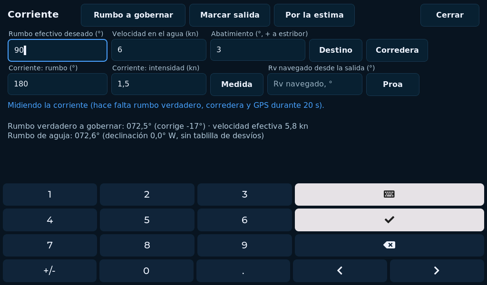

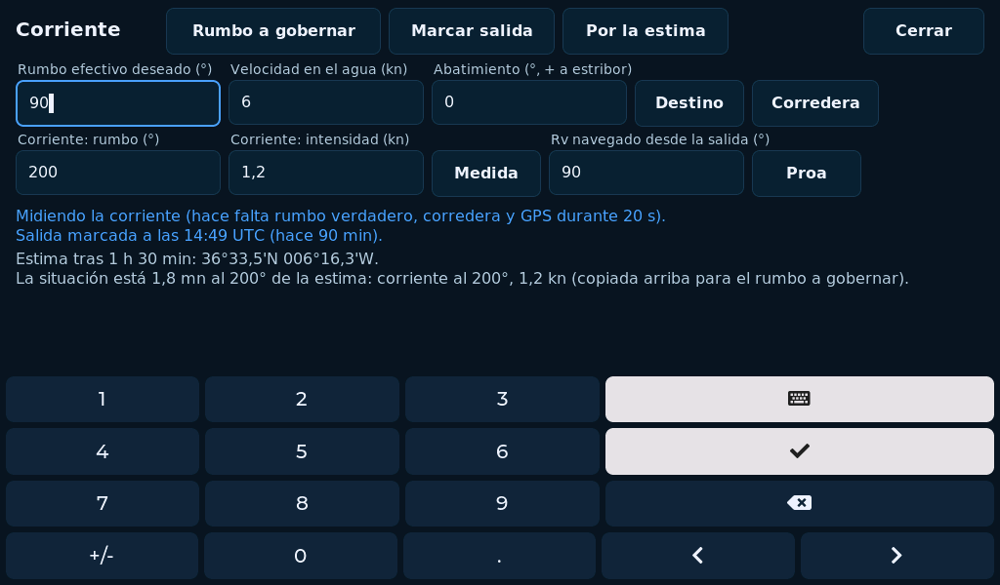

### Demoras (bearings)

The chart's **Demoras** button gives a fix from two bearings of known points: the lights of the card's list within 40
miles and the waypoints, nearest first (`<` `>` to pick each one).

- **Simultaneous bearings**: two different points, both bearings at the same time.
- **Running fix** (*demora trasladada*): the same point or two different ones, with some time in between. Press **Ahora**
  (now) as you take each bearing; with the **course made good** and **speed made good** (**GPS** copies them) the first
  line is advanced for the run.
- **Total correction** (*Corrección total*, + E): for compass bearings the plotter adds Ct (**Ct** fills it with the WMM
  variation and, if there is a deviation card, the deviation on the present compass heading). With 0 the bearings are true.

**Calcular y trazar** (compute and plot) gives the fix, the distance to the second point, the angle of cut (warns below
30°; below 10° there is no fix) and the difference from the GPS, and draws both lines in orange (the advanced one
fainter) and the fix on the chart. **Borrar** clears them.

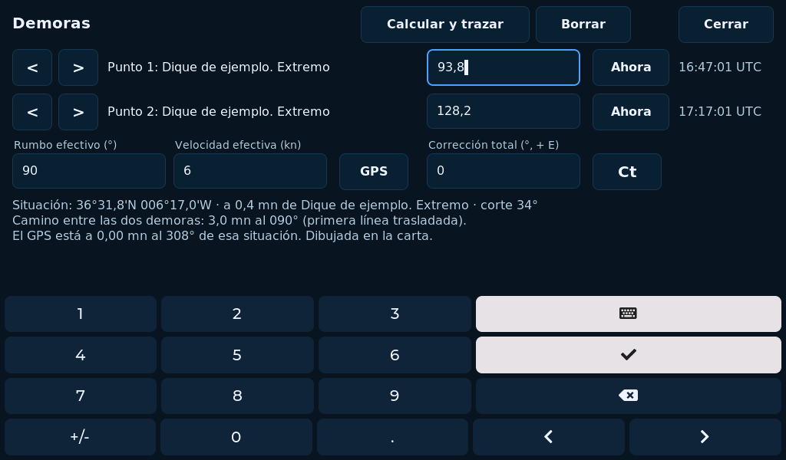

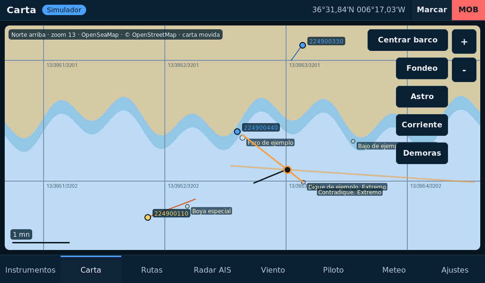

### Astro: line of position

The **Astro** button on the chart opens *Recta de altura* (line of position), to fix your position with a sextant, with no tables or almanac:

1. Choose the body: the *Astro* button cycles **Sol** (Sun) and **Luna** (Moon), each with *limbo inferior* / *superior* (lower / upper limb), **Venus**, **Marte** (Mars), **Júpiter**, **Saturno** and **Estrella** (star); `<` and `>` step through the 57 navigational stars and Polaris, followed by 99 more bright almanac stars (Caph, Mimosa, Castor, Mizar...). The index error and eye height are remembered for next time. For the Moon, the planets and each star it shows its altitude and azimuth right now, to identify it.
   **Visibles** (visible now) lists what is between 10° and 80° of altitude right now (Sun, Moon, planets and stars), sorted by azimuth, with altitude and azimuth; tap one to choose it. White: bodies of the almanac daily pages; grey: the other stars. **Yellow: the three stars that best spread round the horizon** (widest azimuth separation, ideally 120°, brightest among similar ones). The note says whether it is day, twilight (the right time) or full night.

   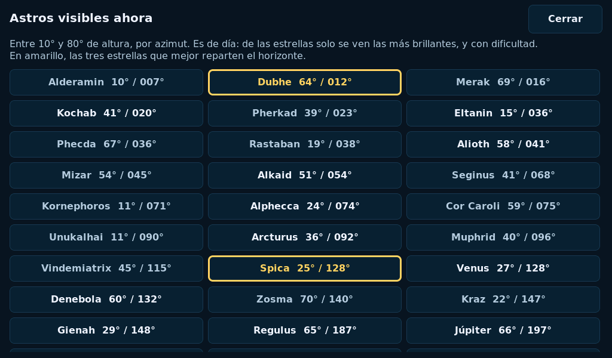

2. At the instant of the sight press **Ahora** (now), or type the UTC time as `hhmmss`.
3. Type the sextant altitude (*Grados*, *Minutos*), the index error in minutes (*Error índice*, positive if the sextant reads high) and the height of eye in metres (*Ojo*).
4. **Calcular y trazar** (compute and plot): dip, refraction, semi-diameter and the Sun's parallax are applied, and you get the observed altitude, the computed altitude, the azimuth and the **intercept** (*Determinante*: miles *hacia el astro*, towards, or *en contra*, away). The line is drawn on the chart in yellow, with the body and the time.

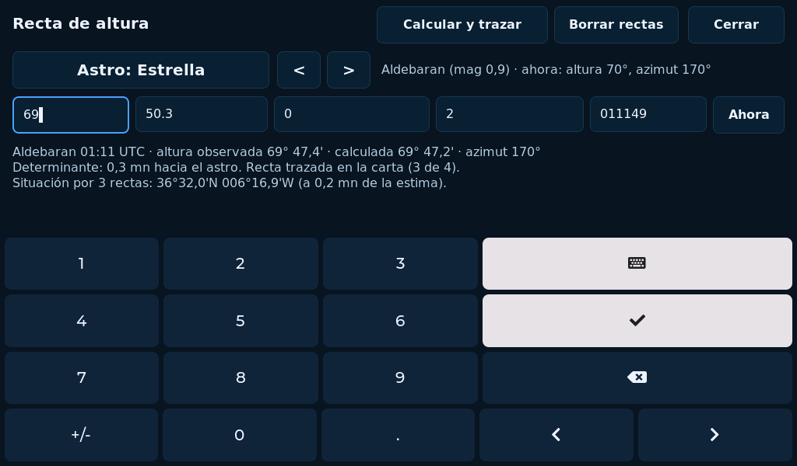

The assumed position is the boat's position on the chart at that moment. Up to four lines are kept; with two or more crossing well a **fix** is computed (*Situación*, yellow circle on the chart) with its distance from the assumed position. Earlier lines are **advanced** automatically for the run since they were taken (the change in the boat's position between one sight and the next) and are tagged "(trasl.)": this works for a round of stars at twilight as well as for two Sun lines hours apart. The fix is for the instant of the last sight. *Borrar rectas* clears them. If the sight does not fit the body and time (over 120 miles), nothing is plotted and a warning is shown.

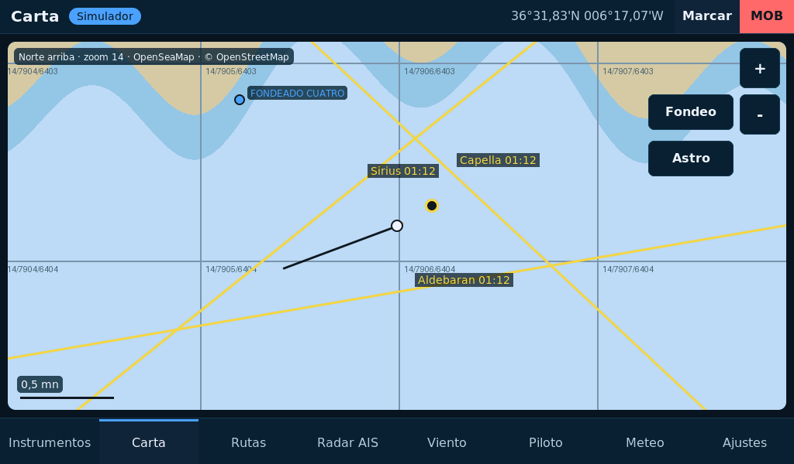

The Sun, Aries and the stars are computed on board to almanac precision (0.1′), checked against a 2026 nautical almanac. The *Astro* button also offers the **Moon** (lower or upper limb; about 0.3′ against JPL DE421, so slightly less precise) and **Venus, Mars, Jupiter and Saturn** (0.1′ against PyEphem), with their parallax applied. The clock must have date and time (GPS or internet): one second of error is up to 0.25 miles.

**How it computes.** It is the Marcq Saint-Hilaire (intercept) method from the assumed position, with no almanac or sight reduction tables:

- *Ephemeris*: the body's GHA and declination at the second of the sight, computed on board: Sun and planets from the VSOP87 series, Moon from Meeus's tables, stars from their catalogue corrected for precession, nutation and aberration.
- *Observed altitude (Ho)*: the sextant altitude corrected for index error, dip for the eye height, refraction and, for the Sun and Moon, the limb semi-diameter and parallax.
- *Computed altitude and azimuth (Hc, Zn)*: the navigational triangle solved from the assumed position.
- *Intercept*: Ho − Hc in nautical miles; positive means towards the body. The line is perpendicular to the azimuth through that point.
- *Fix*: with two or more lines, the point that best satisfies all of them (least squares), after advancing the earlier ones for the run. Nearly parallel lines give no fix.

### Astro > Latitud (latitude by meridian altitude and by Polaris)

**Latitud** uses the same sight to give the latitude directly, without plotting:

- *Por la meridiana* (meridian altitude): sight the Sun (or another body) at meridian passage, when it stops rising.
  You get the latitude and its difference from the DR. It also gives **the UTC time of meridian passage** and the true
  altitude then, from the DR longitude, so you can be ready.
- *Por la Polar* (by Polaris): the **Polar** button selects Polaris; at night its altitude gives the latitude at any
  time (computed with its exact position for the date, no tables) and the Polaris correction at that moment is shown.
- Away from the meridian a latitude is still given, but it depends on the DR longitude; the local hour angle is shown
  as a warning.

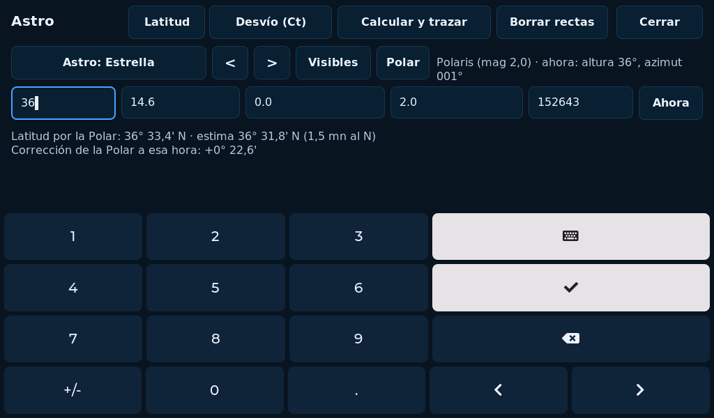

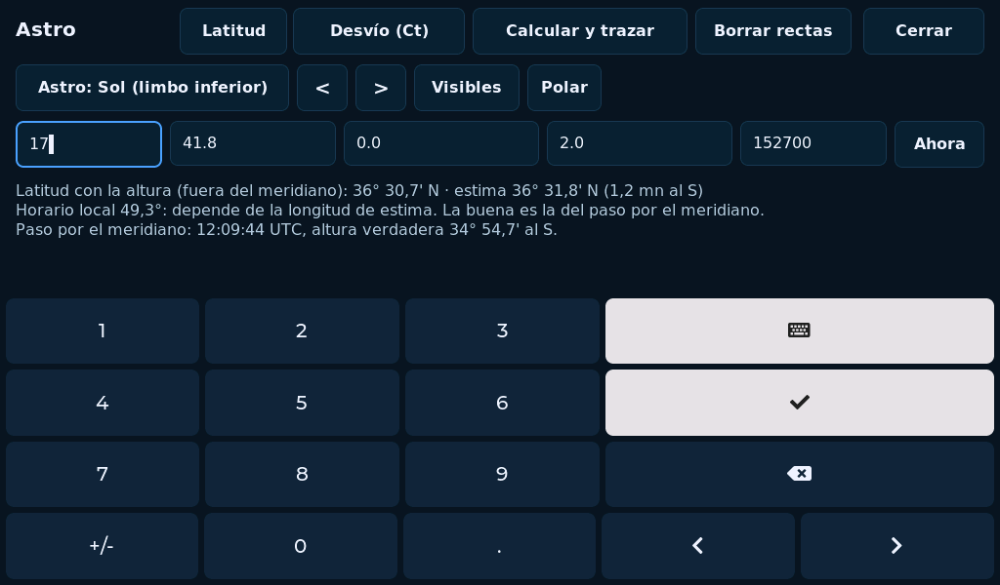

### Astro > Desvío (Ct): total correction and deviation card

The **Desvío (Ct)** button in *Recta de altura* opens *Corrección total y desvío* (total correction and deviation), to check the compass against a celestial body:

1. Choose the body (Sun, Moon, planets or a star; **Polar** picks Polaris directly). The limb does not matter.
2. Take the **compass bearing of the body** and press **Ahora** (now) at that instant (UTC `hhmmss`).
3. Type the compass bearing (*Demora de aguja*) and the boat's **compass heading** (*Rumbo de aguja*) at that moment (**Proa** fills in the electronic compass heading if it arrives as HDM / HDG or NMEA 2000).
4. **Calcular** (compute): you get the true azimuth of the body (computed on board, as for the line of position), the **total correction** Ct = Zv − Zc (true azimuth minus compass bearing), the local magnetic variation (World Magnetic Model) and the **deviation** = Ct − variation at that compass heading. Sign: + is E (the compass reads low), − is W.

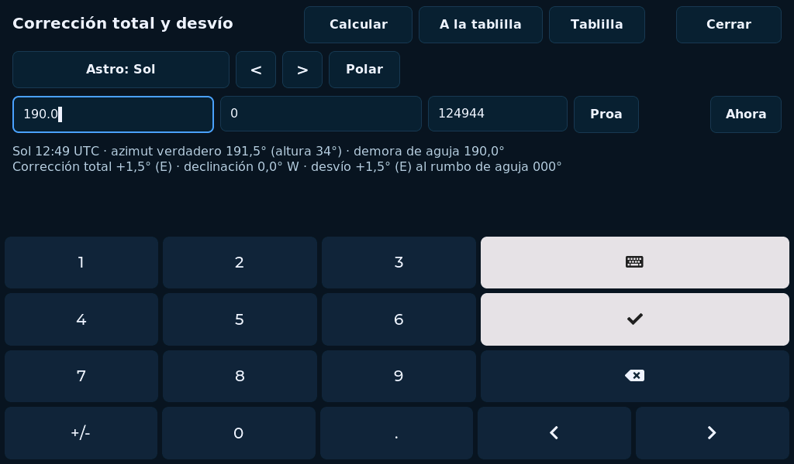

A low body is best (Sun at rising or setting, Polaris): above 60° it warns that the bearing is imprecise. A deviation over 20° is not accepted (check body, time and bearing).

**A la tablilla** (to the card) stores the observation (compass heading and deviation). Another one on the same heading (within 5°) replaces it; up to 24 are kept. **Tablilla** (card) shows them: the approximate coefficients A, B, C, D and E (deviation = A + B·sin Hc + C·cos Hc + D·sin 2Hc + E·cos 2Hc, least squares fit; with fewer than five well spread headings, only A, B and C, or only A), the residual, the deviation every 30° of compass heading and the list of observations (tap one to remove it). *Vaciar* (empty) removes them all. The card is kept across restarts.

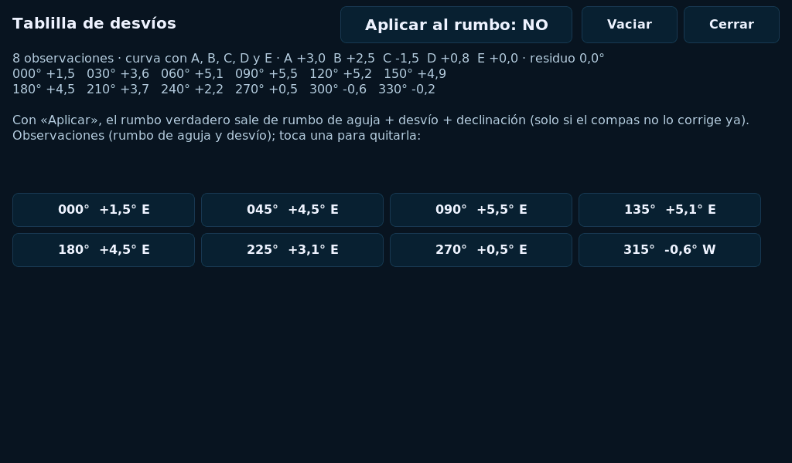

**Aplicar al rumbo** (apply to heading, off by default): the plotter's true heading is then compass heading + deviation from the card + variation, when the compass only gives a magnetic heading (HDM / HDG, or PGN 127250 without variation). Do not turn it on if the compass already corrects itself (self-calibrating electronic compasses usually do).

## 4. Rutas (Routes)

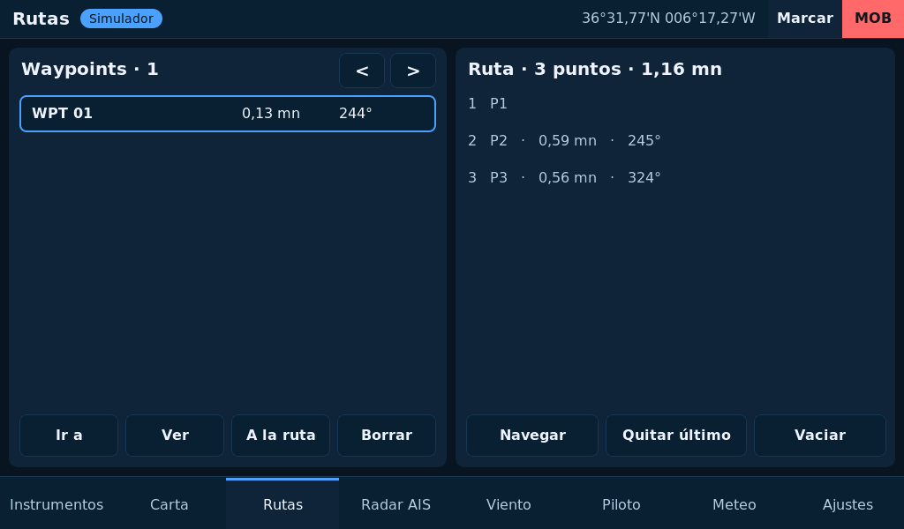

**Left, waypoints**: name, distance and bearing from the boat. Tap one to select it.

| Button | Does |
|---|---|
| **Ir a** | Navigates to that waypoint |
| **Ver** (View) | Shows it on the chart |
| **A la ruta** (To the route) | Appends it to the route |
| **Borrar** (Delete) | Removes it |
| **< / >** | Previous / next page (7 per page, up to 50) |

**Right, the route**: up to 12 points, with the leg and bearing of each one and the total distance.

| Button | Does |
|---|---|
| **Navegar / Parar** | Starts or stops navigating the route |
| **Quitar último** (Remove last) | Removes the last point |
| **Vaciar** (Clear) | Deletes the route |

Waypoints and route are saved in `waypoints.gpx` on the card. Without a card they are lost at power-off.

## 5. Radar AIS

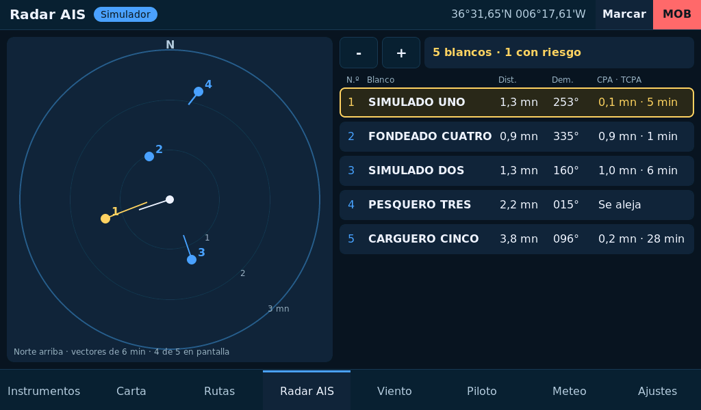

The boat in the centre, north up, three rings and the targets with a 6-minute vector. **− / +** change the range (0.75
to 12 nm).

The list on the right sorts targets with the **dangerous ones first**: distance, bearing and **CPA · TCPA** (closest
distance it will pass at, and how long until then). «Se aleja» (moving away) if it is no longer closing.

A target is **dangerous** if it will pass within 0.5 nm in less than 20 minutes: it is shown in amber and opens the
COLLISION RISK alert. A target is considered **lost** after 6 minutes without signal and removed after 12.

Tap a row to see the **target card**: type, MMSI, class, call sign, speed, course, length and beam. From there you can
**silence** its alarm.

## 6. Viento (Wind)

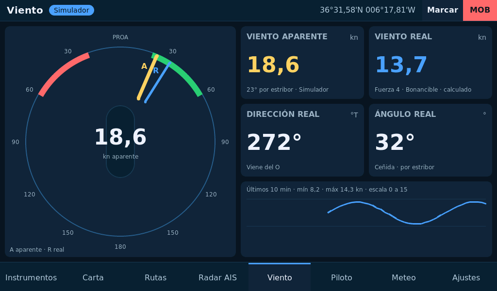

- **Dial** with the bow up. Needle **A** is apparent wind and **R** is true wind. The red and green sectors mark
  close-hauled on port and starboard.
- **Viento aparente** (apparent wind): speed, angle and side.
- **Viento real** (true wind): speed, Beaufort force and its name.
- **Dirección real** (true direction): where it comes from («Viene del O» = from the west).
- **Ángulo real** (true angle): and the point of sail (ceñida = close-hauled, través = beam reach, largo = broad reach,
  empopada = running).
- **History** of 10 minutes, with minimum and maximum.

Wind can come from the **APRS LoRa+ Wind instrument** (4" screen with the NASA Target 2 Wind sensor), which passes it
to the plotter over NMEA 2000, Bluetooth or Wi-Fi: see `WIND_INSTRUMENT_EN.md`.

## 7. Piloto (Pilot)

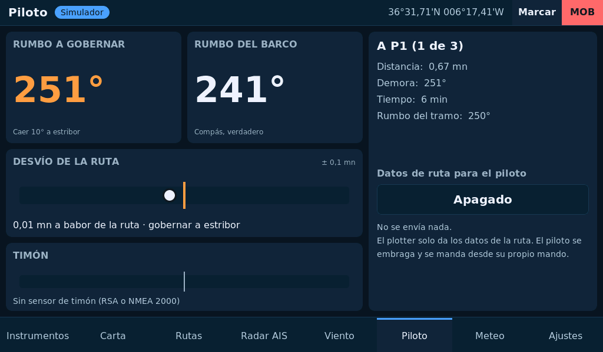

- **Rumbo a gobernar** (course to steer): the bearing to the destination, and how much to turn («Caer 10° a estribor» =
  turn 10° to starboard).
- **Rumbo del barco** (boat heading): the compass or, without one, the course over ground.
- **Desvío de la ruta** (cross-track error): the centre line is the route and the dot is the boat. It tells you which
  side you are on and which way to steer.
- **Timón** (rudder): if the rudder angle is available.
- **Datos de ruta para el piloto** (route data for the pilot): two buttons. The left one picks the pilot: **ST2000+** (the
  Raymarine ST2000 Plus tiller pilot, the default) or **Genérico** (generic). The right one picks the route: Apagado (off),
  **RS485**, **Red (TCP)** (network) or **Bluetooth** (the XIAO gateway passes it on to the pilot).

With the **ST2000+**, once a second: **RMB** and **APB** with a destination (for its Track mode), **VWR** with the apparent
wind (for its WindTrim mode, even without a destination) and **VHW** with the speed through the water. Waypoints are sent
as «W001», «W002»...: the ST2000+ only reads the first four characters of the name, and with «WPT 01», «WPT 02» it would not
see the waypoint change. The ST2000+ listens at **4800 baud** on its connector (pin 6 white NMEA+, pin 5 green NMEA−): if
the output goes through the RS485, set it to 4800 in Ajustes, and then the Comar AIS (38400) no longer comes in. The generic
pilot gets APB and RMB with the waypoint names.

The plotter only gives data to the pilot. **It does not engage or command it**: that is done from its own keypad.

## 8. Meteo (Weather)

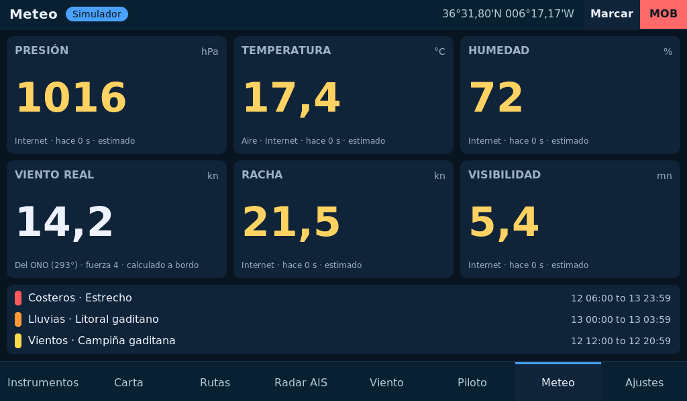

Pressure, air temperature, humidity, true wind, gust and visibility. Each tile shows its source and age.

Anything coming **from the internet** is shown in **amber** and labelled «estimado»: it is a value from a nearby
station or model, not from your boat. The note at the bottom says whether the OpenWeatherMap request works and where
the observation is from.

On-board calculations: the temperature tile gives the **feels-like temperature** (wind chill with the true wind when
cold, heat index when hot and humid) when it differs from the air by half a degree, and the humidity tile the **dew
point** (Magnus formula). Above the note, the **sun** (rise and set to within a second, civil and nautical twilight) and the **moon** (phase, lit
fraction, rise and set) for the day at the boat's position, in UTC. Phase and lit fraction are the true ones for that moment, and *marea NN %* is the **equilibrium tide**: the pull of Moon and Sun together against that of a mean spring tide (100); it rises at new and full moon and with the Moon at perigee, and falls at the quarters. A guide to the day's coefficient: not the height or time of the tide at any port.

### NAVTEX

The **NAVTEX** button in the note opens the list of NAVTEX messages received, newest first: identifier (station, subject
and number, «GA05»), frequency, subject (in Spanish: *Aviso a la navegación* navigational warning, *Previsión
meteorológica* forecast, *Salvamento, socorro, piratería* search and rescue...), UTC time and text. They arrive as NMEA 0183
**NRX** sentences over RS485, the network or Bluetooth: from an on-board NAVTEX receiver (Furuno, ICS, Nasa...) or from the
**APRS LoRa+ app**, which decodes them (Modes > NAVTEX) and sends them through its NMEA server. A repeat of the same message
replaces the earlier copy. Tapping one with positions in the text («36-07.5N 005-21.2W», «3810N 00012W») sets course to the
first one on the chart.

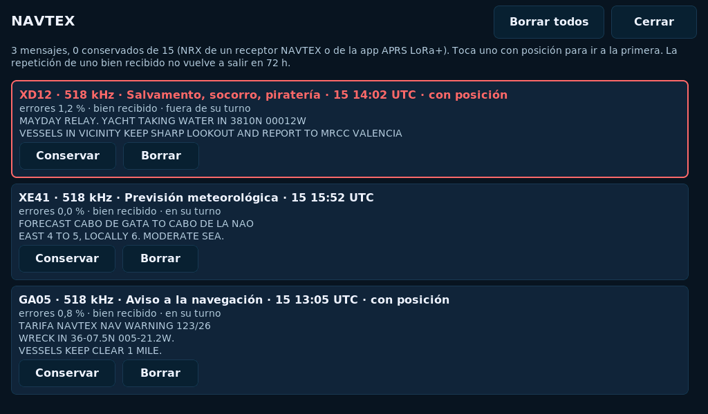

A message of subject **D** (search and rescue, distress, piracy) opens the **NAVTEX SAR / DISTRESS** window with the text;
*LIST* opens the list and *CLOSE* closes it (that message does not open it again).

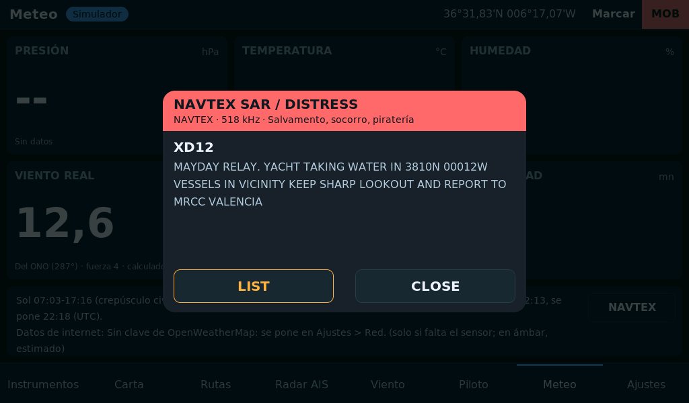

The plotter's NAVTEX is no substitute for the official receiver on board.

### LSD / DSC

The **LSD** button (*llamada selectiva digital*, digital selective calling) in the note opens the list of DSC calls received,
newest first: format (*Alerta de socorro* distress alert, *Todos los buques* all ships, *Llamada individual*, *a grupo*,
*a zona*), category, who calls (MMSI and whether it is a ship, *estación costera* coast station, group, SART...), time and,
for distress calls, the nature, the position with its time, distance and bearing. The same call repeated within 10 minutes
only adds a repeat ("×3"). They arrive in the NMEA 0183 **DSC** sentence over RS485, the network or Bluetooth: from a DSC
radio (Icom IC-M423GE / IC-M330GE, Standard Horizon, Garmin...) or from the **APRS LoRa+ app**, which decodes channel 70 or
MF / HF (Modes > DSC VHF / DSC HF) and sends them through its NMEA server. Tapping one with a position steers to it on the Chart.

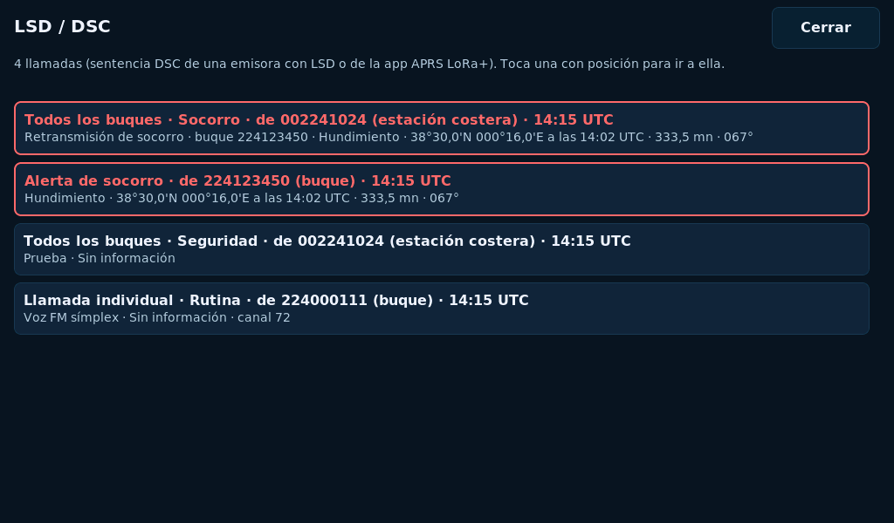

A distress alert, or its relay or acknowledgement, opens the **DSC DISTRESS** window with the MMSI of the ship in distress,
the nature, the position and who sent it; **IR A** ("go to") steers to the position (or opens the list if there is none) and
**CLOSE** closes it.

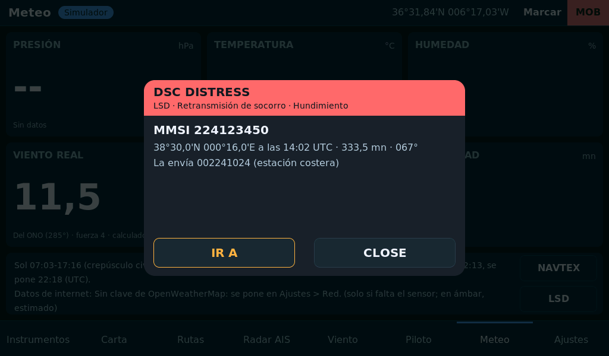

The plotter only shows what the radio receives: it never transmits or answers DSC calls.

## 9. Ajustes (Settings)

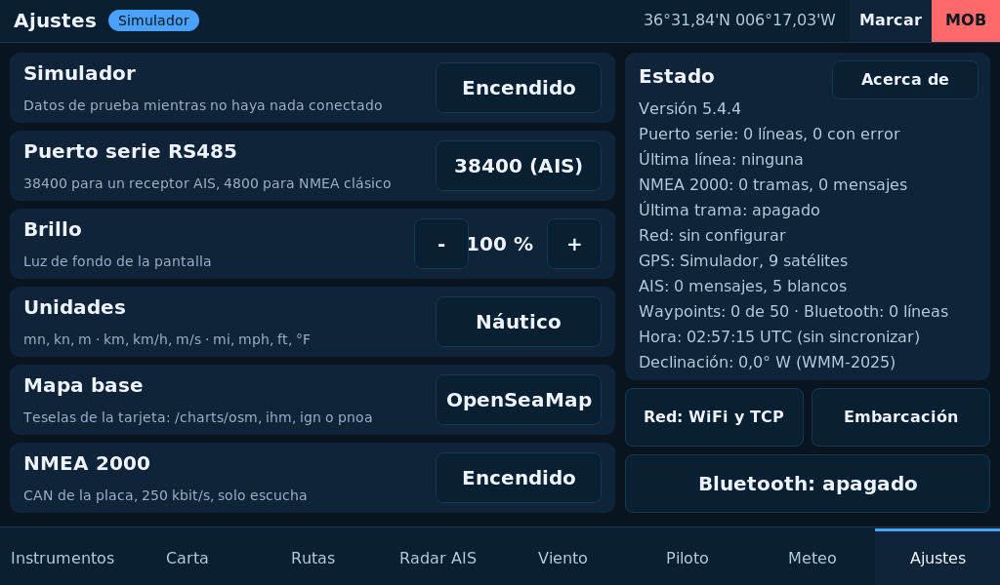

| Setting | What it does |
|---|---|
| **Simulador** | Test data. Turn it off with real data: while it is on, its data wins |
| **Puerto serie RS485** | 38400 (AIS) or 4800 (classic NMEA) |
| **Brillo** | Screen backlight |
| **Unidades** | Nautical, metric or imperial. Anchoring is always in metres |
| **Mapa base** | OpenSeaMap, IHM, IGN or aerial imagery; each reads its own folder on the card |
| **NMEA 2000** | Listening to the network over CAN |
| **Red: WiFi y TCP** | Network screen, with a keyboard |
| **Embarcación** (Vessel) | Vessel data: name, MMSI, «Distintivo marítimo» (maritime call sign of the ship station licence with the MMSI), CALLSIGN (amateur radio callsign), type, length, beam and draught, and the CALLSIGN check |
| **Bluetooth** | Link with the tracker, the gateway or the wind instrument |

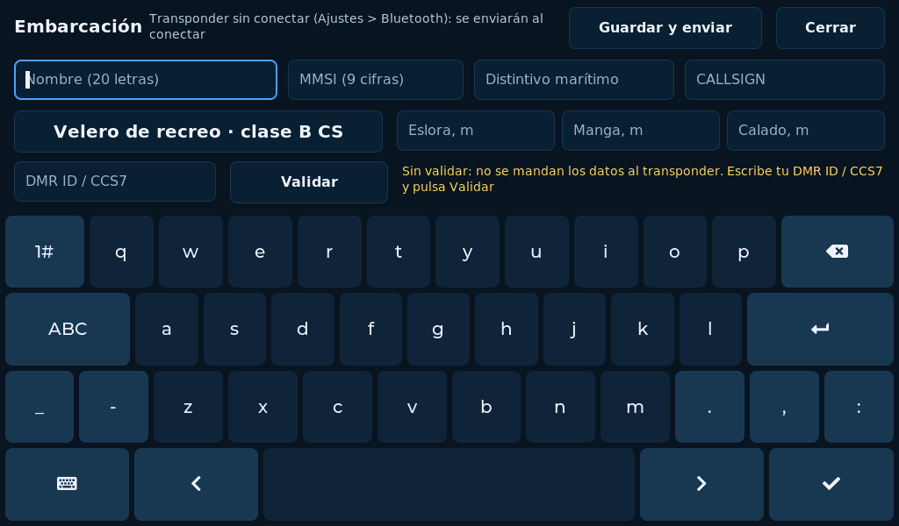

In **Embarcación**, **Guardar y enviar** ("Save and send") stores the data and, if an **APRS LoRa+ MAPRS transponder** (or a
tracker with the nautical AIS profile) is linked over Bluetooth, sends them: the transponder puts them in its AIS beacon.
When it links, the plotter asks for the transponder's data; if the plotter has none, it takes the transponder's, and if it
has different ones, it sends its own. The transponder adjusts what AIS does not accept (upper-case name, class B length of
6 to 24 m) and the plotter keeps what it confirms. With the MAPRS (class B) the type button switches between the two class B types: sailing yacht (B "CS") and power boat (B "SO").
The status is shown at the top: «mismos datos que el plotter» (same data), «enviando» (sending), «los ha ajustado»
(adjusted) or «sin conectar» (not linked).

**CALLSIGN check**, as in the app: type your **DMR ID / CCS7** (7 digits) and press **Validar** ("Validate"). The plotter
asks RadioID.net (Wi-Fi with internet needed, Ajustes > Red) whether that CALLSIGN has that DMR ID or CCS7, which RadioID only
gives after checking the amateur radio licence. If so, «EA7JRS validado en RadioID» shows in green; it is stored and checked
again every 90 days (kept if there is no connection). **Without a validated CALLSIGN the plotter does not send the data to
the transponder** (they change what it transmits): it only reads the transponder's. A new CALLSIGN must be validated again.

**Verified maritime call sign**: the transponder only sends it once verified. With the MarineTraffic API key (paid, 40
characters) in *Clave API MarineTraffic*, the **MarineTraffic** button looks up the MMSI and compares the call sign
(MarineTraffic only knows vessels it has received over real AIS). **Without a key**, the note on the screen gives the
vessel's public page (marinetraffic.com/es/ais/details/ships/mmsi:…): look at it on the phone or a computer and, if the
call sign matches, press **MarineTraffic** to mark it as checked («MarineTraffic: OK»; another press removes it). Its terms
do not let a program read that page, so a person looks at it. If it is not there, look it up in the **ITU MARS**
(itu.int/mmsapp/ShipStation/list, the official register) and press **MARS UIT** to confirm it by hand («MARS: OK»). The
result is sent to the transponder. Changing the MMSI or the call sign needs a new check.

**Estado** (Status), on the right: version, lines received on each route, where the position comes from, AIS targets
and waypoints. At its top, the **Acerca de** (About) button: version and board, copyright, licence, project, library
and chart credits, and the donation QR code (paypal.me/ea7jrs).

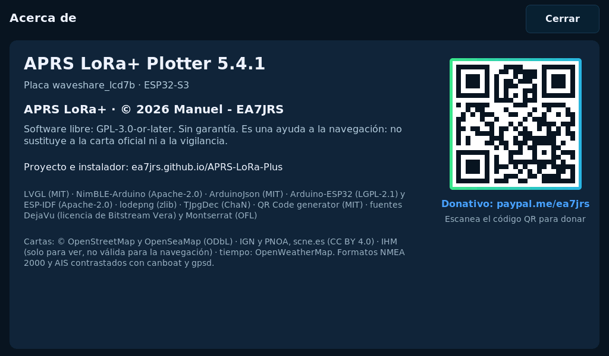

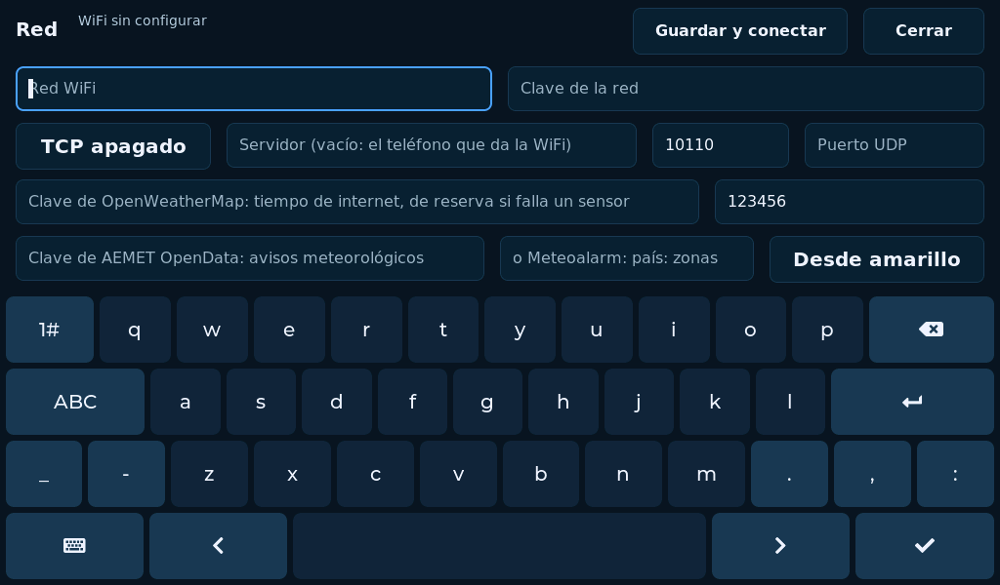

On the **Red** (Network) screen: the Wi-Fi and its password, the server type (off, NMEA 0183, gpsd or Signal K), its
address and port, the UDP port, the OpenWeatherMap key and the tracker PIN. **Guardar y conectar** applies the changes.

## 10. Alerts

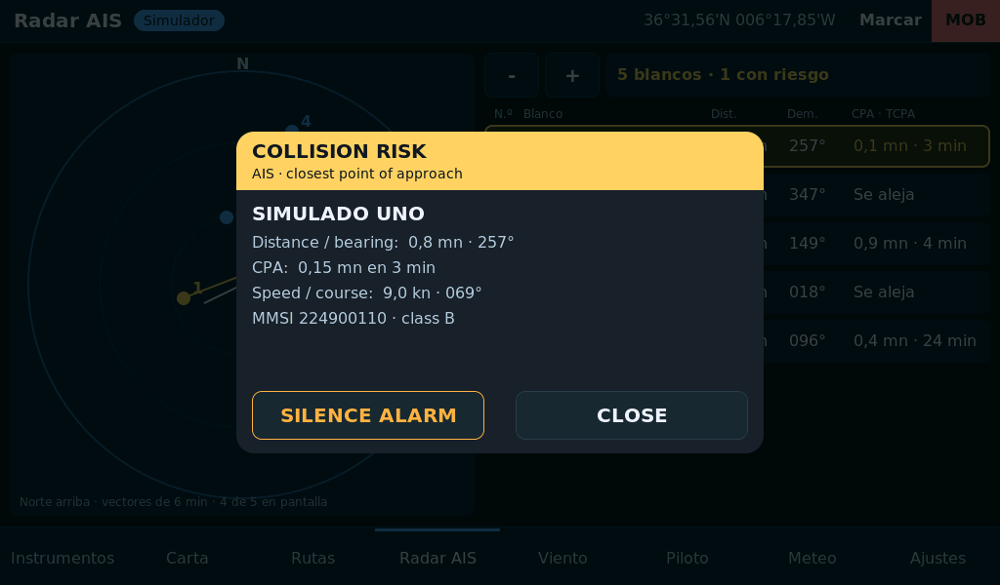

An alert opens a window over any screen. Alert texts are in English, as in the APRS LoRa+ app.

| Window | Raised when | Buttons |
|---|---|---|
| **COLLISION RISK** | An AIS target will pass within 0.5 nm in less than 20 min | SILENCE ALARM: mutes that vessel · CLOSE: does not return for 10 min |
| **MAN OVERBOARD** | You pressed MOB | RADIO (MAYDAY): the distress message to read · CLOSE: navigation to the point continues on the chart |
| **ANCHOR DRAG** | 10 s outside the anchor circle | SILENCE 10 MIN · CLOSE: returns in 2 min if it persists |
| **ANCHOR WATCH · NO GPS FIX** | Anchored and 1 min without a position | Same |
| **SIGNAL K ALARM / EMERGENCY** | Notification from the Signal K server | Closes by itself when the server lowers its level |
| **RS485 COMPARTIDO** (shared RS485) | The pilot output uses the port data is coming in on | Apagar salida (turn output off) · Seguir así (keep going) |
| **RED / ORANGE / YELLOW WARNING, EARTHQUAKE, TSUNAMI, SPACE WEATHER** | New official alert for the area (from the internet, see below) | LIST: Meteo tab · CLOSE: it does not come back unless its level rises |

Collision and anchor alerts close by themselves when the danger is over.

**MOB**: marks the position, sets the course back and shows distance, bearing and elapsed time. **RADIO (MAYDAY)** opens the man overboard distress message.

### Radio: MAYDAY, PAN PAN and SÉCURITÉ

The **Radio** button at the top (from any tab) opens the message ready to **read aloud** on VHF channel 16 (or 2182 kHz),
with the data of *Ajustes > Embarcación* (name, maritime call sign spelt out, MMSI digit by digit, type and length), the
GPS position and the UTC time:

- **MAYDAY** (distress): `<` `>` pick the nature (in the DSC order: fire, flooding, collision, grounding, listing, sinking,
  disabled and adrift, grave and imminent danger, abandoning ship, piracy, man overboard).
- **MAYDAY RELAY**: relays the last DSC distress alert received (MMSI, position, time and nature); with none, the gaps are
  left to fill in by voice.
- **PAN PAN** (urgency): engine or steering failure, sick or injured person, medical evacuation, man overboard being
  searched for, out of fuel.
- **SÉCURITÉ** (safety): navigational hazard, drifting object, weather warning, restricted in ability to manoeuvre.

**−** / **+** set the persons on board (saved); **Idioma** switches between Spanish and English. Below, what to do first
(DSC alert with the DISTRESS button, channel and power). In the MAN OVERBOARD window, **RADIO (MAYDAY)** opens it with
«man overboard». The plotter **does not transmit**: the message is read over the radio.

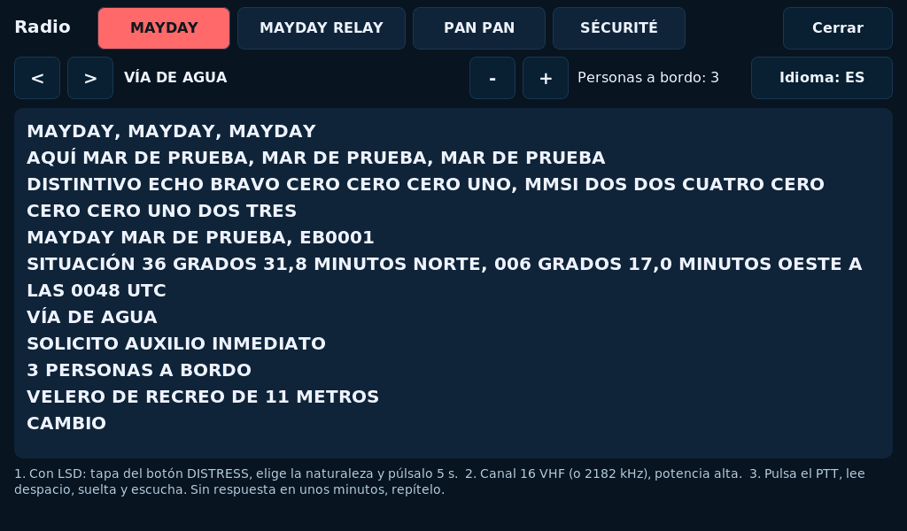

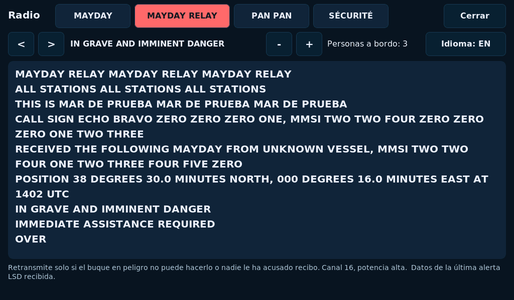

**In this version alerts make no sound.** Do not rely on the plotter as your only anchor or collision alarm.

**Official alerts** (Wi-Fi with internet access, *Ajustes > Red*): weather (AEMET in Spain: with a position, the alerts whose polygon has the boat inside, from the public bundle of every CAP;
without one, the Meteoalerta RSS;
MeteoAlarm in the rest of Europe, with the country in *País ISO*; NWS in the US), tsunamis (tsunami.gov), earthquakes (USGS, EMSC and Raspberry Shake ShakeNet, by
magnitude and distance, e.g. M5 under 600 km) and space weather (NOAA SWPC: G / R / S scales, Kp, solar flux), every 15 min in their own
task. *Avisos: zonas* filters by words of the zone when there is no polygon ("Huelva, Cádiz"; empty = the whole country, and with MeteoAlarm only red alerts open
the window). The Meteo tab sums them up, with the space weather.

## 11. Where the data comes from

The same value can arrive by several routes. The plotter uses the highest-priority one and, if it goes quiet, moves on
to the next:

1. Simulator (if it is on)
2. NMEA 2000
3. RS485 serial port
4. Local network
5. Bluetooth
6. Internet

When the better source returns, it leads again. Nothing needs to be touched.

The internet only stands in for weather: true wind, gust, pressure, temperature, humidity and visibility.
**Position, heading, speed and depth have no substitute**: if they are missing, the tile says «Sin datos».

### The time

The internal clock sets itself, in UTC, in this order:

1. **GPS**: the time in RMC or ZDA sentences arriving by any route (AIS receiver, tracker, gpsd, the phone) and the time on
   the NMEA 2000 bus (PGN 126992 and 129029). Two consecutive times that agree are needed: the first one from a GPS that
   has just been switched on can be wrong.
2. **NTP** over the internet, with the WiFi in Ajustes > Red: `ntp.roa.es`, Spain's official time (Real Instituto y
   Observatorio de la Armada), with `hora.roa.es` and `pool.ntp.org` as backups.

While the GPS time is current (6 hours), NTP does not replace it. Ajustes > Estado > *Hora* («Time») shows the UTC time and
who set it. The plotter passes its time to the wind instrument over Bluetooth (ZDA sentence) when it comes from GPS or NTP.
The simulator time does not count.

**Magnetic declination**: the plotter carries the World Magnetic Model (WMM2025, by NOAA and the British Geological
Survey, valid until 2030) and computes the declination at the boat's position. Ajustes > Estado > *Declinación* shows
it. If only the magnetic heading arrives (HDM / HDG, PGN 127250 magnetic, Signal K `headingMagnetic`), the true heading
is the magnetic one plus the declination (quality «calculated»); a measured true heading always wins.

## 12. Not in this version

- Alert sound.
- Chart download over Wi-Fi and a fallback coastline.
- Renaming waypoints and saving several named routes.
- Tides, weather warnings, navigational warnings and forecast layers.
- Autopilot controls.
- English interface.

APRS LoRa+ · © 2026 Manuel - EA7JRS · GPL-3.0-or-later
