# APRS LoRa+ Wind — Wind instrument (plotter accessory)

Version 5.4.4 · Waveshare ESP32-S3-Touch-LCD-4 (4", 480 × 480), revision V4.0

**It is a navigation aid. It does not replace a proper lookout.**

> **Status of this version.** The firmware builds and the interface has been rendered and reviewed on a PC, but it
> **has not been tested on the board yet**, nor with the wind sensor. Highest risk: the screen start-up (panel timings
> not verified), the RS485 pins (Waveshare's table contradicts itself) and the electrical level of the NASA output.
> Section 7 says what to check.

The screen is in Spanish; this manual gives each Spanish label with its meaning.

An own-design wind display for the cockpit or the chart table. It reads the **NASA Marine Target 2 Wind (version 2,
with NMEA)** vane and anemometer, shows apparent and true wind, and passes it to the APRS LoRa+ plotter over
**Bluetooth**, **NMEA 2000** and **Wi-Fi**, all at once if wanted.

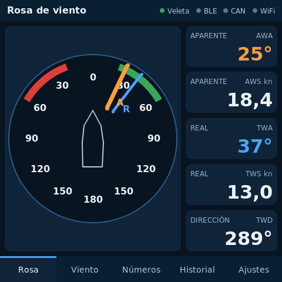

## 1. What you need

- **Waveshare ESP32-S3-Touch-LCD-4** screen (SKU 28154), **revision V4.0**. Earlier revisions use a different pin
  expander and do not start with this firmware (the console says so).
- **NASA Target 2 Wind v2**, the version with NMEA 0183 output (4800 baud, MWV sentence). The old 5-wire analogue
  version does not work.
- 12 V from the boat for the board (7 to 36 V on its terminal) and for the NASA.
- A USB-C data cable to flash the firmware.
- To talk to the plotter, whatever is on board: Bluetooth itself, the NMEA 2000 network or a Wi-Fi network.

## 2. Flashing the firmware

Web installer: open **https://ea7jrs.github.io/APRS-LoRa-Plus/#nautica** in Chrome or Edge, choose the **Náutica**
(Nautical) group and the **waveshare_lcd4_wind** board, connect the screen by USB and press *Install*. Settings are kept.

esptool, the full image from the release (erases the settings):

    python -m esptool --chip esp32s3 write_flash 0x0 aprs-lora-plus-wind-lcd4-5.4.4-full.bin

From source: `pio run -e waveshare_lcd4_wind -t upload`.

The console is on the board's USB at 115200 baud: `APRS-INFO?` answers
`APRS-LoRa-Plus: device=wind board=waveshare_lcd4_wind version=5.4.4 …`, and `SIM 0` / `SIM 1` turn the simulator
off or on.

## 3. Connecting the wind sensor

The NASA NMEA output goes to the board's **RS485** (terminals A and B) at 4800 baud. NMEA 0183 is compatible with the
RS485 receiver:

- NASA NMEA signal to **A**, its 0 V to **B** (and to the board's 0 V).
- If no data arrives, *Ajustes y enlace* (Settings and links) > row **Veleta** (wind sensor) shows how many bytes and
  how many sentences came in:
  - **0 bytes**: change the *RS485: RX en GPIO43* button to GPIO44 (Waveshare's table is unclear about which one
    receives) and check the wiring.
  - **bytes but 0 sentences**: the signal is inverted; swap A and B.
- While nothing comes from the sensor, the instrument shows **simulator** data (*Simulador* button). As soon as the
  sensor sends, the simulator stops by itself.

Wire colours and NASA terminals are not given here: see its documentation.

## 4. The pages

At power-up, for about 2 s, the APRS LoRa+ welcome screen (the logo and «Wind 5.4.4»), as on the plotter and the Display.

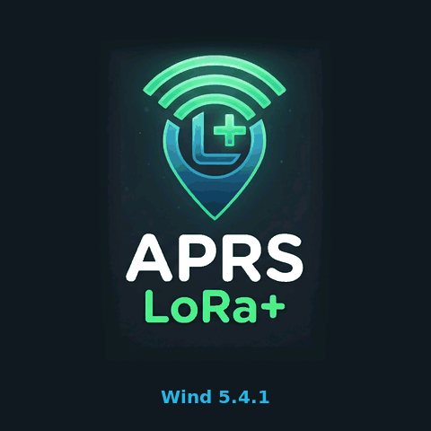

Five tabs at the bottom. Four lights at the top: **Veleta** (sensor), **BLE**, **CAN** and **WiFi** (green = working).

- **Rosa** (rose): bow-up rose, red (port) and green (starboard) close-hauled sectors, needle **A** (apparent,
  orange) and **R** (true, blue). Three layouts, chosen in Settings with the *Rosa* button: *columna* (column: the rose
  and the five values on the right), *dos bandas* (two bands: apparent above, true below) and *banda* (one band with
  the five values).

  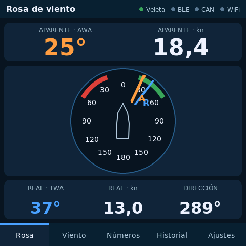 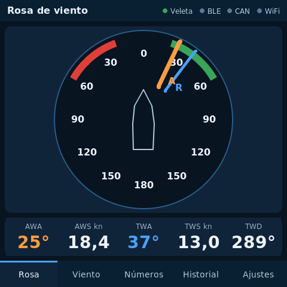

- **Viento** (wind): smaller rose, large apparent values and, below, true angle, true speed, true direction and drift
  (*deriva*).
- **Números** (numbers): apparent and true speed and angle in large figures, with the Beaufort force.
- **Historial** (history): true wind speed and direction over the last 30 minutes (one sample every 30 s), with
  minimum, maximum and average.
- **Ajustes y enlace** (settings and links): state of each link and the buttons (the page scrolls down).

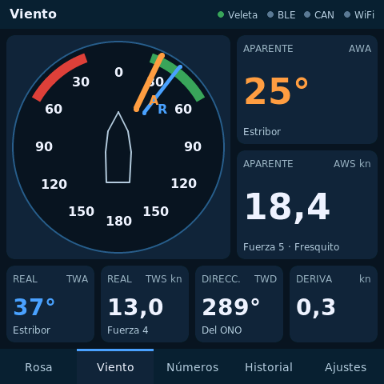 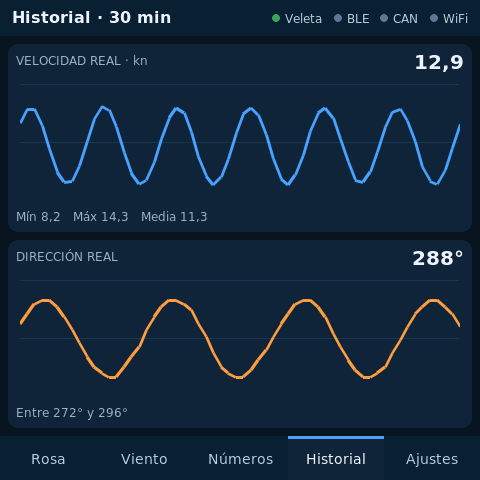

**Night mode.** Settings > *Noche* (night): the whole screen turns red on black, to keep night vision. Also lower the
*Brillo* (brightness, 20 or 40 %).

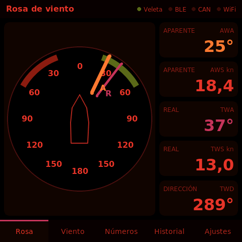

**Alarms.** Three, each with its own button in Settings (off by default):

- *Alarma real* (true wind alarm): true wind above 15 to 40 kn (in 5 kn steps).
- *Alarma aparente* (apparent wind alarm): apparent wind above 20 to 45 kn.
- *Alarma rolada* (wind shift alarm): true wind direction changes more than 10, 15, 20, 30 or 45 degrees from the
  reference (useful at anchor or on a long tack). The reference is taken after 30 s of true direction, and the
  direction is smoothed over 30 s, so a shift of a few seconds does not trigger it.

Speed alarms trigger if the wind stays above the limit for 5 s and clear when it stays below the limit minus 5 % (at
least 1 kn) for 10 s; a single gust does not trigger. The shift alarm triggers after 10 s above the limit. When one
triggers, the **STRONG WIND** or **WIND SHIFT** window appears and the board's buzzer sounds:

- **SILENCIAR 10 MIN** (silence 10 min): window and buzzer quiet for 10 minutes; if it persists, it comes back.
- **CERRAR** (close): for speed alarms, it does not come back until the wind drops and exceeds the limit again; for
  the shift alarm, the current direction becomes the new reference.

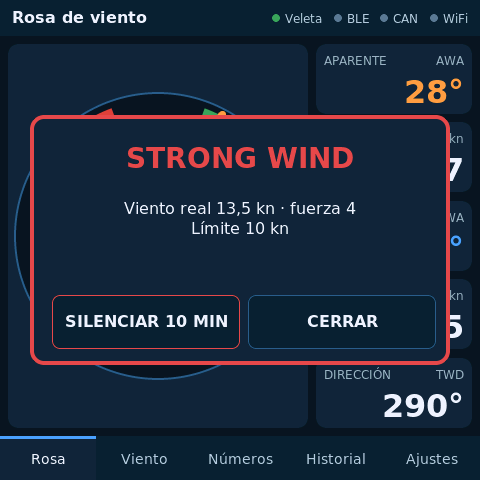

**True wind and drift.** The NASA gives apparent wind. True wind (TWA, TWS, TWD) is computed with boat speed (through
the water if there is a log, otherwise over ground) and heading. It takes them from **NMEA 2000** and, if there is
none, from the **plotter over Bluetooth** (the plotter sends them once a second while linked; the *Bluetooth* row in
Settings says «rumbo y velocidad del plotter»). With neither it shows «--» and «Falta rumbo» (heading missing). Drift also needs course and speed over ground.

## 5. Link to the plotter

| Link | What the instrument sends | What to do on the plotter |
| --- | --- | --- |
| Bluetooth | Apparent MWV and, when it can be computed, true MWV, 4 times a second, on the NMEA data service of `docs/BLE_NMEA.md` | Ajustes > *Bluetooth* on. It joins the first device with that service and remembers it |
| NMEA 2000 | PGN 130306 apparent and true (north-referenced), 4 times a second, with a claimed address | Nothing: the plotter already reads 130306 |
| Wi-Fi | The same MWV over UDP to the whole network, on the chosen port (10110) | Ajustes > Red > *Puerto UDP* (UDP port) 10110, on the same Wi-Fi |

- **Bluetooth**: no pairing or PIN (wind data only). Settings > *Bluetooth* button turns it off. If the XIAO gateway
  with the same service is also on board, the plotter keeps the first one it finds: turn off the other one's
  Bluetooth, or turn the plotter's on while only this one is near.
- **NMEA 2000**: the *NMEA 2000* button cycles *apagado* (off), *escucha* (listen: reads speed and heading only) and
  *emite* (transmit: also sends the wind). When transmitting it claims a bus address (starts at 35 and, if a device
  with priority has it, takes another free one); the **NMEA 2000** row shows the address. The NAME uses an
  unregistered manufacturer code (2046) and the *external environment / atmospheric* class: **it is not a certified**
  NMEA 2000 device. The board has a 120 Ω termination resistor; leave it disconnected unless the instrument is at one
  end of the bus.
- **Wi-Fi**: *WiFi…* button → network (*Red*), password (*Clave*) and UDP port (*Puerto UDP*) with the keyboard,
  *WiFi: encendido* (on) and *Guardar* (save). The **WiFi** row shows the IP address and what was sent.

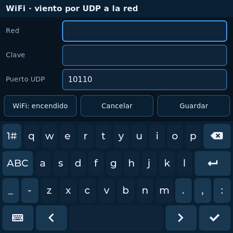 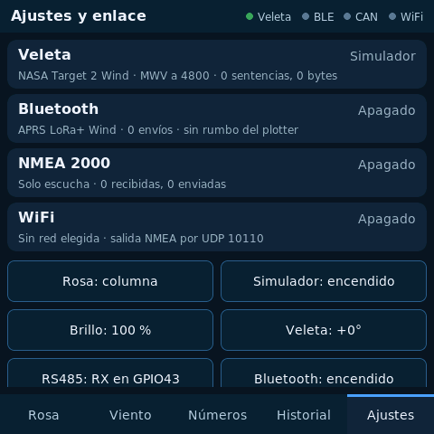

- **Time**: the instrument clock is set from the GPS time on the NMEA 2000 bus (PGN 126992 / 129029), from the time the
  plotter sends over Bluetooth (ZDA, once a second) or, with WiFi, from NTP (`ntp.roa.es`, Spain's official time). The
  **Bluetooth** row shows the UTC time and where it came from.

## 6. Settings

| Button | What it does |
| --- | --- |
| Rosa | Rose page layout: column, two bands or one band |
| Simulador | Test data while there is no sensor |
| Brillo | Brightness, 20 to 100 % |
| Veleta | Wind sensor angle correction, in 5° steps (if it is not aligned with the bow) |
| RS485 | RS485 receive pin: GPIO43 or GPIO44 |
| Bluetooth | On or off |
| NMEA 2000 | Off, listen or transmit |
| WiFi… | Network, password, UDP port and on/off |
| Acerca de | About: version, copyright, licence, project, credits and donation QR (paypal.me/ea7jrs) |
| Noche | Night mode: red on black |
| Alarma real | True wind alarm: off, 15 to 40 kn |
| Alarma aparente | Apparent wind alarm: off, 20 to 45 kn |
| Alarma rolada | Wind shift alarm: off, 10, 15, 20, 30 or 45 degrees |

They are stored on the board and survive power-off. The web installer keeps them; the full image with esptool erases them.

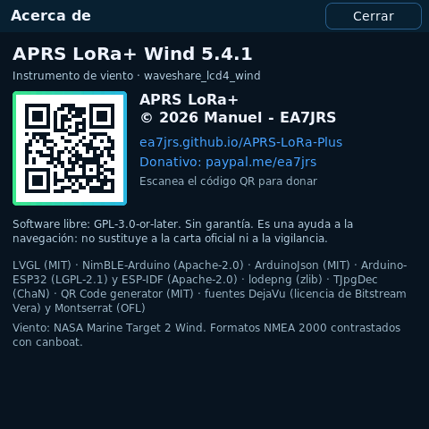

## 7. If something does not work

- **Black screen, backlight on**: the panel timings are not verified. Check the console: if it says «panel listo»
  (panel ready), the fault is in the timings or the ST7701 sequence.
- **«esta placa lleva el expansor TCA9554»** (this board has the TCA9554 expander): it is a revision earlier than
  V4.0, not supported yet.
- **Touch does not respond**: the console says whether the GT911 answered at 0x5D or 0x14.
- **No wind from the sensor**: section 3.
- **The plotter does not see it over Bluetooth**: check that the instrument's Bluetooth is on and the plotter is
  searching (Ajustes > Bluetooth); if the plotter remembered another device, turn its Bluetooth off and on again.
- **No true wind**: boat speed and heading are needed, on NMEA 2000 or from the plotter over Bluetooth.

## 8. Not in this version

- Testing on the board and with the NASA.
- Configurable pages and automatic page cycling.
- Alarms also notifying the plotter.
- Receiving heading and speed from the plotter over Wi-Fi (over Bluetooth and NMEA 2000, yes).
- Answering NMEA 2000 product information requests (PGN 126996) and storing the claimed address.
- Board revisions earlier than V4.0.
